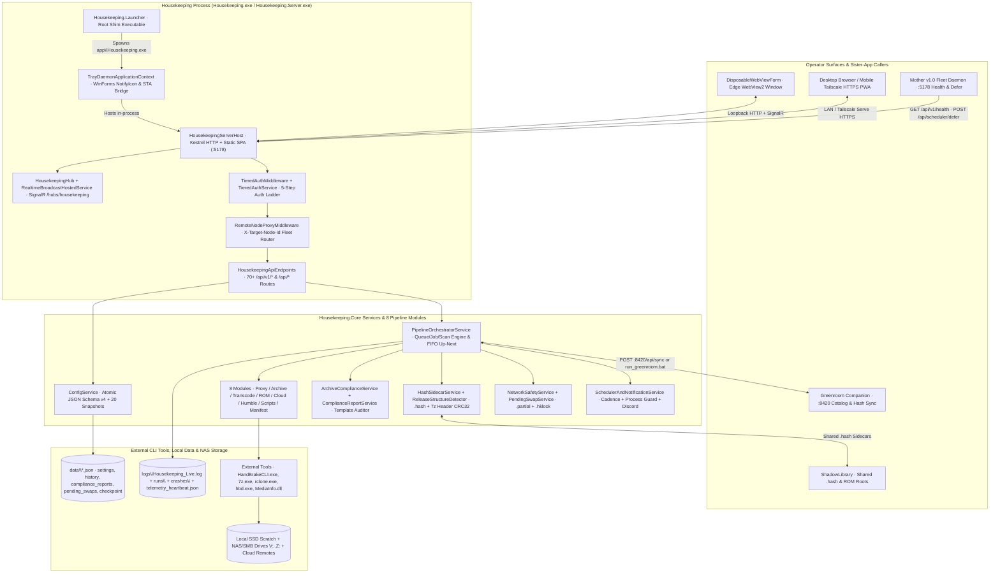
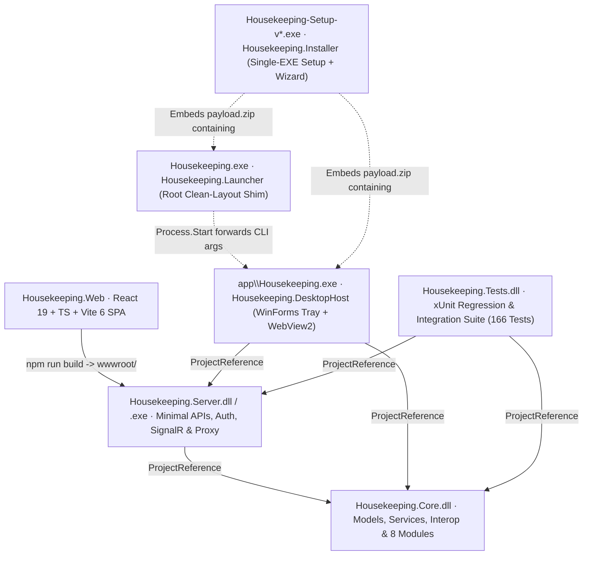

# Housekeeping — Technical Architecture & Engineering Manual

- **Document:** `ARCHITECTURE.md` (Technical Manual 1 of 4)
- **Active Build Version:** `v1.0.0-rc.11-hf.2` (In-Dev Target: `v1.0.0-rc.12`)
- **Application Archetype:** Archetype 2 — System Tray Companion Daemon & Local/Tailnet Web Host ([`Housekeeping`](file:///D:/Projects/Personal/Housekeeping/Dev/Housekeeping.DesktopHost/Housekeeping.DesktopHost.csproj) + [`Housekeeping.Server`](file:///D:/Projects/Personal/Housekeeping/Dev/Housekeeping.Server/Housekeeping.Server.csproj))
- **Runtime Stack:** .NET 8.0 (`net8.0-windows` / `net8.0` C# 12) · ASP.NET Core Minimal APIs + SignalR (`:5178` / `:15178` sandbox) · WinForms System Tray + Disposable WebView2 Standalone Window · React 19 + TypeScript + Vite 6 SPA · Atomic Copy-on-Write JSON State Persistence (`Schema v4`) · `7z.exe` + `HandBrakeCLI.exe` + `rclone.exe` + `hbd.exe` + `MediaInfo.dll`

---

## 1. System Context & Runtime Model

Housekeeping is an automated media transcoding, ROM/game launcher generation, zero-decompression archive compliance, bit-rot `.hash` verification, and cloud synchronization daemon. It runs as a persistent Windows system tray process ([`TrayDaemonApplicationContext`](file:///D:/Projects/Personal/Housekeeping/Dev/Housekeeping.DesktopHost/TrayDaemonApplicationContext.cs#L15-L413)) or headless Kestrel web service (`--headless` via [`HousekeepingServerHost`](file:///D:/Projects/Personal/Housekeeping/Dev/Housekeeping.Server/Hosting/HousekeepingServerHost.cs#L20-L191)) bound to `127.0.0.1:5178` (or `0.0.0.0:5178` when `BindLanAndTailnet` is enabled).

Desktop interaction is dual-mode by design: double-clicking the system tray icon (or launching a second `Housekeeping.exe` instance, which broadcasts the registered Win32 message `HOUSEKEEPING_RESTORE_WINDOW` via [`StaNativeDialogBridge.BroadcastRestoreMessage`](file:///D:/Projects/Personal/Housekeeping/Dev/Housekeeping.DesktopHost/StaNativeDialogBridge.cs#L18-L62)) opens either a disposable Edge WebView2 standalone window ([`DisposableWebViewForm`](file:///D:/Projects/Personal/Housekeeping/Dev/Housekeeping.DesktopHost/DisposableWebViewForm.cs#L14-L209), default in `Schema v4`) or the default system browser. When the standalone window is closed, the Chromium WebView2 control and process tree are completely disposed so background idle footprint stays at native .NET daemon levels (`~25–40 MB` RAM).

---

## 2. Assembly / `.dll` & Hybrid Module Dependency Graph

The [`Dev\`](file:///D:/Projects/Personal/Housekeeping/Dev/Housekeeping.slnx) workspace comprises **6 .NET 8 C# projects** and **1 React 19 + TypeScript Vite frontend** that compiles directly into [`Housekeeping.Server/wwwroot/`](file:///D:/Projects/Personal/Housekeeping/Dev/Housekeeping.Web/vite.config.ts):

| Project / Assembly | Target Framework | Output Type / Binary | Architectural Responsibility |
| :--- | :--- | :--- | :--- |
| [`Housekeeping.Core`](file:///D:/Projects/Personal/Housekeeping/Dev/Housekeeping.Core/Housekeeping.Core.csproj) | `net8.0-windows` | Class Library (`Housekeeping.Core.dll`) | Domain configuration (`AppConfig` Schema v4), atomic JSON persistence, 8 pipeline modules, `.hash` sidecar & DAT engines, archive compliance, network drop safety, process runner, and Win32 interop (`MediaInfo.dll`, `ntdll.dll`, `kernel32.dll`). |
| [`Housekeeping.Server`](file:///D:/Projects/Personal/Housekeeping/Dev/Housekeeping.Server/Housekeeping.Server.csproj) | `net8.0-windows` | Web SDK Exe (`Housekeeping.Server.dll` / `.exe`) | Kestrel HTTP host, CLI parser, `TieredAuthMiddleware`, `RemoteNodeProxyMiddleware`, 70+ REST endpoints in `HousekeepingApiEndpoints`, `HousekeepingHub` SignalR hub, `TailscalePwaService`, and embedded `wwwroot` SPA. |
| [`Housekeeping.DesktopHost`](file:///D:/Projects/Personal/Housekeeping/Dev/Housekeeping.DesktopHost/Housekeeping.DesktopHost.csproj) | `net8.0-windows` (`UseWindowsForms` + `WebView2`) | `WinExe` (`app\Housekeeping.exe`) | Single-instance mutex gate, STA native dialog thread (`StaNativeDialogBridge`), `NotifyIcon` system tray lifecycle (`TrayDaemonApplicationContext`), and `DisposableWebViewForm` standalone UI window. |
| [`Housekeeping.Launcher`](file:///D:/Projects/Personal/Housekeeping/Dev/Housekeeping.Launcher/Housekeeping.Launcher.csproj) | `net8.0` | `WinExe` (`<InstallRoot>\Housekeeping.exe`) | Zero-dependency root launcher shim per Dev Bible Standard 12 §3.1; resolves `<InstallRoot>\app\Housekeeping.exe`, forwards all CLI flags, and switches to synchronous wait + stdio redirect when `--headless`, `--test-mode`, or `--dry-run` is present. |
| [`Housekeeping.Web`](file:///D:/Projects/Personal/Housekeeping/Dev/Housekeeping.Web/package.json) | ES2022 / React 19 / Vite 6 | Static SPA bundle (`wwwroot\`) | 7-view responsive desktop & mobile PWA interface (`Dashboard`, `Job Queues`, `Job Builder`, `Modules`, `Reports`, `Settings`, `History`), virtualized `DualPaneTerminal`, and SignalR client. |
| [`Housekeeping.Installer`](file:///D:/Projects/Personal/Housekeeping/Dev/Housekeeping.Installer/Housekeeping.Installer.csproj) | `net8.0-windows` (`PublishSingleFile=true`) | `WinExe` (`Housekeeping-Setup-v*.exe`) | Self-contained 4-pillar installer embedding `payload.zip` and `metadata.json`; provides 3-page dark WinForms wizard (`InstallerWizardForm`) and headless `--silent`/`--test-mode`/`--verify`/`--uninstall` CLI. |
| [`Housekeeping.Tests`](file:///D:/Projects/Personal/Housekeeping/Dev/Housekeeping.Tests/Housekeeping.Tests.csproj) | `net8.0-windows` | xUnit Test Library | 166 automated `[Fact]`/`[Theory]` tests across 8 test files covering config migrations, `.hash` sidecars, archive compliance, scheduler DST, API endpoints, and Sister-App parity. |

> [!NOTE]
> **Active `v1.0.0-rc.12` Refactor Horizon:** In `v1.0.0-rc.11-hf.2`, Housekeeping uses its own in-project services (`ConfigService`, `NetworkSafetyService`, `CrashBundleService`, `HashSidecarService`) and does not yet reference `Foundation.Core.dll`. Per the locked blueprint [`v1.0.0-rc.12.2026-11-04.md`](file:///D:/Projects/Personal/Housekeeping/Dev/docs/plans/v1.0.0-rc.12.2026-11-04.md), `rc.12` introduces shared `.coexistence.json` / `.hklock` coordination with ShadowLibrary and splits monolith files toward the `<400 LOC` ceiling.

---

## 3. End-to-End Data Flow Across Core Pipelines

### Pipeline A — Queue & Job Orchestration, FIFO Up-Next Chaining & Interrupted Run Checkpointing
1. **Trigger Ingestion:** Runs start via UI/REST (`POST /api/v1/pipeline/run-queue` or `run-job` in [`HousekeepingApiEndpoints.cs`](file:///D:/Projects/Personal/Housekeeping/Dev/Housekeeping.Server/Endpoints/HousekeepingApiEndpoints.cs#L430-L469)) or the 15-second background timer in [`PipelineOrchestratorService.StartBackgroundScheduler`](file:///D:/Projects/Personal/Housekeeping/Dev/Housekeeping.Core/Services/PipelineOrchestratorService.cs#L216-L247) calling [`EvaluateQueueSchedules`](file:///D:/Projects/Personal/Housekeeping/Dev/Housekeeping.Core/Services/PipelineOrchestratorService.cs#L2103-L2222).
2. **Process Guard & Deferral Gate:** Before firing a scheduled queue, `EvaluateQueueSchedules` checks [`SchedulerAndNotificationService.DeferredUntilUtc`](file:///D:/Projects/Personal/Housekeeping/Dev/Housekeeping.Core/Services/SchedulerAndNotificationService.cs#L35-L47) (set by Mother `POST /api/scheduler/defer` or tray 1-hour pause) and [`GetCachedGuardedProcessRunning`](file:///D:/Projects/Personal/Housekeeping/Dev/Housekeeping.Core/Services/SchedulerAndNotificationService.cs#L81-L148) (throttled 10s Win32 process scan for `obs64`, `retroarch`, `pcsx2`, etc.).
3. **FIFO Up-Next Queueing (`_pendingRuns`):** If a pipeline or scan is already active, [`StartOrEnqueueQueueRun`](file:///D:/Projects/Personal/Housekeeping/Dev/Housekeeping.Core/Services/PipelineOrchestratorService.cs#L817-L892) / [`StartOrEnqueueSingleJobRun`](file:///D:/Projects/Personal/Housekeeping/Dev/Housekeeping.Core/Services/PipelineOrchestratorService.cs#L900-L969) calls [`TryEnqueuePendingRunLocked`](file:///D:/Projects/Personal/Housekeeping/Dev/Housekeeping.Core/Services/PipelineOrchestratorService.cs#L372-L416), enforcing at most 1 queued instance per distinct `RunKind:TargetId` key and a 60s anti-bounce cooldown on auto-scheduled completions.
4. **Immutable Snapshot & Checkpoint Persistence:** [`LaunchPipelineInternal`](file:///D:/Projects/Personal/Housekeeping/Dev/Housekeeping.Core/Services/PipelineOrchestratorService.cs#L971-L1070) deep-clones `AppConfig` (`immutableRunConfig`), stamps `queue.LastRunUtc`, writes `data\interrupted_run_checkpoint.json` via [`PersistActiveCheckpointToDisk`](file:///D:/Projects/Personal/Housekeeping/Dev/Housekeeping.Core/Services/PipelineOrchestratorService.cs#L648-L667), and spawns [`ExecutePipelineAsync`](file:///D:/Projects/Personal/Housekeeping/Dev/Housekeeping.Core/Services/PipelineOrchestratorService.cs#L1072-L1506).
5. **Execution, Sleep Prevention & Post-Job Chaining:** `ExecutePipelineAsync` calls [`NativeProcessSuspend.PreventWindowsSleep(true)`](file:///D:/Projects/Personal/Housekeeping/Dev/Housekeeping.Core/Interop/NativeProcessSuspend.cs#L24-L34), attaches a per-run log writer (`logs\runs\Run_<Queue>_<Timestamp>.log`), and iterates through `executionQueue`. After each job finishes cleanly, it records `job.JobId` in `CompletedJobIds`, triggers Greenroom auto-sync if Module 4/8 manifests changed, and enqueues `job.OnSuccessTriggerJobId` (guarded by `visitedJobIds` cycle detection at [`L1334-L1379`](file:///D:/Projects/Personal/Housekeeping/Dev/Housekeeping.Core/Services/PipelineOrchestratorService.cs#L1334-L1379)).
6. **Shutdown vs. User Stop Finalization:** In `finally`, [`FinalizeCheckpointAfterRun`](file:///D:/Projects/Personal/Housekeeping/Dev/Housekeeping.Core/Services/PipelineOrchestratorService.cs#L1616-L1637) deletes `interrupted_run_checkpoint.json` on normal completion or explicit user stop (`_userRequestedExplicitStop = true`), but **preserves** it if the process was terminated mid-run so the next startup displays the `InterruptedRunRecoveryBanner` (or auto-resumes when `AutoRestartInterruptedRunsOnStartup = true`).

### Pipeline B — Media Transcoding (Modules 1, 2 & 3), Distributed `.hklock` & Pending Swaps
1. **Discovery & Codec Probe:** [`ProxyGeneratorModule.RunAsync`](file:///D:/Projects/Personal/Housekeeping/Dev/Housekeeping.Core/Services/Modules/ProxyGeneratorModule.cs#L13-L203), [`ArchiveCompressorModule.RunAsync`](file:///D:/Projects/Personal/Housekeeping/Dev/Housekeeping.Core/Services/Modules/ArchiveCompressorModule.cs#L13-L212), and [`MediaTranscoderModule.RunAsync`](file:///D:/Projects/Personal/Housekeeping/Dev/Housekeeping.Core/Services/Modules/MediaTranscoderModule.cs#L14-L745) verify folder reachability via [`NetworkSafetyService.EnsureDirectoryReachableAsync`](file:///D:/Projects/Personal/Housekeeping/Dev/Housekeeping.Core/Services/NetworkSafetyService.cs#L125-L179). Module 3 matches sources either by filename tags (`DVD`, `BR`, `UHD` in [`ProcessTagMatchingModeAsync`](file:///D:/Projects/Personal/Housekeeping/Dev/Housekeeping.Core/Services/Modules/MediaTranscoderModule.cs#L171-L242)) or native [`MediaInfo.dll`](file:///D:/Projects/Personal/Housekeeping/Dev/Housekeeping.Core/Interop/MediaInfoDLL.cs#L73-L293) stream height/codec inspection ([`GetVideoHeightPx`](file:///D:/Projects/Personal/Housekeeping/Dev/Housekeeping.Core/Services/Modules/MediaTranscoderModule.cs#L641-L667) & [`CheckFileIsHevc`](file:///D:/Projects/Personal/Housekeeping/Dev/Housekeeping.Core/Services/Modules/MediaTranscoderModule.cs#L669-L710)).
2. **Distributed Lock Acquisition (`.hklock`):** Before encoding a target file, [`NetworkSafetyService.TryAcquireDistributedLock`](file:///D:/Projects/Personal/Housekeeping/Dev/Housekeeping.Core/Services/NetworkSafetyService.cs#L383-L466) writes `<finalOutputPath>.hklock` containing `DistributedLockInfo` JSON (`MachineName`, `UserName`, `ProcessId`, `AcquiredAtUtc`, `HeartbeatAtUtc`) and starts a 60-second background heartbeat timer (`DistributedFileLock` at [`L29-L57`](file:///D:/Projects/Personal/Housekeeping/Dev/Housekeeping.Core/Services/NetworkSafetyService.cs#L29-L57)). Locks older than `DistributedLockTimeoutMinutes` (default `90m`) are reclaimed as stale.
3. **Safe Partial Output & HandBrake Subprocess:** [`GetSafeEncodeOutputPath`](file:///D:/Projects/Personal/Housekeeping/Dev/Housekeeping.Core/Services/NetworkSafetyService.cs#L202-L215) directs `HandBrakeCLI.exe` to write to `<stem>.partial<ext>`. [`ProcessRunnerService.RunCommandAsync`](file:///D:/Projects/Personal/Housekeeping/Dev/Housekeeping.Core/Services/ProcessRunnerService.cs#L118-L249) parses `\r` carriage-return progress lines via `HandBrakeProgressRegex` (`Encoding: task 1 of 1, 45.23 % (120.4 fps, avg 118.1 fps, ETA 00h04m12s)`), throttling UI/SignalR updates and support for mid-encode thread freeze via [`NativeProcessSuspend.SuspendProcessTree`](file:///D:/Projects/Personal/Housekeeping/Dev/Housekeeping.Core/Interop/NativeProcessSuspend.cs#L58-L86).
4. **Atomic Commit or Deferred Pending Swap:** On exit code `0`, [`CommitPartialEncode`](file:///D:/Projects/Personal/Housekeeping/Dev/Housekeeping.Core/Services/NetworkSafetyService.cs#L281-L381) validates the `.partial` output is non-zero and attempts `File.Move(working, final, overwrite: true)` with exponential backoff (15 attempts). If the target media file is locked by Plex or SMB (`IOException` / `UnauthorizedAccessException`), `CommitPartialEncode` registers the pair in [`PendingSwapService.AddOrUpdate`](file:///D:/Projects/Personal/Housekeeping/Dev/Housekeeping.Core/Services/PendingSwapService.cs#L68-L106) (`data\pending_swaps.json`), which is automatically swept at the end of every pipeline run (`ExecutePipelineAsync` [`L1476-L1491`](file:///D:/Projects/Personal/Housekeeping/Dev/Housekeeping.Core/Services/PipelineOrchestratorService.cs#L1476-L1491)) or committed on demand from the Dashboard banner.

### Pipeline C — Module 4 ROM Launchers, 9-Column DAT Manifest, Archive Compliance & Cloud Save Sync
1. **Multi-Disc `.m3u` & Solid `.7z` Compression:** [`RomLauncherGeneratorModule.RunAsync`](file:///D:/Projects/Personal/Housekeeping/Dev/Housekeeping.Core/Services/Modules/RomLauncherGeneratorModule.cs#L49-L242) scans each enabled `ConsoleCollectionRule`:
   - [`GenerateM3uPlaylistsInDirectory`](file:///D:/Projects/Personal/Housekeeping/Dev/Housekeeping.Core/Services/Modules/RomLauncherGeneratorModule.cs#L265-L344) groups multi-disc sets (`(Disc 1)`, `(Disc 2)`) and writes relative `.m3u` playlists.
   - [`CompressUnarchivedRomsInCollectionAsync`](file:///D:/Projects/Personal/Housekeeping/Dev/Housekeeping.Core/Services/Modules/RomLauncherGeneratorModule.cs#L346-L612) bundles `.cue`/`.gdi` + `.bin`/`.track` siblings ([`ResolveSupplementalFilesForBundle`](file:///D:/Projects/Personal/Housekeeping/Dev/Housekeeping.Core/Services/Modules/RomLauncherGeneratorModule.cs#L614-L677)) into `.7z` archives using `7z.exe a -t7z -mx=5`.
2. **Launcher `.bat` & `.lnk` Generation:** [`ResolveGamePathFromArchiveAsync`](file:///D:/Projects/Personal/Housekeeping/Dev/Housekeeping.Core/Services/Modules/RomLauncherGeneratorModule.cs#L739-L935) inspects `.7z`/`.zip` headers (`7z l -slt`) without full decompression when `UseFast7zListInspection = true`. [`CreateLauncherFiles`](file:///D:/Projects/Personal/Housekeeping/Dev/Housekeeping.Core/Services/Modules/RomLauncherGeneratorModule.cs#L937-L1036) writes per-game `.bat` scripts that optionally run pre-launch `rclone` save/state sync, extract the archive to `TempExtractionScratchPath` (`C:\Temp\ROM_Cache\<Console>\<Game>`), invoke the emulator ([`BuildEmulatorLaunchCommand`](file:///D:/Projects/Personal/Housekeeping/Dev/Housekeeping.Core/Services/Modules/RomLauncherGeneratorModule.cs#L1189-L1220) supporting 16 runners including RetroArch, PCSX2, DuckStation, RPCS3, Dolphin), and run post-launch save upload on exit.
3. **Orphan Cleanup:** [`CleanupOrphanedLaunchersAndShortcuts`](file:///D:/Projects/Personal/Housekeeping/Dev/Housekeeping.Core/Services/Modules/RomLauncherGeneratorModule.cs#L1038-L1187) removes stale `.bat`, `.lnk`, and `.url` files whose backing ROM/archive was renamed or deleted.
4. **9-Column DAT Manifest & Zero-Decompression Compliance:** [`RomManifestCsvService.GenerateOrUpdateManifestAsync`](file:///D:/Projects/Personal/Housekeeping/Dev/Housekeeping.Core/Services/RomManifestCsvService.cs#L37-L1064) loads No-Intro/Redump XML/Clrmamepro DATs via [`NoIntroRedumpDatParser`](file:///D:/Projects/Personal/Housekeeping/Dev/Housekeeping.Core/Services/NoIntroRedumpDatParser.cs#L159-L830) (auto-downloading missing DATs via [`DatDownloadService`](file:///D:/Projects/Personal/Housekeeping/Dev/Housekeeping.Core/Services/DatDownloadService.cs#L14-L132)), verifies inner ROM CRC32/SHA-1 via 7z headers or `.hash` sidecars, evaluates archive compliance via [`ArchiveComplianceService.EvaluateTargetComplianceAsync`](file:///D:/Projects/Personal/Housekeeping/Dev/Housekeeping.Core/Services/ArchiveComplianceService.cs#L147-L707), and writes `collection_manifest.csv` plus `data\compliance_reports.json`.

### Pipeline D — Module 8 Universal Media Manifest & Two-Step Bit-Rot `.hash` Engine
1. **Topology Classification:** [`CollectionManifestModule.RunAsync`](file:///D:/Projects/Personal/Housekeeping/Dev/Housekeeping.Core/Services/Modules/CollectionManifestModule.cs#L83-L839) enumerates configured `ManifestTargetFolder` roots. [`ReleaseStructureDetector`](file:///D:/Projects/Personal/Housekeeping/Dev/Housekeeping.Core/Services/ReleaseStructureDetector.cs#L22-L547) classifies each target into `SingleFileRom`, `MultiFileGameSet` (cohesive `.cue`+`.bin` or multi-disc folder), or `CompositeFolderDump` (PS3 `PS3_GAME\USRDIR\EBOOT.BIN`, Wii U `code\*.rpx` + `meta\meta.xml`, Switch, Xbox 360, Blu-Ray `BDMV\index.bdmv`, DVD `VIDEO_TS\VIDEO_TS.IFO`).
2. **Two-Step Archive & Sidecar Verification:** [`HashSidecarService`](file:///D:/Projects/Personal/Housekeeping/Dev/Housekeeping.Core/Services/HashSidecarService.cs#L139-L3020) reads or generates `.hash` sidecars:
   - **Step 1 (Outer Container Fast Path):** Checks `# Container: <name> | SIZE: <sz> | CRC32: <crc> | MD5: <md5> | SHA1: <sha1>` ([`HashSidecarService.cs#L431-L434,L596-L612`](file:///D:/Projects/Personal/Housekeeping/Dev/Housekeeping.Core/Services/HashSidecarService.cs#L431-L434)).
   - **Step 2 (Inner Payload Fallback & Auto-Heal):** If an archive was recompressed (`7z d` clutter removal or level change), compares the `FILE:` / `ENTRY:` records against 7-Zip's technical header (`7z l -slt` CRC32 + Size in $<0.1\text{s}$). If the inner payload is 100% intact and `EnableBitRotAutoHeal` is enabled, Housekeeping heals the `.hash` sidecar's `# Container:` header instead of raising a false-positive bit-rot error.
3. **Regex Field Extraction & Multi-Format Export:** [`ApplyFieldParseRules`](file:///D:/Projects/Personal/Housekeeping/Dev/Housekeeping.Core/Services/Modules/CollectionManifestModule.cs#L886-L1001) runs compiled C# regexes (`CustomRuleRegexCache` with 250ms timeout) and preset rules from [`ManifestPresetCatalog`](file:///D:/Projects/Personal/Housekeeping/Dev/Housekeeping.Core/Services/Modules/ManifestPresetCatalog.cs#L7-L412) to populate custom metadata columns, then [`ExportManifestsAsync`](file:///D:/Projects/Personal/Housekeeping/Dev/Housekeeping.Core/Services/Modules/CollectionManifestModule.cs#L1003-L1069) writes `.csv`, `.json`, and standalone `.html` reports and mirrors them to `SecondaryMirrorFolder`.

### Pipeline E — Cloud Sync (`rclone bisync` Lock Recovery), Humble Sync & Multi-Node Fleet Proxy
1. **Orphaned `rclone bisync` `.lck` Recovery:** [`CloudSyncModule.RunAsync`](file:///D:/Projects/Personal/Housekeeping/Dev/Housekeeping.Core/Services/Modules/CloudAndHumbleSyncModules.cs#L187-L270) executes `rclone bisync|sync|copy`. If `rclone bisync` fails because a prior run crashed leaving a `.lck` file in `%LOCALAPPDATA%\rclone\bisync\`, [`TryExtractStaleBisyncLockInfo`](file:///D:/Projects/Personal/Housekeeping/Dev/Housekeeping.Core/Services/Modules/CloudAndHumbleSyncModules.cs#L53-L113) strips ANSI escape codes (`StripAnsiCodes`), parses the lock path and PID, verifies no live `rclone.exe` process holds it ([`HasActiveRcloneProcesses`](file:///D:/Projects/Personal/Housekeeping/Dev/Housekeeping.Core/Services/Modules/CloudAndHumbleSyncModules.cs#L120-L148)), deletes the stale `.lck` file ([`TryRecoverOrphanedBisyncLock`](file:///D:/Projects/Personal/Housekeeping/Dev/Housekeeping.Core/Services/Modules/CloudAndHumbleSyncModules.cs#L150-L185)), and retries `rclone bisync` once automatically.
2. **Multi-Node Fleet Proxy (`X-Target-Node-Id`):** When the operator switches the Top Command Bar target selector from `local` to a remote LAN/Tailnet node, `apiClient.ts` attaches `X-Target-Node-Id: <nodeId>` to `/api/v1/*` requests. [`RemoteNodeProxyMiddleware.InvokeAsync`](file:///D:/Projects/Personal/Housekeeping/Dev/Housekeeping.Server/Proxy/RemoteNodeProxyMiddleware.cs#L42-L136) intercepts the call on the primary host, looks up the node's `HostOrIp`, `HttpApiPort`, and `ApiToken`, attaches `X-Housekeeping-Token`, and reverse-proxies the HTTP request/response transparently.

---

## 4. Complete File & Symbol Lookup Registry

> [!IMPORTANT]
> **400-LOC Modular Slice Audit Status (`v1.0.0-rc.11-hf.2` Baseline):** Across the 68 source and test files in `Dev\`, **40 files are $\le 400$ LOC** and **28 files currently exceed the 400-LOC Dev Bible Standard 08 §8 ceiling** (tracked for decomposition in [`v1.0.0-rc.12.2026-11-04.md`](file:///D:/Projects/Personal/Housekeeping/Dev/docs/plans/v1.0.0-rc.12.2026-11-04.md)). Every file's exact line count and primary symbols are cataloged below.

### 4.1 `Housekeeping.Core` (`Dev\Housekeeping.Core\`)

| File Path | LOC | `<400` Status | Key Types & Primary Symbols |
| :--- | :---: | :---: | :--- |
| [`Interop/MediaInfoDLL.cs`](file:///D:/Projects/Personal/Housekeeping/Dev/Housekeeping.Core/Interop/MediaInfoDLL.cs#L25-L295) | 295 | PASS | `MediaInfo`, `StreamKind`, `InfoKind` — P/Invoke wrapper over native `MediaInfo.dll` (`tools\MediaInfo.dll`). |
| [`Interop/NativeProcessSuspend.cs`](file:///D:/Projects/Personal/Housekeeping/Dev/Housekeeping.Core/Interop/NativeProcessSuspend.cs#L7-L88) | 88 | PASS | `NativeProcessSuspend` (`PreventWindowsSleep`, `ExecutePostRunPowerAction`, `SuspendProcessTree`, `ResumeProcessTree` via `NtSuspendProcess`/`NtResumeProcess`). |
| [`Models/AppConfig.cs`](file:///D:/Projects/Personal/Housekeeping/Dev/Housekeeping.Core/Models/AppConfig.cs#L13-L2333) | 2,333 | **OVER** (`>400`) | `AppConfig` (`CurrentSchemaVersion = 4`), `HousekeepingJob`, `NamedJobQueue`, `HandBrakeEncodingProfile`, `ProxyGeneratorConfig`, `ArchiveCompressorConfig`, `MediaTranscoderConfig`, `RomLauncherGeneratorConfig`, `CloudSyncConfig`, `HumbleSyncConfig`, `CustomScriptsConfig`, `CollectionManifestConfig`, `WebServerSecurityConfig`, `GreenroomIntegrationConfig`, `RemoteNodeConfig`. |
| [`Models/ArchiveComplianceModels.cs`](file:///D:/Projects/Personal/Housekeeping/Dev/Housekeeping.Core/Models/ArchiveComplianceModels.cs#L8-L639) | 639 | **OVER** (`>400`) | `ArchiveComplianceTemplate`, `ComplianceReportItem`, `ComplianceIssueDetail`, `ArchiveEntryPreviewNode`, `ComplianceIssueKind`, `ComplianceReportResolutionStatus`. |
| [`Models/ConsoleSystemCatalog.cs`](file:///D:/Projects/Personal/Housekeeping/Dev/Housekeeping.Core/Models/ConsoleSystemCatalog.cs#L11-L339) | 339 | PASS | `ConsoleSystemCatalog`, `SystemEntry`, `AllSystems`, `ResolveSystem` (45+ canonical No-Intro / Redump console definitions). |
| [`Models/RemoteControlModels.cs`](file:///D:/Projects/Personal/Housekeeping/Dev/Housekeeping.Core/Models/RemoteControlModels.cs#L5-L25) | 25 | PASS | `RemoteControlRequest`, `RemoteControlResponse` (SMB `.json` command/ack DTOs). |
| [`Services/ArchiveComplianceService.cs`](file:///D:/Projects/Personal/Housekeeping/Dev/Housekeeping.Core/Services/ArchiveComplianceService.cs#L14-L1548) | 1,548 | **OVER** (`>400`) | `ArchiveComplianceService` (`EvaluateTargetComplianceAsync`, `ScanConsoleCollectionAsync`, `BuildCleanupDryRunPreview`, `CleanExtraFilesFromArchiveAsync`, `CheckSiblingMultiDiscContinuity`), `TargetComplianceEvaluation`. |
| [`Services/ComplianceReportService.cs`](file:///D:/Projects/Personal/Housekeeping/Dev/Housekeeping.Core/Services/ComplianceReportService.cs#L11-L317) | 317 | PASS | `ComplianceReportService` (`Load`, `Save`, `UpsertConsoleScanResults`, `UpsertHashVerificationFinding`, `MarkIgnored`, `MarkResolved`, `ClearResolvedReports`, `ExportToCsv`). |
| [`Services/ConfigService.cs`](file:///D:/Projects/Personal/Housekeeping/Dev/Housekeeping.Core/Services/ConfigService.cs#L14-L1203) | 1,203 | **OVER** (`>400`) | `ConfigService` (`ResolveDefaultDataDirectory`, `MigrateLegacyRootStateIfPresent`, `AtomicWriteAllText`, `MigrateConfig`, `ValidateConfig`, `TryUpdateAndSave`, `CreateSnapshotIfChanged`, `RestoreSnapshot`, `ExportSanitizedProfileJson`). |
| [`Services/CrashBundleService.cs`](file:///D:/Projects/Personal/Housekeeping/Dev/Housekeeping.Core/Services/CrashBundleService.cs#L14-L427) | 427 | **OVER** (`>400`) | `CrashBundleService` (`RegisterGlobalHandlers`, `WriteCrashBundle`), `CrashBundleDto` — Standard 13 §7 zero-PII crash reports in `logs\crashes\`. |
| [`Services/DatDownloadService.cs`](file:///D:/Projects/Personal/Housekeeping/Dev/Housekeeping.Core/Services/DatDownloadService.cs#L10-L235) | 235 | PASS | `DatDownloadService` (`EnsureDatFilesForConsoleAsync`, `IsValidDatPayload`, `ResolveOnlineDatUrl` from libretro-database). |
| [`Services/DependencyCheckService.cs`](file:///D:/Projects/Personal/Housekeeping/Dev/Housekeeping.Core/Services/DependencyCheckService.cs#L9-L309) | 309 | PASS | `DependencyCheckService` (`ResolveHandBrakeCli`, `ResolveSevenZip`, `ResolveRclone`, `ResolveHumbleDownloader`, `CheckAllDependencies`, `RefreshRcloneRemotesAsync`). |
| [`Services/GreenroomSyncIntegrationService.cs`](file:///D:/Projects/Personal/Housekeeping/Dev/Housekeeping.Core/Services/GreenroomSyncIntegrationService.cs#L16-L339) | 339 | PASS | `GreenroomSyncIntegrationService` (`GetStatusAsync`, `TriggerPostManifestSyncAsync`, `ResolveCliBatchPath`), `GreenroomStatusDto`, `GreenroomSyncResult`. |
| [`Services/HashSidecarService.cs`](file:///D:/Projects/Personal/Housekeeping/Dev/Housekeeping.Core/Services/HashSidecarService.cs#L15-L3022) | 3,022 | **OVER** (`>400`) | `HashSidecarService` (`ComputeStreamHashesAsync`, `ComputeFolderCompositeHashAsync`, `BuildCompositeHashFromArchiveEntries`, `GenerateSidecarContentForFiles`, `TryParseSidecarDocument`, `VerifyAndHealDirectorySidecarsAsync`), `ParsedSidecarDocument`. |
| [`Services/InteractiveCliSessionService.cs`](file:///D:/Projects/Personal/Housekeeping/Dev/Housekeeping.Core/Services/InteractiveCliSessionService.cs#L11-L204) | 204 | PASS | `InteractiveCliSessionService` (`ExecuteCommandAsync`, `CancelActiveCommand`, `GetCommandHistory`) — stateful PowerShell/CMD terminal runner. |
| [`Services/ModuleCatalogService.cs`](file:///D:/Projects/Personal/Housekeeping/Dev/Housekeeping.Core/Services/ModuleCatalogService.cs#L11-L298) | 298 | PASS | `ModuleCatalogService` (`BuildCatalog`, `CreateNewJobForModuleType`, `PopulateStarterJobs`, `TestManifestRegexRules`). |
| [`Services/NetworkSafetyService.cs`](file:///D:/Projects/Personal/Housekeeping/Dev/Housekeeping.Core/Services/NetworkSafetyService.cs#L12-L573) | 573 | **OVER** (`>400`) | `NetworkSafetyService` (`EnsureDirectoryReachableAsync`, `GetSafeEncodeOutputPath`, `CommitPartialEncode`, `TryAcquireDistributedLock`, `CleanupOrphanedPartials`), `DistributedFileLock`. |
| [`Services/NoIntroRedumpDatParser.cs`](file:///D:/Projects/Personal/Housekeeping/Dev/Housekeeping.Core/Services/NoIntroRedumpDatParser.cs#L14-L832) | 832 | **OVER** (`>400`) | `DatIndex` (`LoadFromDirectory`, `MatchRom`, `EvaluateMultiFileSet`), `DatTitleNormalizer`, `MultiFileDatEvaluation`. |
| [`Services/PendingSwapService.cs`](file:///D:/Projects/Personal/Housekeeping/Dev/Housekeeping.Core/Services/PendingSwapService.cs#L9-L265) | 265 | PASS | `PendingSwapService` (`AddOrUpdate`, `RetrySwap`, `SweepAndCommitAll`, `DiscardAll`), `PendingSwapItem`. |
| [`Services/PipelineOrchestratorService.cs`](file:///D:/Projects/Personal/Housekeeping/Dev/Housekeeping.Core/Services/PipelineOrchestratorService.cs#L16-L2328) | 2,328 | **OVER** (`>400`) | `PipelineOrchestratorService` (`StartOrEnqueueQueueRun`, `StartOrEnqueueSingleJobRun`, `ExecutePipelineAsync`, `ResumeInterruptedRun`, `RunComplianceScanAsync`, `RunHashSidecarVerifierAsync`, `EvaluateQueueSchedules`). |
| [`Services/ProcessRunnerService.cs`](file:///D:/Projects/Personal/Housekeeping/Dev/Housekeeping.Core/Services/ProcessRunnerService.cs#L13-L370) | 370 | PASS | `ProcessRunnerService` (`RunCommandAsync`, `ToggleSuspendActiveProcess`, `RedactSensitiveCommandLine`, `ReadStreamWithCarriageReturnsAsync`). |
| [`Services/ReleaseStructureDetector.cs`](file:///D:/Projects/Personal/Housekeeping/Dev/Housekeeping.Core/Services/ReleaseStructureDetector.cs#L10-L548) | 548 | **OVER** (`>400`) | `ReleaseStructureDetector` (`DetectFolderDumpType`, `DetectCompositeDumpTypeFromPaths`, `IsCohesiveMultiFileGameFolder`, `ClassifyArchiveEntries`), `ReleaseTopology`. |
| [`Services/RemoteNodeDeploymentService.cs`](file:///D:/Projects/Personal/Housekeeping/Dev/Housekeeping.Core/Services/RemoteNodeDeploymentService.cs#L15-L647) | 647 | **OVER** (`>400`) | `RemoteNodeDeploymentService` (`RunBoundedUncOperationAsync`, `RefreshNodeStatusAsync`, `UpdateRemoteAppBinariesAsync`, `PushSettingsToRemoteAsync`, `SendRemoteControlCommand`). |
| [`Services/RemoteTerminalStreamService.cs`](file:///D:/Projects/Personal/Housekeeping/Dev/Housekeeping.Core/Services/RemoteTerminalStreamService.cs#L12-L247) | 247 | PASS | `RemoteTerminalStreamService` (`StartStreaming`, `StopStreaming`, `ResolveActiveRemoteLog`). |
| [`Services/RomManifestCsvService.cs`](file:///D:/Projects/Personal/Housekeeping/Dev/Housekeeping.Core/Services/RomManifestCsvService.cs#L14-L1482) | 1,482 | **OVER** (`>400`) | `RomManifestCsvService` (`GenerateOrUpdateManifestAsync`, `LoadExistingManifest`, `WriteManifestToCsv`), `RomManifestItem`. |
| [`Services/SchedulerAndNotificationService.cs`](file:///D:/Projects/Personal/Housekeeping/Dev/Housekeeping.Core/Services/SchedulerAndNotificationService.cs#L13-L937) | 937 | **OVER** (`>400`) | `SchedulerAndNotificationService` (`DeferSchedules`, `IsGuardedProcessRunning`, `ShouldTriggerQueueNow`, `GetPerModuleSchedulesDueNow`, `SendDiscordWebhookAsync`). |
| [`Services/SystemPerformanceTelemetryService.cs`](file:///D:/Projects/Personal/Housekeeping/Dev/Housekeeping.Core/Services/SystemPerformanceTelemetryService.cs#L15-L681) | 681 | **OVER** (`>400`) | `SystemPerformanceTelemetryService` (`BackgroundSamplingLoopAsync`, `PublishHeartbeatFile`, `ScanLocalAndNetworkDrivesBoundedAsync`, `GetRemotePerformanceStatsAsync`). |
| [`Services/TerminalLogBufferService.cs`](file:///D:/Projects/Personal/Housekeeping/Dev/Housekeeping.Core/Services/TerminalLogBufferService.cs#L10-L380) | 380 | PASS | `TerminalLogBufferService` (`Append`, `RotateLiveLogGenerationsLocked`, `PruneStaleRunLogs`, `GetRecentEntries`, `GetPrecedingLogLines`). |
| [`Services/WindowsWatchdogService.cs`](file:///D:/Projects/Personal/Housekeeping/Dev/Housekeeping.Core/Services/WindowsWatchdogService.cs#L12-L151) | 151 | PASS | `WindowsWatchdogService` (`IsWatchdogRegistered`, `RegisterWatchdog`, `UnregisterWatchdog` via `schtasks.exe`). |
| [`Services/Modules/ArchiveCompressorModule.cs`](file:///D:/Projects/Personal/Housekeeping/Dev/Housekeeping.Core/Services/Modules/ArchiveCompressorModule.cs#L11-L214) | 214 | PASS | `ArchiveCompressorModule.RunAsync` (Module 2 Video Archive Compressor). |
| [`Services/Modules/CloudAndHumbleSyncModules.cs`](file:///D:/Projects/Personal/Housekeeping/Dev/Housekeeping.Core/Services/Modules/CloudAndHumbleSyncModules.cs#L12-L404) | 404 | **OVER** (`>400`) | `CloudSyncModule` (Module 5), `HumbleSyncModule` (Module 6), `CustomScriptsModule` (Module 7). |
| [`Services/Modules/CollectionManifestModule.cs`](file:///D:/Projects/Personal/Housekeeping/Dev/Housekeeping.Core/Services/Modules/CollectionManifestModule.cs#L16-L1193) | 1,193 | **OVER** (`>400`) | `CollectionManifestModule.RunAsync` (Module 8), `ManifestRecordItem`, `ApplyFieldParseRules`, `ExportManifestsAsync`. |
| [`Services/Modules/ManifestPresetCatalog.cs`](file:///D:/Projects/Personal/Housekeeping/Dev/Housekeeping.Core/Services/Modules/ManifestPresetCatalog.cs#L7-L413) | 413 | **OVER** (`>400`) | `ManifestPresetCatalog` (`GetPersonalMediaPresets`, `GetPersonalRomPresets`, `GetGeneralMediaPresets`, `GetGeneralFilesPresets`, `GetGeneralAudioPresets`). |
| [`Services/Modules/MediaTranscoderModule.cs`](file:///D:/Projects/Personal/Housekeeping/Dev/Housekeeping.Core/Services/Modules/MediaTranscoderModule.cs#L12-L747) | 747 | **OVER** (`>400`) | `MediaTranscoderModule.RunAsync` (Module 3 Multi-Tier Media Transcoder & Language Editions). |
| [`Services/Modules/ModuleExecutionContext.cs`](file:///D:/Projects/Personal/Housekeeping/Dev/Housekeeping.Core/Services/Modules/ModuleExecutionContext.cs#L8-L82) | 82 | PASS | `ModuleExecutionContext`, `ModuleRunStats` (`IncrementProcessed`, `IncrementSkipped`, `IncrementErrors`). |
| [`Services/Modules/ProxyGeneratorModule.cs`](file:///D:/Projects/Personal/Housekeeping/Dev/Housekeeping.Core/Services/Modules/ProxyGeneratorModule.cs#L11-L205) | 205 | PASS | `ProxyGeneratorModule.RunAsync` (Module 1 Proxy Media Generator). |
| [`Services/Modules/RomLauncherGeneratorModule.cs`](file:///D:/Projects/Personal/Housekeeping/Dev/Housekeeping.Core/Services/Modules/RomLauncherGeneratorModule.cs#L12-L1221) | 1,221 | **OVER** (`>400`) | `RomLauncherGeneratorModule.RunAsync` (Module 4 ROM & Game Launchers, `.m3u`, `.7z`, `.bat`, orphan cleanup). |

### 4.2 `Housekeeping.Server`, `DesktopHost`, `Launcher` & `Installer`

| File Path | LOC | `<400` Status | Key Types & Primary Symbols |
| :--- | :---: | :---: | :--- |
| [`Housekeeping.Server/Program.cs`](file:///D:/Projects/Personal/Housekeeping/Dev/Housekeeping.Server/Program.cs#L1-L66) | 66 | PASS | Headless entry point; parses CLI options, registers `CrashBundleService`, starts `HousekeepingServerHost`. |
| [`Housekeeping.Server/Hosting/HousekeepingCliParser.cs`](file:///D:/Projects/Personal/Housekeeping/Dev/Housekeeping.Server/Hosting/HousekeepingCliParser.cs#L10-L272) | 272 | PASS | `HousekeepingCliOptions`, `HousekeepingCliParser.Parse`, `WriteVersionOutput`, `WriteHelpOutput`. |
| [`Housekeeping.Server/Hosting/HousekeepingRuntimeContainer.cs`](file:///D:/Projects/Personal/Housekeeping/Dev/Housekeeping.Server/Hosting/HousekeepingRuntimeContainer.cs#L11-L118) | 118 | PASS | `HousekeepingRuntimeContainer` — singleton DI wiring for all Core services, startup partial cleanup, and 30-day run log pruning. |
| [`Housekeeping.Server/Hosting/HousekeepingServerHost.cs`](file:///D:/Projects/Personal/Housekeeping/Dev/Housekeeping.Server/Hosting/HousekeepingServerHost.cs#L20-L193) | 193 | PASS | `HousekeepingServerHost` (`BuildWebApplication`, `StartAsync`, `StopAsync`, port conflict fallback). |
| [`Housekeeping.Server/Hosting/RealtimeBroadcastHostedService.cs`](file:///D:/Projects/Personal/Housekeeping/Dev/Housekeeping.Server/Hosting/RealtimeBroadcastHostedService.cs#L18-L194) | 194 | PASS | `RealtimeBroadcastHostedService` — bridges `TerminalLogBuffer`, `PipelineOrchestrator`, `ComplianceReports`, and `TelemetryService` to SignalR `node:local` group + 10s console heartbeat. |
| [`Housekeeping.Server/Hubs/HousekeepingHub.cs`](file:///D:/Projects/Personal/Housekeeping/Dev/Housekeeping.Server/Hubs/HousekeepingHub.cs#L14-L108) | 108 | PASS | `HousekeepingHub` (`OnConnectedAsync`, `SubscribeToNode`). |
| [`Housekeeping.Server/Proxy/RemoteNodeProxyMiddleware.cs`](file:///D:/Projects/Personal/Housekeeping/Dev/Housekeeping.Server/Proxy/RemoteNodeProxyMiddleware.cs#L16-L138) | 138 | PASS | `RemoteNodeProxyMiddleware` — reverse-proxies `/api/v1/*` requests carrying `X-Target-Node-Id`. |
| [`Housekeeping.Server/Security/TieredAuthMiddleware.cs`](file:///D:/Projects/Personal/Housekeeping/Dev/Housekeeping.Server/Security/TieredAuthMiddleware.cs#L12-L94) | 94 | PASS | `TieredAuthMiddleware` — enforces authentication across `/api/*` and `/hubs/*` routes. |
| [`Housekeeping.Server/Security/TieredAuthService.cs`](file:///D:/Projects/Personal/Housekeeping/Dev/Housekeeping.Server/Security/TieredAuthService.cs#L17-L396) | 396 | PASS | `TieredAuthService` (`EvaluateRequest`, `IsDirectLoopback`, `TryCheckLoginRateLimit`, `VerifyPassword`, `IssueSessionCookieValue`, `TryValidateSessionToken`). |
| [`Housekeeping.Server/Services/TailscalePwaService.cs`](file:///D:/Projects/Personal/Housekeeping/Dev/Housekeeping.Server/Services/TailscalePwaService.cs#L16-L368) | 368 | PASS | `TailscalePwaService` (`GetStatusAsync`, `EnableHttpsServeAsync`, `DisableHttpsServeAsync`). |
| [`Housekeeping.Server/Endpoints/HousekeepingApiEndpoints.cs`](file:///D:/Projects/Personal/Housekeeping/Dev/Housekeeping.Server/Endpoints/HousekeepingApiEndpoints.cs#L25-L1675) | 1,675 | **OVER** (`>400`) | `HousekeepingApiEndpoints.MapHousekeepingEndpoints` — maps all 70+ REST endpoints across `/api/v1/*`, `/api/scheduler/*`, and `/api/system/shutdown`. |
| [`Housekeeping.DesktopHost/Program.cs`](file:///D:/Projects/Personal/Housekeeping/Dev/Housekeeping.DesktopHost/Program.cs#L12-L220) | 220 | PASS | Desktop/Tray entry point; enforces single-instance mutex (`Global\Housekeeping_2_SingleInstance_Mutex`), handles `--headless`, or boots `TrayDaemonApplicationContext`. |
| [`Housekeeping.DesktopHost/TrayDaemonApplicationContext.cs`](file:///D:/Projects/Personal/Housekeeping/Dev/Housekeeping.DesktopHost/TrayDaemonApplicationContext.cs#L15-L413) | 413 | **OVER** (`>400`) | `TrayDaemonApplicationContext` — dark context menu, dynamic status icon, standalone WebView2 window lifecycle, and balloon notifications. |
| [`Housekeeping.DesktopHost/DisposableWebViewForm.cs`](file:///D:/Projects/Personal/Housekeeping/Dev/Housekeeping.DesktopHost/DisposableWebViewForm.cs#L14-L209) | 209 | PASS | `DisposableWebViewForm` — dark titlebar (`DwmSetWindowAttribute`), persistent geometry (`WindowLeft`/`Top`/`Width`/`Height`/`IsWindowMaximized`), full disposal on close. |
| [`Housekeeping.DesktopHost/StaNativeDialogBridge.cs`](file:///D:/Projects/Personal/Housekeeping/Dev/Housekeeping.DesktopHost/StaNativeDialogBridge.cs#L14-L209) | 209 | PASS | `StaNativeDialogBridge` (`BroadcastRestoreMessage`, `PickFolderAsync`, `PickFileAsync`, `OpenInExplorer`). |
| [`Housekeeping.Launcher/Program.cs`](file:///D:/Projects/Personal/Housekeeping/Dev/Housekeeping.Launcher/Program.cs#L6-L119) | 119 | PASS | Root `<InstallRoot>\Housekeeping.exe` shim forwarding args to `app\Housekeeping.exe`. |
| [`Housekeeping.Installer/Program.cs`](file:///D:/Projects/Personal/Housekeeping/Dev/Housekeeping.Installer/Program.cs#L18-L1915) | 1,915 | **OVER** (`>400`) | Self-contained setup engine: SHA-256 payload verification, process shutdown, legacy root-to-`data\` migration, atomic `app\` extraction, and `--test-mode` sandbox containment. |
| [`Housekeeping.Installer/InstallerWizardForm.cs`](file:///D:/Projects/Personal/Housekeeping/Dev/Housekeeping.Installer/InstallerWizardForm.cs#L14-L604) | 604 | **OVER** (`>400`) | 3-page dark WinForms interactive installer/maintenance/uninstaller wizard. |

### 4.3 `Housekeeping.Web` (`Dev\Housekeeping.Web\src\`)

| File Path | LOC | `<400` Status | UI Responsibility |
| :--- | :---: | :---: | :--- |
| [`main.tsx`](file:///D:/Projects/Personal/Housekeeping/Dev/Housekeeping.Web/src/main.tsx#L1-L20) & [`App.tsx`](file:///D:/Projects/Personal/Housekeeping/Dev/Housekeeping.Web/src/App.tsx#L1-L221) | 20 / 221 | PASS | Root mount, `InterruptedRunRecoveryBanner`, global hotkeys (`Ctrl+K`, `?`), and 7-tab view router. |
| [`context/AppStateContext.tsx`](file:///D:/Projects/Personal/Housekeeping/Dev/Housekeeping.Web/src/context/AppStateContext.tsx#L1-L716) | 716 | **OVER** (`>400`) | Global state provider: debounced 650ms auto-save, `Ctrl+S` force save, SignalR event wiring, theme/density persistence, and target node switching. |
| [`services/apiClient.ts`](file:///D:/Projects/Personal/Housekeeping/Dev/Housekeeping.Web/src/services/apiClient.ts#L1-L504) & [`signalrClient.ts`](file:///D:/Projects/Personal/Housekeeping/Dev/Housekeeping.Web/src/services/signalrClient.ts#L1-L89) | 504 / 89 | **OVER** / PASS | Typed REST client (attaching `X-Target-Node-Id`) and auto-reconnecting SignalR hub client. |
| [`types/models.ts`](file:///D:/Projects/Personal/Housekeeping/Dev/Housekeeping.Web/src/types/models.ts#L1-L821) & [`styles/theme.css`](file:///D:/Projects/Personal/Housekeeping/Dev/Housekeeping.Web/src/styles/theme.css#L1-L1850) | 821 / 1,850 | **OVER** (`>400`) | TypeScript DTO mirrors of `AppConfig` and dark/light CSS variables + responsive layout rules. |
| [`components/SidebarNavRail.tsx`](file:///D:/Projects/Personal/Housekeeping/Dev/Housekeeping.Web/src/components/SidebarNavRail.tsx#L1-L191) | 191 | PASS | Collapsible left navigation rail (`220px` $\leftrightarrow$ `56px`), `1..7` hotkeys, and pinned drive free-space list. |
| [`components/TopCommandBar.tsx`](file:///D:/Projects/Personal/Housekeeping/Dev/Housekeeping.Web/src/components/TopCommandBar.tsx#L1-L839) | 839 | **OVER** (`>400`) | Target node switcher, save status pill, 20-snapshot history button, drive strip, PWA install button, and Run/Dry/Pause/Suspend/Stop controls. |
| [`components/DualPaneTerminal.tsx`](file:///D:/Projects/Personal/Housekeeping/Dev/Housekeeping.Web/src/components/DualPaneTerminal.tsx#L1-L564) & [`GlobalTerminalDrawer.tsx`](file:///D:/Projects/Personal/Housekeeping/Dev/Housekeeping.Web/src/components/GlobalTerminalDrawer.tsx#L1-L197) | 564 / 197 | **OVER** / PASS | Virtualized 60fps 1-or-2 pane log viewer, remote node log poller, interactive CLI bar, and `Ctrl+\`` docked drawer. |
| [`components/ArchiveTemplateEditorDialog.tsx`](file:///D:/Projects/Personal/Housekeeping/Dev/Housekeeping.Web/src/components/ArchiveTemplateEditorDialog.tsx#L1-L366), [`ServerFolderPickerDialog.tsx`](file:///D:/Projects/Personal/Housekeeping/Dev/Housekeeping.Web/src/components/ServerFolderPickerDialog.tsx#L1-L233), [`OmniSearchModal.tsx`](file:///D:/Projects/Personal/Housekeeping/Dev/Housekeeping.Web/src/components/OmniSearchModal.tsx#L1-L245), [`LoginGateDialog.tsx`](file:///D:/Projects/Personal/Housekeeping/Dev/Housekeeping.Web/src/components/LoginGateDialog.tsx#L1-L110), [`ModalDialog.tsx`](file:///D:/Projects/Personal/Housekeeping/Dev/Housekeeping.Web/src/components/ModalDialog.tsx#L1-L110), [`SnapshotHistoryDialog.tsx`](file:///D:/Projects/Personal/Housekeeping/Dev/Housekeeping.Web/src/components/SnapshotHistoryDialog.tsx#L1-L109), [`HybridPathPicker.tsx`](file:///D:/Projects/Personal/Housekeeping/Dev/Housekeeping.Web/src/components/HybridPathPicker.tsx#L1-L102), [`KeyboardShortcutsModal.tsx`](file:///D:/Projects/Personal/Housekeeping/Dev/Housekeeping.Web/src/components/KeyboardShortcutsModal.tsx#L1-L72), [`ComboSelect.tsx`](file:///D:/Projects/Personal/Housekeeping/Dev/Housekeeping.Web/src/components/ComboSelect.tsx#L1-L43) | 43–366 | PASS | Reusable modal dialogs, native/web folder pickers, `Ctrl+K` omni-search, and editable comboboxes. |
| [`pages/DashboardPage.tsx`](file:///D:/Projects/Personal/Housekeeping/Dev/Housekeeping.Web/src/pages/DashboardPage.tsx#L1-L408), [`JobQueuesPage.tsx`](file:///D:/Projects/Personal/Housekeeping/Dev/Housekeeping.Web/src/pages/JobQueuesPage.tsx#L1-L657), [`JobBuilderPage.tsx`](file:///D:/Projects/Personal/Housekeeping/Dev/Housekeeping.Web/src/pages/JobBuilderPage.tsx#L1-L631), [`ModulesCatalogPage.tsx`](file:///D:/Projects/Personal/Housekeeping/Dev/Housekeeping.Web/src/pages/ModulesCatalogPage.tsx#L1-L220), [`ReportsCenterPage.tsx`](file:///D:/Projects/Personal/Housekeeping/Dev/Housekeeping.Web/src/pages/ReportsCenterPage.tsx#L1-L708), [`SettingsPage.tsx`](file:///D:/Projects/Personal/Housekeeping/Dev/Housekeeping.Web/src/pages/SettingsPage.tsx#L1-L1865), [`HistoryPage.tsx`](file:///D:/Projects/Personal/Housekeeping/Dev/Housekeeping.Web/src/pages/HistoryPage.tsx#L1-L539) | 220–1,865 | 1 PASS / 6 **OVER** | Primary 7 navigation views. |
| [`pages/editors/ProxyGeneratorEditor.tsx`](file:///D:/Projects/Personal/Housekeeping/Dev/Housekeeping.Web/src/pages/editors/ProxyGeneratorEditor.tsx#L1-L152) (152), [`ArchiveCompressorEditor.tsx`](file:///D:/Projects/Personal/Housekeeping/Dev/Housekeeping.Web/src/pages/editors/ArchiveCompressorEditor.tsx#L1-L191) (191), [`CloudSyncEditor.tsx`](file:///D:/Projects/Personal/Housekeeping/Dev/Housekeeping.Web/src/pages/editors/CloudSyncEditor.tsx#L1-L227) (227), [`CustomScriptsEditor.tsx`](file:///D:/Projects/Personal/Housekeeping/Dev/Housekeeping.Web/src/pages/editors/CustomScriptsEditor.tsx#L1-L203) (203), [`HumbleSyncEditor.tsx`](file:///D:/Projects/Personal/Housekeeping/Dev/Housekeeping.Web/src/pages/editors/HumbleSyncEditor.tsx#L1-L73) (73), [`MediaTranscoderEditor.tsx`](file:///D:/Projects/Personal/Housekeeping/Dev/Housekeeping.Web/src/pages/editors/MediaTranscoderEditor.tsx#L1-L497) (497), [`CollectionManifestEditor.tsx`](file:///D:/Projects/Personal/Housekeeping/Dev/Housekeeping.Web/src/pages/editors/CollectionManifestEditor.tsx#L1-L862) (862), [`RomLauncherGeneratorEditor.tsx`](file:///D:/Projects/Personal/Housekeeping/Dev/Housekeeping.Web/src/pages/editors/RomLauncherGeneratorEditor.tsx#L1-L1076) (1,076) | 73–1,076 | 5 PASS / 3 **OVER** | Per-module Job Builder configuration editors. |

---

## 5. Persistence Stores, Atomic JSON State & Structured Text Databases Ownership

Housekeeping uses **zero SQLite databases**; all runtime state is persisted via atomic copy-on-write JSON files (`File.WriteAllText(tmp)` $\rightarrow$ `File.Copy(target, bak)` $\rightarrow$ `File.Move(tmp, target, overwrite: true)` in [`ConfigService.AtomicWriteAllText`](file:///D:/Projects/Personal/Housekeeping/Dev/Housekeeping.Core/Services/ConfigService.cs#L445-L469)) and structured CSV/text sidecars.

| Store / Artifact Path | Format | Owner Service | Concurrency & Retention Policy |
| :--- | :--- | :--- | :--- |
| `<DataDir>\settings.json` ( + `.bak`) | JSON (`AppConfig` Schema v4) | [`ConfigService`](file:///D:/Projects/Personal/Housekeeping/Dev/Housekeeping.Core/Services/ConfigService.cs#L489-L762) | `_saveLock` + `AtomicWriteAllText`; auto-migrates `v1..v3 -> v4`; saves SHA-256 deduplicated timestamped copies in `<InstallRoot>\backups\config_snapshots\` (retains newest **20** snapshots). |
| `<DataDir>\history.json` | JSON (`List<RunHistoryEntry>`) | [`ConfigService`](file:///D:/Projects/Personal/Housekeeping/Dev/Housekeeping.Core/Services/ConfigService.cs#L790-L855) | Prepends newest run at index `0`; trims to `MaxHistoryEntries` (default `250`, configurable up to `5000`). |
| `<DataDir>\compliance_reports.json` | JSON (`List<ComplianceReportItem>`) | [`ComplianceReportService`](file:///D:/Projects/Personal/Housekeeping/Dev/Housekeeping.Core/Services/ComplianceReportService.cs#L35-L78) | `_syncLock` + `AtomicWriteAllText`; deterministic key `"{console}|{fullPath}"`; preserves user `Ignored` status across re-scans if issue signature (`SummaryCode` + issue codes) is unchanged. |
| `<DataDir>\pending_swaps.json` | JSON (`List<PendingSwapItem>`) | [`PendingSwapService`](file:///D:/Projects/Personal/Housekeeping/Dev/Housekeeping.Core/Services/PendingSwapService.cs#L231-L263) | `_lock` + `AtomicWriteAllText`; tracks `.partial` transcodes waiting to replace locked target media files. |
| `<DataDir>\interrupted_run_checkpoint.json` | JSON (`InterruptedRunCheckpoint`) | [`PipelineOrchestratorService`](file:///D:/Projects/Personal/Housekeeping/Dev/Housekeeping.Core/Services/PipelineOrchestratorService.cs#L628-L683) | Flushed on job transitions and every $\ge 8\text{s}$ during progress; deleted on clean finish or explicit user Stop; retained on process kill/shutdown. |
| `<DataDir>\.hk_cookie_secret.key` | 32-byte hex secret | [`TieredAuthService`](file:///D:/Projects/Personal/Housekeeping/Dev/Housekeeping.Server/Security/TieredAuthService.cs#L363-L393) | Generated via `RandomNumberGenerator.GetBytes(32)` on first run to sign 30-day HMAC-SHA256 `hk_session` cookies across restarts. |
| `<LogsDir>\telemetry_heartbeat.json` | JSON (`TelemetryHeartbeatDto`) | [`SystemPerformanceTelemetryService`](file:///D:/Projects/Personal/Housekeeping/Dev/Housekeeping.Core/Services/SystemPerformanceTelemetryService.cs#L197-L234) | Written atomically via `.tmp` swap every **10 seconds** while a job is running and every **30 seconds** while idle for Mother supervision. |
| `<Target>.hash` | Structured Key-Value Text | [`HashSidecarService`](file:///D:/Projects/Personal/Housekeeping/Dev/Housekeeping.Core/Services/HashSidecarService.cs#L425-L471) | Single-file, multi-file (`FILE:`), or composite folder (`COMPOSITE_SHA1:` + `ENTRY:`) checksum sidecars with `# Container:` outer archive header. |
| `collection_manifest.csv` & `<ManifestName>.csv/.json/.html` | RFC-4180 CSV / JSON / HTML | [`RomManifestCsvService`](file:///D:/Projects/Personal/Housekeeping/Dev/Housekeeping.Core/Services/RomManifestCsvService.cs#L1415-L1435) & [`CollectionManifestModule`](file:///D:/Projects/Personal/Housekeeping/Dev/Housekeeping.Core/Services/Modules/CollectionManifestModule.cs#L1003-L1069) | 9-column ROM DAT manifest (Module 4) and 15+ column universal media/file manifest (Module 8) with optional secondary mirror copy. |

---

## 6. Failure Modes, Concurrency & Resilience Engineering

| Failure Scenario | Detection Mechanism | Automated Recovery / Mitigation | Code Reference |
| :--- | :--- | :--- | :--- |
| **NAS / SMB Share Drops Mid-Run** | `NetworkSafetyService.IsPathReachable` / `IsRootReachable` fails before or during scan/encode | Pauses pipeline, sets `IsWaitingForNetwork = true`, fires tray alert, and loops `NetworkMaxRetries` (`240`) every `NetworkRetryIntervalSeconds` (`15s`) with operator `Retry Now` / `Skip Wait` signals. | [`NetworkSafetyService.cs#L125-L179`](file:///D:/Projects/Personal/Housekeeping/Dev/Housekeeping.Core/Services/NetworkSafetyService.cs#L125-L179) |
| **Target Media File Locked by Plex / SMB During Transcode Swap** | `File.Move(working, final, overwrite: true)` throws `IOException` or `UnauthorizedAccessException` after 15 backoff retries | Retains `<file>.partial<ext>` on disk and enqueues a `PendingSwapItem` in `data\pending_swaps.json`; auto-sweeps after every pipeline run or via Dashboard **Commit Swaps Now**. | [`NetworkSafetyService.cs#L281-L381`](file:///D:/Projects/Personal/Housekeeping/Dev/Housekeeping.Core/Services/NetworkSafetyService.cs#L281-L381), [`PendingSwapService.cs#L108-L196`](file:///D:/Projects/Personal/Housekeeping/Dev/Housekeeping.Core/Services/PendingSwapService.cs#L108-L196) |
| **Two Fleet Nodes Encode Same NAS File Simultaneously** | `<finalOutputPath>.hklock` already exists with a heartbeat younger than `DistributedLockTimeoutMinutes` (`90m`) | Second node reads `DistributedLockInfo` (`MachineName`, `ProcessId`, `HeartbeatAtUtc`) and skips the file cleanly; active owner refreshes `.hklock` every 60s. | [`NetworkSafetyService.cs#L383-L466`](file:///D:/Projects/Personal/Housekeeping/Dev/Housekeeping.Core/Services/NetworkSafetyService.cs#L383-L466) |
| **Orphaned `rclone bisync` `.lck` File After Prior Crash** | `rclone` exits non-zero with `prior lock file found: ... .lck` (even when wrapped in ANSI color codes) | `CloudSyncModule.StripAnsiCodes` + `TryExtractStaleBisyncLockInfo` extracts the `.lck` path, verifies no active `rclone.exe` process is running, deletes the `.lck` file, and retries `bisync` once automatically. | [`CloudAndHumbleSyncModules.cs#L53-L254`](file:///D:/Projects/Personal/Housekeeping/Dev/Housekeeping.Core/Services/Modules/CloudAndHumbleSyncModules.cs#L53-L254) |
| **Daemon Killed or Rebooted Mid-Queue** | `data\interrupted_run_checkpoint.json` exists on startup | Loads `_recoverableInterruptedRun`; surfaces the top recovery banner (**Resume Remaining Jobs** vs **Restart Entire Queue**) or auto-resumes after 2.5s when `AutoRestartInterruptedRunsOnStartup = true`. | [`PipelineOrchestratorService.cs#L237-L246,L628-L809`](file:///D:/Projects/Personal/Housekeeping/Dev/Housekeeping.Core/Services/PipelineOrchestratorService.cs#L628-L809) |
| **Repacked `.7z` Archive Triggers False Bit-Rot Alarm** | Outer `.7z` SHA-1 differs from `.hash` `# Container:` header after `7z d` clutter removal | Two-Step Archive Verification inspects inner ROM CRC32 + Size via `7z l -slt`; when inner payload matches 100%, auto-heals the `# Container:` header in `.hash`. | [`HashSidecarService.cs#L1500-L1850`](file:///D:/Projects/Personal/Housekeeping/Dev/Housekeeping.Core/Services/HashSidecarService.cs#L1500-L1850) |
| **Offline UNC Host Blocks UI Telemetry Threads** | Windows SMB timeout (`20–30s`) on unreachable `\\host\share` | [`RemoteNodeDeploymentService.RunBoundedUncOperationAsync`](file:///D:/Projects/Personal/Housekeeping/Dev/Housekeeping.Core/Services/RemoteNodeDeploymentService.cs#L27-L149) probes TCP `:445` with a `450ms` socket timeout first and caches offline hosts in a 15-second cooldown map (`_offlineUncCooldownUntilUtc`) behind per-host single-flight semaphores. | [`RemoteNodeDeploymentService.cs#L17-L149`](file:///D:/Projects/Personal/Housekeeping/Dev/Housekeeping.Core/Services/RemoteNodeDeploymentService.cs#L17-L149) |
| **Unhandled Process Exception** | `AppDomain.CurrentDomain.UnhandledException` or `TaskScheduler.UnobservedTaskException` | [`CrashBundleService.WriteCrashBundle`](file:///D:/Projects/Personal/Housekeeping/Dev/Housekeeping.Core/Services/CrashBundleService.cs#L155-L265) writes a PII-redacted JSON crash bundle (`logs\crashes\crash_<yyyyMMdd_HHmmss>_<id>.json`) with the 50 preceding log lines and prunes beyond 30 bundles. | [`CrashBundleService.cs#L115-L425`](file:///D:/Projects/Personal/Housekeeping/Dev/Housekeeping.Core/Services/CrashBundleService.cs#L115-L425) |

---

## 7. Security & Privacy Model

1. **5-Step Tiered Authentication Ladder ([`TieredAuthService.EvaluateRequest`](file:///D:/Projects/Personal/Housekeeping/Dev/Housekeeping.Server/Security/TieredAuthService.cs#L63-L163)):**
   - **Step 1 — Machine-to-Machine `NodeApiToken`:** Validates `X-Housekeeping-Token` or `Authorization: Bearer <token>` using constant-time byte comparison ([`ConstantTimeEquals`](file:///D:/Projects/Personal/Housekeeping/Dev/Housekeeping.Server/Security/TieredAuthService.cs#L353-L361)).
   - **Step 2 — Tailscale Serve Identity:** When a request arrives over raw loopback (`127.0.0.1`/`::1`) and `TrustTailscaleServeHeaders = true`, trusts `Tailscale-User-Login` injected by local `tailscale serve`.
   - **Step 3 — Direct Localhost Loopback (`IsDirectLoopback`):** Loopback requests *without* `X-Forwarded-For`, `X-Real-IP`, or `Tailscale-User-Login` headers are frictionless (`AuthMethod: "Loopback"`). Reverse-proxied loopback requests are never treated as raw localhost.
   - **Step 4 — Signed Session Cookie (`hk_session`) / SignalR Query Token:** Validates 30-day `HttpOnly; SameSite=Lax` HMAC-SHA256 tokens (`{issuedUnix}:{identity}:{hexSig}`).
   - **Step 5 — Reject (`401 Unauthorized`):** Enforced by [`TieredAuthMiddleware`](file:///D:/Projects/Personal/Housekeeping/Dev/Housekeeping.Server/Security/TieredAuthMiddleware.cs#L28-L92) across all non-public `/api/*` and `/hubs/*` paths.
2. **PBKDF2-SHA256 Password Storage & Brute-Force Rate Limiting:** Admin passwords are salted with 16 CSPRNG bytes and hashed with **100,000 iterations of PBKDF2-SHA256** ([`HashPassword`](file:///D:/Projects/Personal/Housekeeping/Dev/Housekeeping.Server/Security/TieredAuthService.cs#L246-L253)). [`TryCheckLoginRateLimit`](file:///D:/Projects/Personal/Housekeeping/Dev/Housekeeping.Server/Security/TieredAuthService.cs#L186-L238) locks out any IP (or `xff:<firstHop>`) after **5 failed attempts within 60 seconds** for **30 seconds** (`HTTP 429` + `Retry-After`).
3. **Remote Raw Shell & Script Execution Guard (`RestrictRawShellToLocalhost`):** When enabled (default `true`), non-loopback callers are blocked (`HTTP 403`) from `POST /api/v1/terminal/exec`, modifying `CustomScripts` tasks or CLI tool paths via `PUT /api/v1/config` ([`HasRestrictedRemoteScriptOrToolChanges`](file:///D:/Projects/Personal/Housekeeping/Dev/Housekeeping.Server/Endpoints/HousekeepingApiEndpoints.cs#L1568-L1608)), restoring config snapshots, or importing profiles.
4. **PII & Secret Redaction:** [`ProcessRunnerService.RedactSensitiveCommandLine`](file:///D:/Projects/Personal/Housekeeping/Dev/Housekeeping.Core/Services/ProcessRunnerService.cs#L40-L47) masks `--session-auth`, `--cookie`, `--password`, `--token`, and `--secret` flags in terminal logs. [`CrashBundleService.SanitizeText`](file:///D:/Projects/Personal/Housekeeping/Dev/Housekeeping.Core/Services/CrashBundleService.cs#L298-L320) scrubs `C:\Users\<name>` paths (`<USER_HOME>`) and secrets from crash dumps. [`ConfigService.ExportSanitizedProfileJson`](file:///D:/Projects/Personal/Housekeeping/Dev/Housekeeping.Core/Services/ConfigService.cs#L951-L1008) strips Humble cookies, Discord webhook URLs, admin password hashes, and API tokens when exporting shareable profiles.

---

## 8. Testing Strategy Map (`Housekeeping.Tests`)

The xUnit test suite in [`Dev\Housekeeping.Tests\`](file:///D:/Projects/Personal/Housekeeping/Dev/Housekeeping.Tests/Housekeeping.Tests.csproj) contains **166 `[Fact]`/`[Theory]` test methods** across 8 test files (100% isolated inside temporary directories with zero production `D:\Programs\Housekeeping` mutations):

| Test File | LOC | `[Fact]` / `[Theory]` Count | Coverage Scope & Invariants Verified |
| :--- | :---: | :---: | :--- |
| [`HousekeepingTests.cs`](file:///D:/Projects/Personal/Housekeeping/Dev/Housekeeping.Tests/HousekeepingTests.cs#L1-L3952) | 3,952 | 99 | Core unit & integration coverage: `AppConfig` Schema v1$\rightarrow$v4 migrations, `.hash` sidecar generation/parsing/healing, `NoIntroRedumpDatParser`, `RomManifestCsvService`, `ArchiveComplianceService`, `ReleaseStructureDetector`, `CloudSyncModule` stale `.lck` recovery, and `NetworkSafetyService`. |
| [`ServerAndOrchestratorTests.cs`](file:///D:/Projects/Personal/Housekeeping/Dev/Housekeeping.Tests/ServerAndOrchestratorTests.cs#L1-L1314) | 1,314 | 27 | `TieredAuthService` 5-step auth ladder, login rate limiting, `PipelineOrchestratorService` queue/single-job execution, pause/resume, interrupted run checkpoint recovery, and REST endpoint contracts. |
| [`CodeAuditRc7RegressionTests.cs`](file:///D:/Projects/Personal/Housekeeping/Dev/Housekeeping.Tests/CodeAuditRc7RegressionTests.cs#L1-L647) | 647 | 10 | Regression tests for ANSI-colored `rclone bisync` lock recovery, circular post-job chain prevention, and remote raw-shell restriction guards. |
| [`QueueDeduplicationRc9Tests.cs`](file:///D:/Projects/Personal/Housekeeping/Dev/Housekeeping.Tests/QueueDeduplicationRc9Tests.cs#L1-L450) | 450 | 5 | FIFO `Up Next` queue deduplication (`TryEnqueuePendingRunLocked`), consecutive duplicate rejection, and scheduled auto-chaining. |
| [`MediaManifestAndLauncherBitRotTests.cs`](file:///D:/Projects/Personal/Housekeeping/Dev/Housekeeping.Tests/MediaManifestAndLauncherBitRotTests.cs#L1-L375) | 375 | 4 | Two-step archive bit-rot verification (`# Container:` header + inner 7z CRC32 fallback) and Module 8 universal manifest exports. |
| [`Rc10PlanRegressionTests.cs`](file:///D:/Projects/Personal/Housekeeping/Dev/Housekeeping.Tests/Rc10PlanRegressionTests.cs#L1-L308) | 308 | 7 | `Schema v4` migration (`DefaultDesktopLaunchMode = StandaloneWindow`), root-to-`data\` state migration, and `DisposableWebViewForm` URL resolution. |
| [`Rc11ParityAndMotherTests.cs`](file:///D:/Projects/Personal/Housekeeping/Dev/Housekeeping.Tests/Rc11ParityAndMotherTests.cs#L1-L275) | 275 | 7 | Mother `/api/scheduler/status` & `/api/scheduler/defer` contracts, `SystemDoctor` backup/diagnostic endpoints, and `mother.manifest.json` schema parity. |
| [`Nightly20261101AuditTests.cs`](file:///D:/Projects/Personal/Housekeeping/Dev/Housekeeping.Tests/Nightly20261101AuditTests.cs#L1-L252) | 252 | 7 | `CrashBundleService` PII sanitization & 30-bundle rotation, `PendingSwapService` recovery, and `SchedulerAndNotificationService` UTC DST safety. |

---

## 9. Architectural Decision Log (ADRs)

| ADR | Decision | Context & Tradeoff | Implementation Anchor |
| :--- | :--- | :--- | :--- |
| **ADR-01** | **Retired WPF Desktop UI in Favor of Tray Daemon + Disposable WebView2 + Local/Tailnet Web SPA (`v1.0.0-rc.4` $\rightarrow$ `rc.10`)** | Maintaining duplicate WPF XAML editors and web pages caused constant feature drift. Hosting the React 19 SPA inside Kestrel (`:5178`) and rendering it on demand inside `DisposableWebViewForm` gives a native desktop window with zero idle Chromium RAM when closed, while serving the exact same UI to LAN and Tailscale mobile PWA clients. | [`DisposableWebViewForm.cs#L14-L209`](file:///D:/Projects/Personal/Housekeeping/Dev/Housekeeping.DesktopHost/DisposableWebViewForm.cs#L14-L209), [`TrayDaemonApplicationContext.cs#L190-L255`](file:///D:/Projects/Personal/Housekeeping/Dev/Housekeeping.DesktopHost/TrayDaemonApplicationContext.cs#L190-L255) |
| **ADR-02** | **Zero-Decompression `7z l -slt` Header Auditing & Composite Folder `.hash` Sidecars (`v1.0.0-rc.3` $\rightarrow$ `rc.8`)** | Extracting multi-gigabyte PS2/PS3/GameCube `.7z` archives just to check ROM compliance or compute folder hashes saturated NAS links and SSD wear. Reading 7-Zip's technical header (`7z l -slt`) yields every inner entry's path, size, and CRC32 in $<0.1\text{s}$, enabling both `ArchiveComplianceService` and `BuildCompositeHashFromArchiveEntries` without decompression. | [`HashSidecarService.cs#L367-L423`](file:///D:/Projects/Personal/Housekeeping/Dev/Housekeeping.Core/Services/HashSidecarService.cs#L367-L423), [`ArchiveComplianceService.cs#L147-L310`](file:///D:/Projects/Personal/Housekeeping/Dev/Housekeeping.Core/Services/ArchiveComplianceService.cs#L147-L310) |
| **ADR-03** | **Two-Step Archive Bit-Rot Inspection with `# Container:` Metadata (`v1.0.0-rc.8` $\rightarrow$ `rc.11-hf.2`)** | Cleaning extra clutter files (`7z d` removing `.nfo`/`.txt`) or repacking an archive changes the outer `.7z` SHA-1 even though the inner ROM payload is untouched. Storing `# Container:` alongside `FILE:`/`ENTRY:` payload hashes allows fast outer verification first and inner payload fallback second, auto-healing the container hash when the ROM is intact. | [`HashSidecarService.cs#L425-L447,L596-L612`](file:///D:/Projects/Personal/Housekeeping/Dev/Housekeeping.Core/Services/HashSidecarService.cs#L425-L447) |
| **ADR-04** | **Clean Install Root (`Housekeeping.Launcher` Shim + `data\` Containment — `v1.0.0-rc.10` $\rightarrow$ `rc.11-hf.1`)** | Per Dev Bible Standard 12 §3.1, the deployed `<InstallRoot>\` must stay clean (`Housekeeping.exe` launcher, `app\`, `data\`, `logs\`, `scripts\`). `ConfigService.MigrateLegacyRootStateIfPresent` automatically migrates legacy root `settings.json`, `history.json`, `dats\`, `manifests\`, and `tools\` into `data\` on startup and during installer upgrades. | [`ConfigService.cs#L218-L332`](file:///D:/Projects/Personal/Housekeeping/Dev/Housekeeping.Core/Services/ConfigService.cs#L218-L332), [`Housekeeping.Launcher/Program.cs#L10-L118`](file:///D:/Projects/Personal/Housekeeping/Dev/Housekeeping.Launcher/Program.cs#L10-L118) |

---

## 10. Zero-Touch Extension Playbooks

### 10.1 Adding a New Pipeline Module (`ModuleId`)
1. **Enum & Config Model:** Add the enum value to [`ModuleId`](file:///D:/Projects/Personal/Housekeeping/Dev/Housekeeping.Core/Models/AppConfig.cs#L13-L23), create `<NewModule>Config : ModuleBaseConfig` in `Housekeeping.Core/Models/`, and attach it to `HousekeepingJob` and `AppConfig` (plus `DeepClone()`).
2. **Module Runner:** Create `Housekeeping.Core/Services/Modules/<NewModule>Module.cs` implementing `public static async Task RunAsync(ModuleExecutionContext ctx, CancellationToken ct)` using `ctx.WaitIfQueuePausedAsync(ct)`, `ctx.UpdateModuleProgress(...)`, and `ctx.Stats.IncrementProcessed()`.
3. **Orchestrator & Catalog Wiring:** Add the `switch (job.ModuleType)` case in [`PipelineOrchestratorService.ExecutePipelineAsync`](file:///D:/Projects/Personal/Housekeeping/Dev/Housekeeping.Core/Services/PipelineOrchestratorService.cs#L1233-L1260) and register metadata/starter job defaults in [`ModuleCatalogService.BuildCatalog`](file:///D:/Projects/Personal/Housekeeping/Dev/Housekeeping.Core/Services/ModuleCatalogService.cs#L42-L208).
4. **Web UI Editor:** Add the TypeScript interface and `MODULE_METADATA` entry in [`models.ts`](file:///D:/Projects/Personal/Housekeeping/Dev/Housekeeping.Web/src/types/models.ts), create `src/pages/editors/<NewModule>Editor.tsx`, and mount it in [`JobBuilderPage.tsx`](file:///D:/Projects/Personal/Housekeeping/Dev/Housekeeping.Web/src/pages/JobBuilderPage.tsx#L5-L35).

### 10.2 Adding a New Manifest Extraction Preset or Archive Compliance Template
1. **Manifest Regex Preset:** Add the rule list in [`ManifestPresetCatalog.cs`](file:///D:/Projects/Personal/Housekeeping/Dev/Housekeeping.Core/Services/Modules/ManifestPresetCatalog.cs#L14-L412) and expose its bundle key in [`ModuleCatalogService.GetManifestPresetBundle`](file:///D:/Projects/Personal/Housekeeping/Dev/Housekeeping.Core/Services/ModuleCatalogService.cs#L237-L248).
2. **Built-In Archive Compliance Template:** Add the template definition in `ArchiveComplianceTemplate.GetBuiltInTemplates()` inside [`ArchiveComplianceModels.cs`](file:///D:/Projects/Personal/Housekeeping/Dev/Housekeeping.Core/Models/ArchiveComplianceModels.cs#L260-L430); `RomLauncherGeneratorConfig.EnsureArchiveTemplatesInitialized()` automatically merges missing built-in templates into `settings.json`.

### 10.3 Adding a New Persistent Configuration Setting
1. **Backend Property & Schema Migration:** Add the property with a safe default to [`AppConfig.cs`](file:///D:/Projects/Personal/Housekeeping/Dev/Housekeeping.Core/Models/AppConfig.cs), copy it in `DeepClone()`, and if migrating existing user defaults, increment `CurrentSchemaVersion` and add a step in [`ConfigService.MigrateConfig`](file:///D:/Projects/Personal/Housekeeping/Dev/Housekeeping.Core/Services/ConfigService.cs#L573-L602).
2. **Validation & Secret Sanitization:** If the setting holds a path or port, validate it in [`ConfigService.ValidateConfig`](file:///D:/Projects/Personal/Housekeeping/Dev/Housekeeping.Core/Services/ConfigService.cs#L604-L697); if it holds credentials or tokens, scrub it in [`ExportSanitizedProfileJson`](file:///D:/Projects/Personal/Housekeeping/Dev/Housekeeping.Core/Services/ConfigService.cs#L951-L1008).
3. **Frontend Binding:** Add the field to [`models.ts`](file:///D:/Projects/Personal/Housekeeping/Dev/Housekeeping.Web/src/types/models.ts) and bind it in [`SettingsPage.tsx`](file:///D:/Projects/Personal/Housekeeping/Dev/Housekeeping.Web/src/pages/SettingsPage.tsx) via `updateConfig((d) => { d.<Property> = value; })`.
