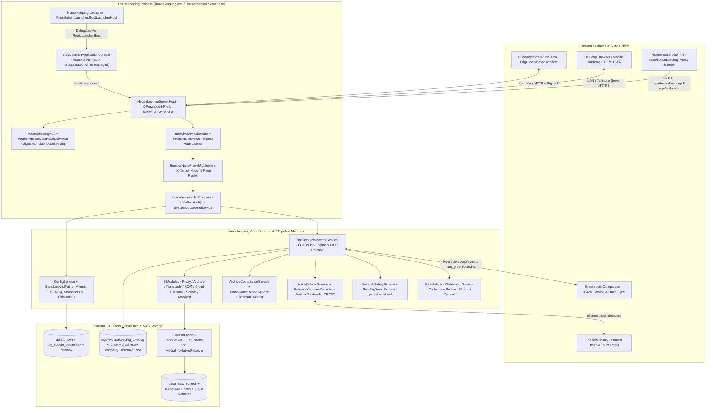
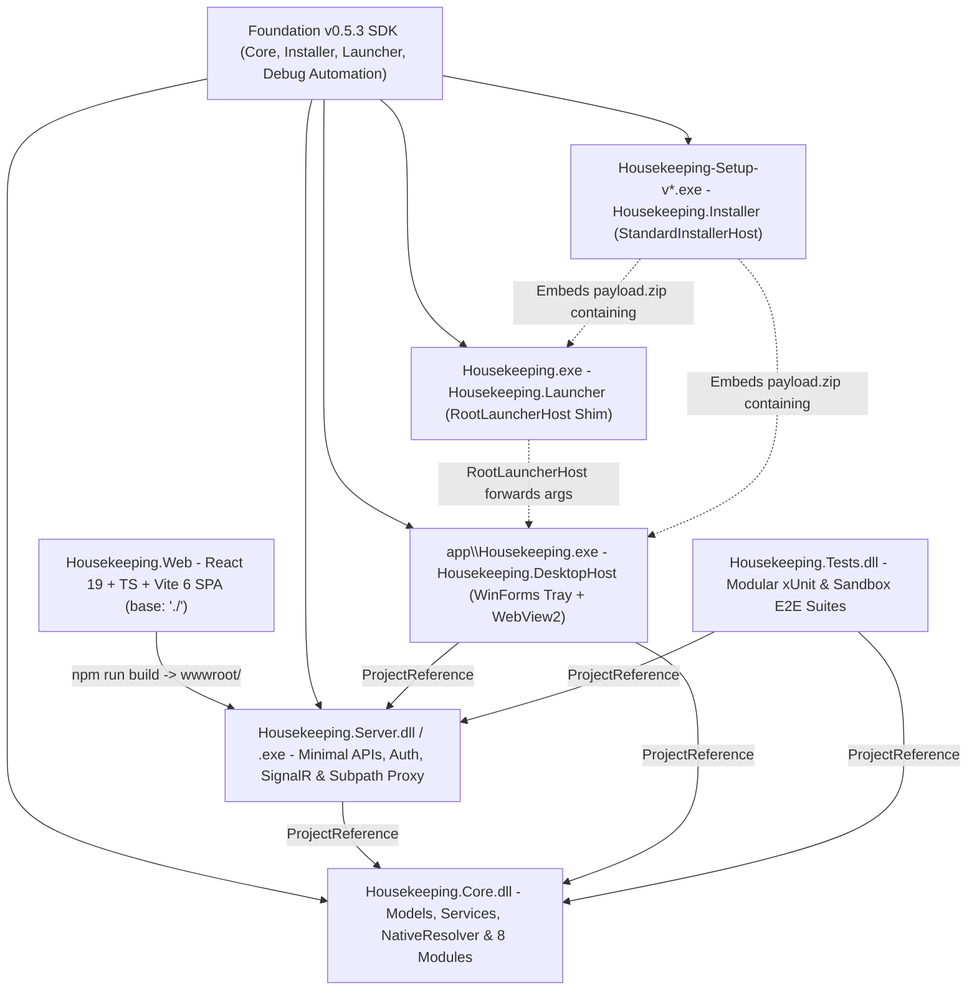

# Housekeeping — Technical Architecture & Engineering Manual

- **Document:** `ARCHITECTURE.md` (Technical Manual 1 of 4)
- **Active Build Version:** `v0.2.0` (`Foundation v0.5.3`, Universal SemVer `PATCH+1`)
- **Application Archetype:** System Tray Companion Daemon & Local/Suite Web Host ([Housekeeping.DesktopHost](../Housekeeping.DesktopHost/Housekeeping.DesktopHost.csproj) + [Housekeeping.Server](../Housekeeping.Server/Housekeeping.Server.csproj))
- **Runtime Stack:** .NET 8.0 (`net8.0-windows` / `net8.0` C# 12) · ASP.NET Core Minimal APIs + SignalR (`:5178`) · WinForms System Tray + Disposable WebView2 Standalone Window · `Foundation v0.5.3` (`Core`, `Installer`, `Launcher`, `Automation` Debug-only) · React 19 + TypeScript + Vite 6 SPA (`base: './'`) · Atomic Copy-on-Write JSON State Persistence (`Schema v4`) · `7z.exe` + `HandBrakeCLI.exe` + `rclone.exe` + `hbd.exe` + runtime-resolved `MediaInfo.dll`

---

## 1. System Context & Runtime Model

Housekeeping is an automated media transcoding, ROM/game launcher generation, zero-decompression archive compliance, bit-rot `.hash` verification, and cloud synchronization daemon. It runs as a persistent Windows system tray process ([TrayDaemonApplicationContext](../Housekeeping.DesktopHost/TrayDaemonApplicationContext.cs)) or standalone Kestrel server (`Housekeeping.Server.exe` via [HousekeepingServerHost](../Housekeeping.Server/Hosting/HousekeepingServerHost.cs)) bound to `127.0.0.1:5178` by default (loopback enforced under `--managed-by-mother` / `--managed-by-suite`, or `0.0.0.0:5178` when `BindLanAndTailnet` is explicitly enabled without suite supervision).

Desktop interaction is dual-mode by design: double-clicking the system tray icon (or launching a second `Housekeeping.exe` instance, which broadcasts the Win32 message `HOUSEKEEPING_RESTORE_WINDOW` via [StaNativeDialogBridge](../Housekeeping.DesktopHost/StaNativeDialogBridge.cs)) opens either a disposable Edge WebView2 standalone window ([DisposableWebViewForm](../Housekeeping.DesktopHost/DisposableWebViewForm.cs), default in `Schema v4`) or the default system browser. Closing the standalone window disposes the Chromium WebView2 process tree so background idle RAM returns to native .NET daemon levels.

---

## 2. Assembly & Hybrid Module Dependency Graph

The [Housekeeping.slnx](../Housekeeping.slnx) workspace comprises **6 .NET 8 C# projects** backed by pinned `Foundation v0.5.3` assemblies in `Dev/lib/` and **1 React 19 + TypeScript Vite frontend** compiled into `Dev/Housekeeping.Server/wwwroot/` at build/package time:

| Project / Assembly | Target Framework | Output Type / Binary | Architectural Responsibility |
| :--- | :--- | :--- | :--- |
| [Housekeeping.Core](../Housekeeping.Core/Housekeeping.Core.csproj) | `net8.0-windows` | Class Library (`Housekeeping.Core.dll`) | Domain configuration (`AppConfig` Schema v4), `SandboxEnvironmentSeam` containment, atomic JSON persistence, 8 pipeline modules, `.hash` sidecar & DAT engines, archive compliance, network drop safety, `<dataDir>\rclone\` isolation, single-flight SMB push lock, and `MediaInfoNativeResolver`. |
| [Housekeeping.Server](../Housekeeping.Server/Housekeeping.Server.csproj) | `net8.0-windows` | Web SDK Exe (`Housekeeping.Server.dll` / `.exe`) | Kestrel HTTP host, `X-Forwarded-Prefix` subpath middleware, CLI parser/runner (`--doctor`, `--status`, `--repair-config`, `--bind`, `--suite-id`), `TieredAuthMiddleware` (`data\.hk_cookie_secret.key`), `RemoteNodeProxyMiddleware`, `/api/v1/*` + `/api/v1/system/tailscale-qr`, `HousekeepingHub` SignalR hub, and `wwwroot` SPA. |
| [Housekeeping.DesktopHost](../Housekeeping.DesktopHost/Housekeeping.DesktopHost.csproj) | `net8.0-windows` (`UseWindowsForms` + `WebView2`) | `WinExe` (`app\Housekeeping.exe`) | Single-instance `Global\Mother_Housekeeping_Mutex`, STA native dialog bridge (`StaNativeDialogBridge`), `NotifyIcon` tray lifecycle (`TrayDaemonApplicationContext` with `--managed-by-suite` suppression), `DisposableWebViewForm`, and Debug/TestAutomation-only `DesktopAutomationBridge`. |
| [Housekeeping.Launcher](../Housekeeping.Launcher/Housekeeping.Launcher.csproj) | `net8.0` | `WinExe` (`<InstallRoot>\Housekeeping.exe`) | Thin root launcher delegating via `Foundation.Launcher.RootLauncherHost` + `HousekeepingLauncherArgsHelper` to `app\Housekeeping.exe`, supporting synchronous one-shot flags (`--status`, `--repair-config`, `--doctor`) and value options (`--bind`, `--suite-id`, `--automation-*`). |
| [Housekeeping.Web](../Housekeeping.Web/package.json) | ES2022 / React 19 / Vite 6 | Static SPA bundle (`wwwroot\`) | Vite `base: './'` 7-view desktop & mobile PWA with `subpathUrl.ts` `/app/housekeeping/` detection, `TopBarPwaControls`, `SettingsTailscalePwaCard` inline SVG QR, virtualized `DualPaneTerminal`, and SignalR client. |
| [Housekeeping.Installer](../Housekeeping.Installer/Housekeeping.Installer.csproj) | `net8.0-windows` (`PublishSingleFile=true`) | `WinExe` (`Housekeeping-Setup-v*.exe`) | `Foundation.Installer.StandardInstallerHost` + declarative `installer.manifest.json` (`schemaVersion: 2`), gzip-compressed embedded Foundation DLLs via `AssemblyLoadContext`, `--suite-dir`, `--profile`, opt-in `--migrate-legacy` (`Housekeeping_Watchdog` cleanup), and Release `--automation-*` `ExitCode = 2` guard. |
| [Housekeeping.Tests](../Housekeeping.Tests/Housekeeping.Tests.csproj) | `net8.0-windows` | xUnit Test Library | Isolated unit, HTTP proxy, installer `--payload` (Zip-Slip / tampered SHA-256), security containment, and Stage 2 4-Drive Sandbox E2E verification suites. |

---

## 3. End-to-End Data Flow Across Core Pipelines

### Pipeline A — Queue & Job Orchestration, FIFO Up-Next Chaining & Interrupted Run Checkpointing
1. **Trigger Ingestion:** Runs start via UI/REST (`POST /api/v1/pipeline/run-queue` or `run-job` in [HousekeepingApiEndpoints.CoexistenceAndControl.cs](../Housekeeping.Server/Endpoints/HousekeepingApiEndpoints.CoexistenceAndControl.cs)) or the 15-second background timer in [PipelineOrchestratorService.cs](../Housekeeping.Core/Services/PipelineOrchestratorService.cs).
2. **Process Guard & Deferral Gate:** Before firing a scheduled queue, `EvaluateQueueSchedules` checks [SchedulerAndNotificationService.cs](../Housekeeping.Core/Services/SchedulerAndNotificationService.cs) `DeferredUntilUtc` (set by `Mother` `POST /api/scheduler/defer` or tray 1-hour pause) and throttled 10s Win32 process scans for `obs64`, `retroarch`, `pcsx2`, etc.
3. **FIFO Up-Next Queueing (`_pendingRuns`):** If a pipeline or scan is active, `TryEnqueuePendingRunLocked` enforces at most 1 queued instance per distinct `RunKind:TargetId` key and a 60s anti-bounce cooldown on auto-scheduled completions.
4. **Immutable Snapshot & Checkpoint Persistence:** `LaunchPipelineInternal` deep-clones `AppConfig` (`immutableRunConfig`), stamps `queue.LastRunUtc`, writes `data\interrupted_run_checkpoint.json` via [PipelineOrchestratorService.CancellationAndShutdown.cs](../Housekeeping.Core/Services/PipelineOrchestratorService.CancellationAndShutdown.cs), and runs `ExecutePipelineAsync`.
5. **Execution, Sleep Prevention & Post-Job Chaining:** `ExecutePipelineAsync` calls [NativeProcessSuspend.cs](../Housekeeping.Core/Interop/NativeProcessSuspend.cs) `PreventWindowsSleep(true)`, attaches a per-run log writer (`logs\runs\Run_<Queue>_<Timestamp>.log`), records `CompletedJobIds`, triggers Greenroom auto-sync on manifest changes, and enqueues `job.OnSuccessTriggerJobId` with cycle detection.
6. **Dual-Mode Stop & Graceful Shutdown Finalization:**
   - `StopCurrentJob()` (`POST /api/v1/pipeline/stop-job`): cancels only the linked per-job `_activeJobCts`, advancing the active queue to its next job while preserving `PendingRuns`.
   - `StopActiveRun()` (`POST /api/v1/pipeline/stop-queue`): cancels `_activeRunCts`, clears `PendingRuns`, and deletes `interrupted_run_checkpoint.json`.
   - `InitiateGracefulShutdownAbort()` (`POST /api/v1/system/shutdown` & tray exit): resumes any `NtSuspendProcess`-paused child tree, cancels `_activeRunCts`, and preserves `interrupted_run_checkpoint.json` + `PendingRuns` so the next launch presents `InterruptedRunRecoveryBanner`.

### Pipeline B — Media Transcoding (Modules 1, 2 & 3), `MediaInfoNativeResolver` & Exclusive SMB Pre-Probe
1. **Discovery, Sister-App Guard & Codec Probe:** [ProxyGeneratorModule.cs](../Housekeeping.Core/Services/Modules/ProxyGeneratorModule.cs), [ArchiveCompressorModule.cs](../Housekeeping.Core/Services/Modules/ArchiveCompressorModule.cs), and [MediaTranscoderModule.cs](../Housekeeping.Core/Services/Modules/MediaTranscoderModule.cs) (assisted by [MediaTranscoderModule.CoexistenceGuards.cs](../Housekeeping.Core/Services/Modules/MediaTranscoderModule.CoexistenceGuards.cs) skipping `.redroom-part` and active sister-app `.hklock` directories) verify reachability via `NetworkSafetyService.EnsureDirectoryReachableAsync`. Module 3 classifies sources by filename tags or native `MediaInfo` inspection resolved dynamically by [MediaInfoNativeResolver.cs](../Housekeeping.Core/Interop/MediaInfoNativeResolver.cs) (`NativeLibrary.SetDllImportResolver` + `Foundation.Core.ToolResolver`); probe or DLL failures report explicit errors instead of assuming HEVC.
2. **Distributed File & Directory Lock Acquisition (`.hklock`):** [NetworkSafetyService.DistributedLocks.cs](../Housekeeping.Core/Services/NetworkSafetyService.DistributedLocks.cs) writes `<finalOutputPath>.hklock` with a 60s heartbeat, while [NetworkSafetyService.DirectoryLocks.cs](../Housekeeping.Core/Services/NetworkSafetyService.DirectoryLocks.cs) manages `<TargetDir>\.<appId>_<pid>.hklock` (`schemaVersion: 1`, `pid` + `processStartTimeUtc`) directory sentinels.
3. **Safe Partial Output & HandBrake Subprocess:** `GetSafeEncodeOutputPath` directs `HandBrakeCLI.exe` to `<stem>.partial<ext>`. [ProcessRunnerService.cs](../Housekeeping.Core/Services/ProcessRunnerService.cs) parses `\r` progress lines, injects isolated env vars when needed, and resumes `NtSuspendProcess`-paused child trees before termination on cancellation.
4. **Exclusive SMB Pre-Probe & Atomic Commit:** On exit code `0`, `CommitPartialEncode` and [PendingSwapService.cs](../Housekeeping.Core/Services/PendingSwapService.cs) pre-probe both `.partial` and `finalOutputPath` with `FileShare.None` (`TryProbeExclusiveAccess`) without pre-deleting `finalOutputPath`, then execute atomic `File.Move(working, final, overwrite: true)` or enqueue a `PendingSwapItem` in `data\pending_swaps.json`.

### Pipeline C — Module 4 ROM Launchers (Decoupled) & Standalone 9-Column DAT Engine
1. **Multi-Disc `.m3u` & Solid `.7z` Compression:** [RomLauncherGeneratorModule.cs](../Housekeeping.Core/Services/Modules/RomLauncherGeneratorModule.cs) groups multi-disc sets into `.m3u` playlists and bundles loose ROM sets into `.7z` archives excluding sidecar/lock artifacts (`-xr!*.hash -xr!*.partial* -xr!*.hklock -xr!.archive_hashes.json`), completely decoupled from DAT/manifest/sidecar mutation.
2. **Launcher `.bat` & `.lnk` Generation:** `ResolveGamePathFromArchiveAsync` inspects `.7z`/`.zip` headers (`7z l -slt`) without full extraction, and [RomLauncherGeneratorModule.CommandBuilder.cs](../Housekeeping.Core/Services/Modules/RomLauncherGeneratorModule.CommandBuilder.cs) writes `.bat`/`.lnk` launchers with `<dataDir>\rclone\`-contained pre/post save sync commands across 24 emulator runners.
3. **9-Column DAT Manifest & Zero-Decompression Compliance:** [RomManifestCsvService.cs](../Housekeeping.Core/Services/RomManifestCsvService.cs) and [RomManifestCsvService.CoexistenceCompat.cs](../Housekeeping.Core/Services/RomManifestCsvService.CoexistenceCompat.cs) parse No-Intro/Redump DATs via [NoIntroRedumpDatParser.cs](../Housekeeping.Core/Services/NoIntroRedumpDatParser.cs), evaluate archive templates via [ArchiveComplianceService.cs](../Housekeeping.Core/Services/ArchiveComplianceService.cs), and persist `collection_manifest.csv` + `data\compliance_reports.json`.

### Pipeline D — Module 8 Universal Media Manifest, 4-Mode `.hash` Placement & `.archive_hashes.json`
1. **Topology Classification:** [CollectionManifestModule.cs](../Housekeeping.Core/Services/Modules/CollectionManifestModule.cs) enumerates configured targets (deferring on active `.hklock` sentinels or `SkipShadowLibraryManagedRoots`), and [ReleaseStructureDetector.cs](../Housekeeping.Core/Services/ReleaseStructureDetector.cs) classifies single-file, multi-file, or composite folder dumps.
2. **Two-Step Archive Verification & 4-Mode Placement (`0..3`):** [HashSidecarService.cs](../Housekeeping.Core/Services/HashSidecarService.cs), [HashSidecarService.ArchiveRegistry.cs](../Housekeeping.Core/Services/HashSidecarService.ArchiveRegistry.cs), and [HashSidecarService.ValidationCompat.cs](../Housekeeping.Core/Services/HashSidecarService.ValidationCompat.cs) maintain `DatabaseOnly = 0`, `SidecarBeside = 1`, `PackageInsideArchive = 2`, and `SidecarAndArchive = 3`, tracking post-injection outer hashes in `<TargetDir>\.archive_hashes.json`.
3. **Regex Field Extraction & Delimiter-Aware Export:** [CollectionManifestModule.Exporters.cs](../Housekeeping.Core/Services/Modules/CollectionManifestModule.Exporters.cs) exports delimiter-aware `.csv`/`.tsv`, `.json`, and `.html` manifests mirrored to `SecondaryMirrorFolder`.

### Pipeline E — Contained Cloud Sync (`rclone`), Humble Sync & Single-Flight Fleet Proxy
1. **Contained `rclone` Execution & Lock Recovery:** [CloudSyncModule.cs](../Housekeeping.Core/Services/Modules/CloudSyncModule.cs), [RomLauncherGeneratorModule.CommandBuilder.cs](../Housekeeping.Core/Services/Modules/RomLauncherGeneratorModule.CommandBuilder.cs), and [DependencyCheckService.cs](../Housekeeping.Core/Services/DependencyCheckService.cs) route `rclone` through `<dataDir>\rclone\` (`RCLONE_CONFIG`, `--workdir`, `--cache-dir`, `RCLONE_CACHE_DIR` via [ProcessRunnerService.cs](../Housekeeping.Core/Services/ProcessRunnerService.cs)) so isolated and sandboxed runs never write `.lck` or config files into host `%LOCALAPPDATA%\rclone\`. `CloudSyncModule` strips ANSI escape sequences on stale `.lck` recovery before retrying once.
2. **Multi-Node Fleet Proxy & Single-Flight SMB Sync:** [RemoteNodeProxyMiddleware.cs](../Housekeeping.Server/Proxy/RemoteNodeProxyMiddleware.cs) forwards `X-Target-Node-Id` API calls, while [RemoteNodeDeploymentService.cs](../Housekeeping.Core/Services/RemoteNodeDeploymentService.cs), [RemoteNodeDeploymentService.PathLayout.cs](../Housekeeping.Core/Services/RemoteNodeDeploymentService.PathLayout.cs), and [RemoteNodeDeploymentService.PushLock.cs](../Housekeeping.Core/Services/RemoteNodeDeploymentService.PushLock.cs) serialize remote `settings.json` pushes using per-node `SemaphoreSlim` locks and `{pid}.{guid}.tmp` staging (never copying `AGENTS.md` to remote deployments).

---

## 4. Solution Inventory & Modular Architecture (`v0.2.0`)

### 4.1 `Housekeeping.Core` (`Dev\Housekeeping.Core\`)
- **Interop:** `MediaInfoNativeResolver.cs` (`NativeLibrary.SetDllImportResolver` + `Foundation.Core.ToolResolver`), `MediaInfoDLL.cs`, `NativeProcessSuspend.cs`.
- **Models:** `AppConfig.cs` (`ConfigVersion = 4`), `AppConfig.LayoutAndCoexistence.cs` (`UiLayoutConfig`, `RemoteNodeConfig`, `UiOptionsCatalog`, `ResolveAllSyncCommands` & `rclone` helpers), `ArchiveComplianceModels.cs`, `ConsoleSystemCatalog.cs`, `RemoteControlModels.cs`.
- **Services:** `ConfigService.cs`, `ConfigService.AtomicIoAndMigrations.cs`, `ConfigService.LegacyRootMigration.cs`, `ConfigService.SandboxAndPaths.cs` (`SandboxEnvironmentSeam` `ExitCode = 3` & `settings.example.json` seeding), `PipelineOrchestratorService.cs` + `CancellationAndShutdown.cs`, `CrashBundleService.cs` + `CrashBundleExceptionFilter.cs` (`SocketException 10054` suppression), `RemoteNodeDeploymentService.cs` + `PathLayout.cs` + `PushLock.cs`, `NetworkSafetyService.cs` + `DirectoryLocks.cs` + `DistributedLocks.cs`, `PendingSwapService.cs`, `ProcessRunnerService.cs` (env var injection + child resume), `DependencyCheckService.cs` (async `rclone listremotes`), `ModuleCatalogService.cs`, `SisterAppCoexistenceService.cs` + `SisterAppCoexistenceModels.cs`, `HashSidecarService.cs` + `ArchiveRegistry.cs` + `ValidationCompat.cs`, `RomManifestCsvService.cs` + `CoexistenceCompat.cs`, `ArchiveComplianceService.cs`, `ComplianceReportService.cs`, `NoIntroRedumpDatParser.cs` + `DatTitleNormalizer.cs`, `ReleaseStructureDetector.cs`, `SchedulerAndNotificationService.cs`, `SystemPerformanceTelemetryService.cs`, `TerminalLogBufferService.cs`, `GreenroomSyncIntegrationService.cs`, `DatDownloadService.cs`, `InteractiveCliSessionService.cs`, `RemoteTerminalStreamService.cs`, `WindowsWatchdogService.cs`.
- **Modules (`Services\Modules\`):** `ProxyGeneratorModule.cs`, `ArchiveCompressorModule.cs`, `MediaTranscoderModule.cs` + `CoexistenceGuards.cs`, `RomLauncherGeneratorModule.cs` + `CommandBuilder.cs`, `CloudSyncModule.cs`, `HumbleSyncModule.cs` (also exports `CustomScriptsModule`), `CollectionManifestModule.cs` + `Exporters.cs`, `ManifestPresetCatalog.cs`, `ModuleExecutionContext.cs`.

### 4.2 `Housekeeping.Server`, `DesktopHost`, `Launcher` & `Installer`
- **Server (`Dev\Housekeeping.Server\`):** `Program.cs`, `Hosting\HousekeepingCliParser.cs` (`--doctor`, `--bind`, `--suite-id`, `--managed-by-suite`, `--automation-*`), `Hosting\HousekeepingCliRunner.cs` (`RunDoctor`, `RunStatusCheck`, `RunRepairConfig`), `Hosting\HousekeepingServerHost.cs` (`X-Forwarded-Prefix`, `UsePathBase`, `127.0.0.1` loopback guard, dynamic `/manifest.webmanifest` & `Service-Worker-Allowed`), `Hosting\HousekeepingRuntimeContainer.cs`, `Hosting\RealtimeBroadcastHostedService.cs`, `Endpoints\HousekeepingApiEndpoints.cs` + `CoexistenceAndControl.cs` + `SystemDoctorAndBackup.cs` + `MotherAndQr.cs` (`/api/v1/system/tailscale-qr`), `Hubs\HousekeepingHub.cs`, `Proxy\RemoteNodeProxyMiddleware.cs`, `Security\TieredAuthMiddleware.cs`, `Security\TieredAuthService.cs` (`logs\`->`data\.hk_cookie_secret.key`), `Services\TailscalePwaService.cs` (`Foundation.Core.QrCodeEncoder.RenderSvg`).
- **DesktopHost (`Dev\Housekeeping.DesktopHost\`):** `Program.cs` (`Global\Mother_Housekeeping_Mutex`, Release `--automation-*` `ExitCode = 2`), `TrayDaemonApplicationContext.cs` (tray suppression under `ManagedByMother`), `TrayMenuFactory.cs`, `DisposableWebViewForm.cs`, `StaNativeDialogBridge.cs`, `DesktopAutomationBridge.cs` (`#if DEBUG || HOUSEKEEPING_TEST_AUTOMATION`, `GET /v1/snapshot.png`).
- **Launcher (`Dev\Housekeeping.Launcher\`):** `Program.cs` & `HousekeepingLauncherArgsHelper.cs` delegating to `Foundation.Launcher.RootLauncherHost`.
- **Installer (`Dev\Housekeeping.Installer\`):** `Program.cs`, `HousekeepingInstallerRunner.cs`, `HousekeepingInstallerIntegration.cs`, `LegacyInstallCleanup.cs`, `installer.manifest.json` (`schemaVersion: 2`, `%LOCALAPPDATA%\Programs\StreamItAll\Mother\Housekeeping\`, `--suite-dir`, `--profile`, `--migrate-legacy`, Release `ExitCode = 2`).

### 4.3 `Housekeeping.Web` (`Dev\Housekeeping.Web\src\`)
- **Shell & Subpath Plumbing:** `utils\subpathUrl.ts`, `main.tsx`, `App.tsx`, `components\TopCommandBar.tsx`, `components\TopBarPwaControls.tsx`, `components\SidebarNavRail.tsx`, `components\MobileBottomNavBar.tsx`, `components\DrivesTableModal.tsx`, `components\DualPaneTerminal.tsx` + `TerminalPaneToolbar.tsx` + `TerminalCliPromptBar.tsx` + `TerminalResizeHandle.tsx` + `GlobalTerminalDrawer.tsx`, `components\CoexistenceWarningBanner.tsx`, `components\ActivePipelineControlBar.tsx`, `components\ProfileSelect.tsx`.
- **Services, Context & Pages:** `services\apiClient.ts`, `coexistenceAndSystemApi.ts`, `signalrClient.ts`, `context\AppStateContext.tsx`, `hooks\{useUiLayoutPersistence, useTerminalAutoScroll, useRemoteTerminalTail}.ts`, `pages\{DashboardPage, JobQueuesPage, JobBuilderPage, ModulesCatalogPage, ReportsCenterPage, SettingsPage, HistoryPage}.tsx`, `pages\settings\{SettingsIntegrationsAndDoctorCard, SettingsTailscalePwaCard}.tsx`, `pages\editors\*`, `src\hints\*.ts`.

---

## 5. Persistence Stores, Atomic JSON State & Containment Artifacts

Housekeeping persists all runtime state via per-caller atomic copy-on-write JSON (`{target}.{pid}.{guid:N}.tmp` UTF-8 No-BOM -> `.bak` -> `File.Move(..., overwrite: true)`) and structured sidecars:

| Store / Artifact Path | Format | Owner Service | Concurrency & Containment Policy |
| :--- | :--- | :--- | :--- |
| `<DataDir>\settings.json` ( + `.bak`) | JSON (`AppConfig` Schema v4) | [ConfigService.cs](../Housekeeping.Core/Services/ConfigService.cs) | `_ioLock` + `AtomicWriteAllText`; auto-migrates `v1..v3 -> v4`; seeds `<DataDir>\settings.example.json` if missing; prunes snapshots in sibling `backups\config_snapshots\` past **20**. |
| `<DataDir>\history.json` | JSON (`List<RunHistoryEntry>`) | [ConfigService.cs](../Housekeeping.Core/Services/ConfigService.cs) | Prepends newest run at index `0`; trims to `MaxHistoryEntries`. |
| `<DataDir>\compliance_reports.json` | JSON (`List<ComplianceReportItem>`) | [ComplianceReportService.cs](../Housekeeping.Core/Services/ComplianceReportService.cs) | `_syncLock` + `AtomicWriteAllText`; deterministic key `"{console}|{fullPath}"`; preserves `Ignored` status. |
| `<DataDir>\pending_swaps.json` | JSON (`List<PendingSwapItem>`) | [PendingSwapService.cs](../Housekeeping.Core/Services/PendingSwapService.cs) | `_lock` + `AtomicWriteAllText`; tracks `.partial` encodes awaiting exclusive destination handle release. |
| `<DataDir>\interrupted_run_checkpoint.json` | JSON (`InterruptedRunCheckpoint`) | [PipelineOrchestratorService.CancellationAndShutdown.cs](../Housekeeping.Core/Services/PipelineOrchestratorService.CancellationAndShutdown.cs) | Preserved on `InitiateGracefulShutdownAbort()`; deleted on clean finish or explicit `StopActiveRun()`. |
| `<DataDir>\.hk_cookie_secret.key` | 32-byte hex secret | [TieredAuthService.cs](../Housekeeping.Server/Security/TieredAuthService.cs) | Migrated atomically out of legacy `logs\` with strict ACLs; `logs\` copy deleted. |
| `<DataDir>\rclone\` | `rclone.conf`, `bisync\`, `cache\` | [ProcessRunnerService.cs](../Housekeeping.Core/Services/ProcessRunnerService.cs) + 3 callers | Isolates `RCLONE_CONFIG`, `--workdir`, `--cache-dir`, and `RCLONE_CACHE_DIR` from host `%LOCALAPPDATA%\rclone\`. |
| `<LogsDir>\telemetry_heartbeat.json` | JSON (`TelemetryHeartbeatDto`) | [SystemPerformanceTelemetryService.cs](../Housekeeping.Core/Services/SystemPerformanceTelemetryService.cs) | Atomic `.tmp` swap every **10s** active / **30s** idle for `Mother` supervision. |
| `<Target>.hash`, `.archive_hashes.json`, `.coexistence.json`, `.hklock` | Text / JSON sidecars | [HashSidecarService.cs](../Housekeeping.Core/Services/HashSidecarService.cs), [SisterAppCoexistenceService.cs](../Housekeeping.Core/Services/SisterAppCoexistenceService.cs), [NetworkSafetyService.DirectoryLocks.cs](../Housekeeping.Core/Services/NetworkSafetyService.DirectoryLocks.cs) | 4-mode `.hash` (`0..3`), post-injection outer archive registry (`v1`), shared-root coexistence (`v2`), and PID+StartTime directory locks (`v1`). |

---

## 6. Failure Modes, Security & Testing Strategy

- **Socket `10054` & Transient Disconnects:** `CrashBundleService` and `CrashBundleExceptionFilter` call `e.SetObserved()` and downgrade aborted-client `SocketException (10054)` and transient `HttpRequestException`/`IOException` unobserved tasks to structured `WARN` telemetry with zero crash JSON dumps.
- **Single-Flight Remote SMB Pushes:** `RemoteNodeDeploymentService.PushLock.cs` serializes pushes per node via `SemaphoreSlim` and writes `{pid}.{guid}.tmp` before atomic promotion, omitting `AGENTS.md`.
- **Fail-Closed Release & Sandbox Gates:** Passing `--automation-*` flags to Release binaries exits with **`ExitCode = 2`**; escaping `FOUNDATION_SANDBOX_ROOT` containment exits with **`ExitCode = 3`**.
- **Automated Test Suites (`Dev\Housekeeping.Tests\` + `Dev\scripts\run_stage2_e2e.py`):**
  - Core, Auth, Queue, Coexistence, Mother Parity, and Fleet/CLI xUnit suites run under `APP_ISOLATED_TEST=1` with `TreatWarningsAsErrors=true`.
  - `V020SuiteAndInstallerTests.cs`, `V020SecurityAndContainmentTests.cs`, and `V020SandboxStage2E2ETests.cs` cover `StandardInstallerHost` (`--verify`, `--silent`, `--profile`, `--suite-dir`, `--migrate-legacy`), `--payload <zip>` Zip-Slip and tampered-SHA256 / corrupt-ZIP failures, `/app/housekeeping/` `X-Forwarded-Prefix` headers, `/api/v1/system/tailscale-qr`, `.hk_cookie_secret.key` migration, 3-caller `rclone` containment, `MediaInfo` probe truthfulness, `--doctor`, and Two-Build 4-Drive Sandbox E2E (`run_stage2_e2e.py`).

---

## 7. Zero-Touch Extension Playbooks

1. **Adding a Pipeline Module (`ModuleId`):** Add enum value + config class in `AppConfig.cs`, implement `Housekeeping.Core/Services/Modules/<New>Module.cs` (`<= 250` SLOC), register in `PipelineOrchestratorService` & `ModuleCatalogService`, and add the TS model + `src/pages/editors/<New>Editor.tsx` + `src/hints/<new>.ts` (passing `node Dev/scripts/verify_ui_hints.mjs`).
2. **Adding a Persistent Setting:** Add property to `AppConfig.LayoutAndCoexistence.cs` (or focused partial `<= 250` SLOC), copy in `DeepClone()`, validate in `ConfigService.ValidateConfig`, strip any secrets in `CreateSanitizedCopyForSharing`, and update `Dev/config/settings.example.json` + TS models.
3. **Adding an Endpoint:** Map new routes in a focused partial under `Housekeeping.Server/Endpoints/`, verify `TieredAuthMiddleware` coverage and `X-Forwarded-Prefix` relative URL compatibility, and document in [INTERFACES.md](INTERFACES.md).
