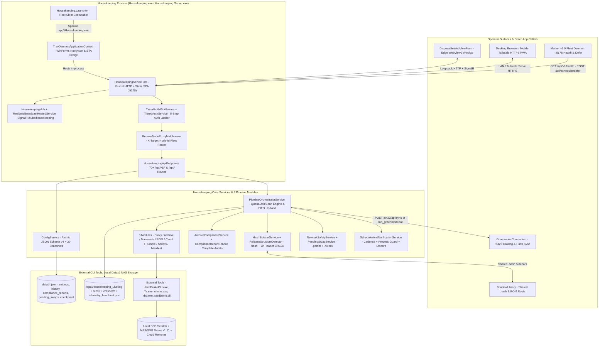

# Housekeeping — Technical Architecture & Engineering Manual

- **Document:** `ARCHITECTURE.md` (Technical Manual 1 of 4)
- **Active Build Version:** `v0.1.12` (Universal SemVer `PATCH+1`)
- **Application Archetype:** Archetype 2 — System Tray Companion Daemon & Local/Tailnet Web Host ([`Housekeeping`](file:///D:/Projects/Personal/Housekeeping/Dev/Housekeeping.DesktopHost/Housekeeping.DesktopHost.csproj) + [`Housekeeping.Server`](file:///D:/Projects/Personal/Housekeeping/Dev/Housekeeping.Server/Housekeeping.Server.csproj))
- **Runtime Stack:** .NET 8.0 (`net8.0-windows` / `net8.0` C# 12) · ASP.NET Core Minimal APIs + SignalR (`:5178` / `:15178` sandbox) · WinForms System Tray + Disposable WebView2 Standalone Window · React 19 + TypeScript + Vite 6 SPA · Atomic Copy-on-Write JSON State Persistence (`Schema v4`) · `7z.exe` + `HandBrakeCLI.exe` + `rclone.exe` + `hbd.exe` + `MediaInfo.dll`

---

## 1. System Context & Runtime Model

Housekeeping is an automated media transcoding, ROM/game launcher generation, zero-decompression archive compliance, bit-rot `.hash` verification, and cloud synchronization daemon. It runs as a persistent Windows system tray process ([`TrayDaemonApplicationContext`](file:///D:/Projects/Personal/Housekeeping/Dev/Housekeeping.DesktopHost/TrayDaemonApplicationContext.cs#L1-L290)) or headless Kestrel web service (`--headless` via [`HousekeepingServerHost`](file:///D:/Projects/Personal/Housekeeping/Dev/Housekeeping.Server/Hosting/HousekeepingServerHost.cs#L20-L191)) bound to `127.0.0.1:5178` (or `0.0.0.0:5178` when `BindLanAndTailnet` is enabled).

Desktop interaction is dual-mode by design: double-clicking the system tray icon (or launching a second `Housekeeping.exe` instance, which broadcasts the registered Win32 message `HOUSEKEEPING_RESTORE_WINDOW` via [`StaNativeDialogBridge.BroadcastRestoreMessage`](file:///D:/Projects/Personal/Housekeeping/Dev/Housekeeping.DesktopHost/StaNativeDialogBridge.cs#L18-L62)) opens either a disposable Edge WebView2 standalone window ([`DisposableWebViewForm`](file:///D:/Projects/Personal/Housekeeping/Dev/Housekeeping.DesktopHost/DisposableWebViewForm.cs#L14-L209), default in `Schema v4`) or the default system browser. When the standalone window is closed, the Chromium WebView2 control and process tree are completely disposed so background idle footprint stays at native .NET daemon levels (`~25–40 MB` RAM).

---

## 2. Assembly / `.dll` & Hybrid Module Dependency Graph

The [`Dev\`](file:///D:/Projects/Personal/Housekeeping/Dev/Housekeeping.slnx) workspace comprises **6 .NET 8 C# projects** and **1 React 19 + TypeScript Vite frontend** that compiles directly into [`Housekeeping.Server/wwwroot/`](file:///D:/Projects/Personal/Housekeeping/Dev/Housekeeping.Web/vite.config.ts):

| Project / Assembly | Target Framework | Output Type / Binary | Architectural Responsibility |
| :--- | :--- | :--- | :--- |
| [`Housekeeping.Core`](file:///D:/Projects/Personal/Housekeeping/Dev/Housekeeping.Core/Housekeeping.Core.csproj) | `net8.0-windows` | Class Library (`Housekeeping.Core.dll`) | Domain configuration (`AppConfig` Schema v4), atomic JSON persistence, 8 pipeline modules, `.hash` sidecar & DAT engines, archive compliance, network drop safety, process runner, and Win32 interop (`MediaInfo.dll`, `ntdll.dll`, `kernel32.dll`). |
| [`Housekeeping.Server`](file:///D:/Projects/Personal/Housekeeping/Dev/Housekeeping.Server/Housekeeping.Server.csproj) | `net8.0-windows` | Web SDK Exe (`Housekeeping.Server.dll` / `.exe`) | Kestrel HTTP host, CLI parser, `TieredAuthMiddleware`, `RemoteNodeProxyMiddleware`, 70+ REST endpoints in `HousekeepingApiEndpoints`, `HousekeepingHub` SignalR hub, `TailscalePwaService`, and embedded `wwwroot` SPA. |
| [`Housekeeping.DesktopHost`](file:///D:/Projects/Personal/Housekeeping/Dev/Housekeeping.DesktopHost/Housekeeping.DesktopHost.csproj) | `net8.0-windows` (`UseWindowsForms` + `WebView2`) | `WinExe` (`app\Housekeeping.exe`) | Single-instance mutex gate, STA native dialog thread (`StaNativeDialogBridge`), `NotifyIcon` system tray lifecycle (`TrayDaemonApplicationContext`), and `DisposableWebViewForm` standalone UI window. |
| [`Housekeeping.Launcher`](file:///D:/Projects/Personal/Housekeeping/Dev/Housekeeping.Launcher/Housekeeping.Launcher.csproj) | `net8.0` | `WinExe` (`<InstallRoot>\Housekeeping.exe`) | Zero-dependency root launcher shim per Dev Bible Standard 12 §3.1; resolves `<InstallRoot>\app\Housekeeping.exe`, forwards all CLI flags, and switches to synchronous wait + stdio redirect when `--headless`, `--test-mode`, or `--dry-run` is present. |
| [`Housekeeping.Web`](file:///D:/Projects/Personal/Housekeeping/Dev/Housekeeping.Web/package.json) | ES2022 / React 19 / Vite 6 | Static SPA bundle (`wwwroot\`) | 7-view responsive desktop & mobile PWA interface (`Dashboard`, `Job Queues`, `Job Builder`, `Modules`, `Reports`, `Settings`, `History`), virtualized `DualPaneTerminal`, and SignalR client. |
| [`Housekeeping.Installer`](file:///D:/Projects/Personal/Housekeeping/Dev/Housekeeping.Installer/Housekeeping.Installer.csproj) | `net8.0-windows` (`PublishSingleFile=true`) | `WinExe` (`Housekeeping-Setup-v*.exe`) | Self-contained 4-pillar installer embedding `payload.zip` and `metadata.json`; provides 3-page dark WinForms wizard (`InstallerWizardForm`) and headless `--silent`/`--test-mode`/`--verify`/`--uninstall` CLI. |
| [`Housekeeping.Tests`](file:///D:/Projects/Personal/Housekeeping/Dev/Housekeeping.Tests/Housekeeping.Tests.csproj) | `net8.0-windows` | xUnit Test Library | 183 automated `[Fact]`/`[Theory]` tests across 11 test files covering config migrations, `.hash` sidecars, archive compliance, scheduler DST, API endpoints, graceful shutdown checkpointing, and 5-app Fleet Coexistence parity. |

> [!NOTE]
> **`v0.1.12` Modularization & Fleet Coexistence Architecture:** In `v0.1.12`, all 28 touched legacy files underwent Dev Bible Standard 08 §8.2 **Extract-on-Touch** decomposition into cohesive `<= 400 LOC` partials, services, hooks, and UI components (`SisterAppCoexistenceService`, `NetworkSafetyService.DirectoryLocks`, `HashSidecarService.ArchiveRegistry`, `RomManifestCsvService.CoexistenceCompat`, `PipelineOrchestratorService.CancellationAndShutdown`, `HousekeepingCliRunner`, `DrivesTableModal`, `ProfileSelect`, `CoexistenceWarningBanner`, `TerminalResizeHandle`, `src/hints/*`), bringing 10 formerly `> 400 LOC` files strictly below `400 LOC` and adding full `.coexistence.json` (`v2`) + Standard 19 `pid`/`processStartTimeUtc` `.hklock` coordination across `ShadowLibrary`, `Redroom`, `uStation`, `StreamEngine`, and `Greenroom`.

---

## 3. End-to-End Data Flow Across Core Pipelines

### Pipeline A — Queue & Job Orchestration, FIFO Up-Next Chaining & Interrupted Run Checkpointing
1. **Trigger Ingestion:** Runs start via UI/REST (`POST /api/v1/pipeline/run-queue` or `run-job` in [`HousekeepingApiEndpoints.cs`](file:///D:/Projects/Personal/Housekeeping/Dev/Housekeeping.Server/Endpoints/HousekeepingApiEndpoints.cs#L430-L469)) or the 15-second background timer in [`PipelineOrchestratorService.StartBackgroundScheduler`](file:///D:/Projects/Personal/Housekeeping/Dev/Housekeeping.Core/Services/PipelineOrchestratorService.cs#L216-L247) calling [`EvaluateQueueSchedules`](file:///D:/Projects/Personal/Housekeeping/Dev/Housekeeping.Core/Services/PipelineOrchestratorService.cs#L1940-L2060).
2. **Process Guard & Deferral Gate:** Before firing a scheduled queue, `EvaluateQueueSchedules` checks [`SchedulerAndNotificationService.DeferredUntilUtc`](file:///D:/Projects/Personal/Housekeeping/Dev/Housekeeping.Core/Services/SchedulerAndNotificationService.cs#L35-L47) (set by Mother `POST /api/scheduler/defer` or tray 1-hour pause) and [`GetCachedGuardedProcessRunning`](file:///D:/Projects/Personal/Housekeeping/Dev/Housekeeping.Core/Services/SchedulerAndNotificationService.cs#L81-L148) (throttled 10s Win32 process scan for `obs64`, `retroarch`, `pcsx2`, etc.).
3. **FIFO Up-Next Queueing (`_pendingRuns`):** If a pipeline or scan is already active, [`StartOrEnqueueQueueRun`](file:///D:/Projects/Personal/Housekeeping/Dev/Housekeeping.Core/Services/PipelineOrchestratorService.cs#L650-L735) / [`StartOrEnqueueSingleJobRun`](file:///D:/Projects/Personal/Housekeeping/Dev/Housekeeping.Core/Services/PipelineOrchestratorService.cs#L737-L805) calls [`TryEnqueuePendingRunLocked`](file:///D:/Projects/Personal/Housekeeping/Dev/Housekeeping.Core/Services/PipelineOrchestratorService.cs#L350-L398), enforcing at most 1 queued instance per distinct `RunKind:TargetId` key and a 60s anti-bounce cooldown on auto-scheduled completions.
4. **Immutable Snapshot & Checkpoint Persistence:** `LaunchPipelineInternal` deep-clones `AppConfig` (`immutableRunConfig`), stamps `queue.LastRunUtc`, writes `data\interrupted_run_checkpoint.json` via `PersistActiveCheckpointToDisk` ([`PipelineOrchestratorService.CancellationAndShutdown.cs`](file:///D:/Projects/Personal/Housekeeping/Dev/Housekeeping.Core/Services/PipelineOrchestratorService.CancellationAndShutdown.cs#L130-L215)), and spawns [`ExecutePipelineAsync`](file:///D:/Projects/Personal/Housekeeping/Dev/Housekeeping.Core/Services/PipelineOrchestratorService.cs#L910-L1345).
5. **Execution, Sleep Prevention & Post-Job Chaining:** `ExecutePipelineAsync` calls [`NativeProcessSuspend.PreventWindowsSleep(true)`](file:///D:/Projects/Personal/Housekeeping/Dev/Housekeeping.Core/Interop/NativeProcessSuspend.cs#L24-L34), attaches a per-run log writer (`logs\runs\Run_<Queue>_<Timestamp>.log`), and iterates through `executionQueue`. After each job finishes cleanly, it records `job.JobId` in `CompletedJobIds`, triggers Greenroom auto-sync if Module 8 manifests changed, and enqueues `job.OnSuccessTriggerJobId` (guarded by `visitedJobIds` cycle detection).
6. **Three-Tier Cancellation & Graceful Shutdown Finalization:** [`PipelineOrchestratorService.CancellationAndShutdown.cs`](file:///D:/Projects/Personal/Housekeeping/Dev/Housekeeping.Core/Services/PipelineOrchestratorService.CancellationAndShutdown.cs#L1-L256) separates three distinct stop paths:
   - `StopCurrentJob()` (`POST /api/v1/pipeline/stop-job`): cancels only the linked per-job `_activeJobCts`, advancing the active queue to its next job while preserving `PendingRuns`.
   - `StopActiveRun()` (`POST /api/v1/pipeline/stop-queue`): sets `_userRequestedExplicitStop = true`, cancels `_activeRunCts`, clears `PendingRuns`, and deletes `interrupted_run_checkpoint.json`.
   - `InitiateGracefulShutdownAbort()` (`POST /api/v1/system/shutdown` & `TrayDaemonApplicationContext.ShutdownAndExit()`): leaves `_userRequestedExplicitStop = false`, resumes any `NtSuspendProcess`-paused child tree, cancels `_activeRunCts`, and **preserves** both `interrupted_run_checkpoint.json` and `PendingRuns` so the next startup presents `InterruptedRunRecoveryBanner`.

### Pipeline B — Media Transcoding (Modules 1, 2 & 3), Exclusive SMB Pre-Probe, `.hklock` & Pending Swaps
1. **Discovery, Sister-App Guard & Codec Probe:** [`ProxyGeneratorModule.RunAsync`](file:///D:/Projects/Personal/Housekeeping/Dev/Housekeeping.Core/Services/Modules/ProxyGeneratorModule.cs#L13-L210), [`ArchiveCompressorModule.RunAsync`](file:///D:/Projects/Personal/Housekeeping/Dev/Housekeeping.Core/Services/Modules/ArchiveCompressorModule.cs#L13-L220), and [`MediaTranscoderModule.RunAsync`](file:///D:/Projects/Personal/Housekeeping/Dev/Housekeeping.Core/Services/Modules/MediaTranscoderModule.cs#L14-L650) (assisted by [`MediaTranscoderModule.CoexistenceGuards.cs`](file:///D:/Projects/Personal/Housekeeping/Dev/Housekeeping.Core/Services/Modules/MediaTranscoderModule.CoexistenceGuards.cs#L1-L200) skipping `.redroom-part` / active sister-app `.hklock` directories) verify folder reachability via [`NetworkSafetyService.EnsureDirectoryReachableAsync`](file:///D:/Projects/Personal/Housekeeping/Dev/Housekeeping.Core/Services/NetworkSafetyService.cs#L110-L168). Module 3 matches sources by filename tags (`DVD`, `BR`, `UHD`) or native [`MediaInfo.dll`](file:///D:/Projects/Personal/Housekeeping/Dev/Housekeeping.Core/Interop/MediaInfoDLL.cs#L73-L293) stream height/codec inspection.
2. **Distributed File & Directory Lock Acquisition (`.hklock`):** Before encoding a target file, [`NetworkSafetyService.DistributedLocks.cs`](file:///D:/Projects/Personal/Housekeeping/Dev/Housekeeping.Core/Services/NetworkSafetyService.DistributedLocks.cs#L1-L94) writes `<finalOutputPath>.hklock` (`DistributedLockInfo`) with a 60s heartbeat, while [`NetworkSafetyService.DirectoryLocks.cs`](file:///D:/Projects/Personal/Housekeeping/Dev/Housekeeping.Core/Services/NetworkSafetyService.DirectoryLocks.cs#L68-L320) manages Standard 19 §4 `<TargetDir>\.<appId>_<pid>.hklock` (`schemaVersion: 1`, `pid` + `processStartTimeUtc`) directory mutation sentinels across sister apps.
3. **Safe Partial Output & HandBrake Subprocess:** [`GetSafeEncodeOutputPath`](file:///D:/Projects/Personal/Housekeeping/Dev/Housekeeping.Core/Services/NetworkSafetyService.cs#L180-L198) directs `HandBrakeCLI.exe` to write to `<stem>.partial<ext>`. [`ProcessRunnerService.RunCommandAsync`](file:///D:/Projects/Personal/Housekeeping/Dev/Housekeeping.Core/Services/ProcessRunnerService.cs#L118-L355) parses `\r` progress lines and automatically resumes `NtSuspendProcess`-paused child trees before termination on cancellation.
4. **Exclusive SMB Pre-Probe & Atomic Commit:** On exit code `0`, [`CommitPartialEncode`](file:///D:/Projects/Personal/Housekeeping/Dev/Housekeeping.Core/Services/NetworkSafetyService.cs#L205-L335) and [`PendingSwapService.RetrySwap`](file:///D:/Projects/Personal/Housekeeping/Dev/Housekeeping.Core/Services/PendingSwapService.cs#L130-L175) pre-probe both `workingOutputPath` (`.partial`) and `finalOutputPath` with `FileShare.None` ([`TryProbeExclusiveAccess`](file:///D:/Projects/Personal/Housekeeping/Dev/Housekeeping.Core/Services/NetworkSafetyService.DirectoryLocks.cs#L25-L51)) **without** pre-deleting `finalOutputPath`, then execute atomic `File.Move(working, final, overwrite: true)` or enqueue a `PendingSwapItem` in `data\pending_swaps.json` with accurate lock attribution.

### Pipeline C — Module 4 ROM Launchers (Decoupled from DAT/Sidecar Auditing) & Standalone 9-Column DAT Engine
1. **Multi-Disc `.m3u` & Solid `.7z` Compression:** [`RomLauncherGeneratorModule.RunAsync`](file:///D:/Projects/Personal/Housekeeping/Dev/Housekeeping.Core/Services/Modules/RomLauncherGeneratorModule.cs#L45-L210) scans each enabled `ConsoleCollectionRule`, groups multi-disc sets into `.m3u` playlists, and bundles loose ROM sets into `.7z` archives while excluding sidecar/lock artifacts (`-xr!*.hash -xr!*.partial* -xr!*.hklock -xr!.archive_hashes.json`). Per `v0.1.12` `T13`, Module 4 is 100% decoupled from DAT/manifest/sidecar generation so game launcher refreshes never trigger archive/sidecar mutations.
2. **Launcher `.bat` & `.lnk` Generation:** `ResolveGamePathFromArchiveAsync` inspects `.7z`/`.zip` headers (`7z l -slt`) without full decompression when `UseFast7zListInspection = true`, and [`RomLauncherGeneratorModule.CommandBuilder.cs`](file:///D:/Projects/Personal/Housekeeping/Dev/Housekeeping.Core/Services/Modules/RomLauncherGeneratorModule.CommandBuilder.cs#L1-L253) writes per-game `.bat`/`.lnk` launchers with optional `rclone` pre/post save sync across 16 emulator runners.
3. **Orphan Cleanup:** `CleanupOrphanedLaunchersAndShortcuts` ([`RomLauncherGeneratorModule.cs`](file:///D:/Projects/Personal/Housekeeping/Dev/Housekeeping.Core/Services/Modules/RomLauncherGeneratorModule.cs#L735-L895)) removes stale `.bat`, `.lnk`, and `.url` files whose backing ROM/archive was renamed or deleted.
4. **9-Column DAT Manifest & Zero-Decompression Compliance:** [`RomManifestCsvService`](file:///D:/Projects/Personal/Housekeeping/Dev/Housekeeping.Core/Services/RomManifestCsvService.cs#L37-L980) and [`RomManifestCsvService.CoexistenceCompat.cs`](file:///D:/Projects/Personal/Housekeeping/Dev/Housekeeping.Core/Services/RomManifestCsvService.CoexistenceCompat.cs#L1-L304) load No-Intro/Redump XML/Clrmamepro DATs via [`NoIntroRedumpDatParser`](file:///D:/Projects/Personal/Housekeeping/Dev/Housekeeping.Core/Services/NoIntroRedumpDatParser.cs#L1-L721) + [`DatTitleNormalizer`](file:///D:/Projects/Personal/Housekeeping/Dev/Housekeeping.Core/Services/DatTitleNormalizer.cs#L1-L121), backfill missing `MD5`/`SHA1` from DAT matches, honor ShadowLibrary `Match Status` synonyms, evaluate archive templates via [`ArchiveComplianceService`](file:///D:/Projects/Personal/Housekeeping/Dev/Housekeeping.Core/Services/ArchiveComplianceService.cs#L147-L707), and write `collection_manifest.csv` plus `data\compliance_reports.json`.

### Pipeline D — Module 8 Universal Media Manifest, 4-Mode `.hash` Placement & `.archive_hashes.json`
1. **Topology Classification:** [`CollectionManifestModule.RunAsync`](file:///D:/Projects/Personal/Housekeeping/Dev/Housekeeping.Core/Services/Modules/CollectionManifestModule.cs#L80-L810) enumerates configured `ManifestTargetFolder` roots (deferring when an active sister-app `.hklock` is present or when `SkipShadowLibraryManagedRoots` applies). [`ReleaseStructureDetector`](file:///D:/Projects/Personal/Housekeeping/Dev/Housekeeping.Core/Services/ReleaseStructureDetector.cs#L22-L547) classifies each target into `SingleFileRom`, `MultiFileGameSet`, or `CompositeFolderDump`.
2. **Two-Step Archive Verification & 4-Mode Placement (`0..3`):** [`HashSidecarService`](file:///D:/Projects/Personal/Housekeeping/Dev/Housekeeping.Core/Services/HashSidecarService.cs#L1-L2727), [`HashSidecarService.ArchiveRegistry.cs`](file:///D:/Projects/Personal/Housekeeping/Dev/Housekeeping.Core/Services/HashSidecarService.ArchiveRegistry.cs#L1-L349), and [`HashSidecarService.ValidationCompat.cs`](file:///D:/Projects/Personal/Housekeeping/Dev/Housekeeping.Core/Services/HashSidecarService.ValidationCompat.cs#L1-L246) verify or generate sidecars across `DatabaseOnly = 0`, `SidecarBeside = 1`, `PackageInsideArchive = 2`, and `SidecarAndArchive = 3`, preserving `# Container:` and `CRC32+MD5+SHA1` digests without unnecessary rewrites and recording post-injection outer container hashes in `<TargetDir>\.archive_hashes.json`.
3. **Regex Field Extraction & Delimiter-Aware Export:** `ApplyFieldParseRules` runs compiled C# regexes and presets from [`ManifestPresetCatalog`](file:///D:/Projects/Personal/Housekeeping/Dev/Housekeeping.Core/Services/Modules/ManifestPresetCatalog.cs#L7-L412), and [`CollectionManifestModule.Exporters.cs`](file:///D:/Projects/Personal/Housekeeping/Dev/Housekeeping.Core/Services/Modules/CollectionManifestModule.Exporters.cs#L1-L306) writes delimiter-aware `.csv`/`.tsv`, `.json`, and standalone `.html` reports mirrored to `SecondaryMirrorFolder`.

### Pipeline E — Cloud Sync (`rclone bisync` Lock Recovery), Humble Sync & Multi-Node Fleet Proxy
1. **Orphaned `rclone bisync` `.lck` Recovery & Humble Sync:** [`CloudSyncModule.cs`](file:///D:/Projects/Personal/Housekeeping/Dev/Housekeeping.Core/Services/Modules/CloudSyncModule.cs#L1-L229) executes `rclone bisync|sync|copy`; if `rclone bisync` hits an orphaned `.lck` file in `%LOCALAPPDATA%\rclone\bisync\`, `StripAnsiCodes` + `TryExtractStaleBisyncLockInfo` verifies no live `rclone.exe` process holds it, deletes the stale `.lck`, and retries once automatically. [`HumbleSyncModule.cs`](file:///D:/Projects/Personal/Housekeeping/Dev/Housekeeping.Core/Services/Modules/HumbleSyncModule.cs#L1-L148) orchestrates `hbd.exe` library downloads and `CustomScriptsModule` task steps.
2. **Multi-Node Fleet Proxy (`X-Target-Node-Id`) & Clean-Release-Root SMB Sync:** `apiClient.ts` attaches `X-Target-Node-Id: <nodeId>` to `/api/v1/*` requests, reverse-proxied by [`RemoteNodeProxyMiddleware`](file:///D:/Projects/Personal/Housekeeping/Dev/Housekeeping.Server/Proxy/RemoteNodeProxyMiddleware.cs#L42-L136), while [`RemoteNodeDeploymentService`](file:///D:/Projects/Personal/Housekeeping/Dev/Housekeeping.Core/Services/RemoteNodeDeploymentService.cs#L1-L518) + [`RemoteNodeDeploymentService.PathLayout.cs`](file:///D:/Projects/Personal/Housekeeping/Dev/Housekeeping.Core/Services/RemoteNodeDeploymentService.PathLayout.cs#L1-L243) sync binaries and settings into Clean-Release-Root `<RemoteRoot>\app\` and `<RemoteRoot>\data\` (with legacy flat fallback).

---

## 4. Complete File & Symbol Lookup Registry (`v0.1.12` Live Inventory)

> [!IMPORTANT]
> **Standard 08 §8.2 Modularity & Extract-on-Touch Status (`v0.1.12` — [`v0.1.12.2026-11-11.md`](file:///D:/Projects/Personal/Housekeeping/Dev/docs/plans/v0.1.12.2026-11-11.md)):** **100%** of the **63** newly created `v0.1.12` C#, TypeScript/React, CSS, script, and xUnit files are **strictly $\le 400$ LOC**, **100%** of modified legacy $> 400$ LOC files achieved a strict net line-count reduction, and **8** formerly $> 400$ LOC files (`CrashBundleService.cs`, `NetworkSafetyService.cs`, `CloudSyncModule.cs` + `HumbleSyncModule.cs`, `TrayDaemonApplicationContext.cs`, `apiClient.ts`, `DualPaneTerminal.tsx`, `DashboardPage.tsx`, `MediaTranscoderEditor.tsx`) are now **PASS ($\le 400$ LOC)**.

### 4.1 `Housekeeping.Core` (`Dev\Housekeeping.Core\`)

| File Path | LOC | `<400` Status | Key Types & Primary Symbols |
| :--- | :---: | :---: | :--- |
| [`Interop/MediaInfoDLL.cs`](file:///D:/Projects/Personal/Housekeeping/Dev/Housekeeping.Core/Interop/MediaInfoDLL.cs#L25-L295) & [`NativeProcessSuspend.cs`](file:///D:/Projects/Personal/Housekeeping/Dev/Housekeeping.Core/Interop/NativeProcessSuspend.cs#L7-L88) | 295 / 88 | PASS | `MediaInfo` P/Invoke wrapper and `NativeProcessSuspend` (`PreventWindowsSleep`, `SuspendProcessTree`, `ResumeProcessTree`). |
| [`Models/AppConfig.cs`](file:///D:/Projects/Personal/Housekeeping/Dev/Housekeeping.Core/Models/AppConfig.cs#L1-L2141) + [`AppConfig.LayoutAndCoexistence.cs`](file:///D:/Projects/Personal/Housekeeping/Dev/Housekeeping.Core/Models/AppConfig.LayoutAndCoexistence.cs#L1-L166) | 2,141 / 166 | **OVER** / PASS | `AppConfig` (`CurrentSchemaVersion = 4`, `[JsonExtensionData]`, `AutoAlignWithSisterApps`, `UiLayout`), `UiLayoutConfig`, `RemoteNodeConfig`, `WebServerSecurityConfig`, per-module configs. |
| [`Models/ArchiveComplianceModels.cs`](file:///D:/Projects/Personal/Housekeeping/Dev/Housekeeping.Core/Models/ArchiveComplianceModels.cs#L8-L639), [`ConsoleSystemCatalog.cs`](file:///D:/Projects/Personal/Housekeeping/Dev/Housekeeping.Core/Models/ConsoleSystemCatalog.cs#L11-L339), [`RemoteControlModels.cs`](file:///D:/Projects/Personal/Housekeeping/Dev/Housekeeping.Core/Models/RemoteControlModels.cs#L5-L25) | 639 / 339 / 25 | **OVER** / PASS / PASS | `ArchiveComplianceTemplate`, `ComplianceReportItem`, `ConsoleSystemCatalog` (45+ consoles), `RemoteControlRequest`. |
| [`Services/ArchiveComplianceService.cs`](file:///D:/Projects/Personal/Housekeeping/Dev/Housekeeping.Core/Services/ArchiveComplianceService.cs#L14-L1548) & [`ComplianceReportService.cs`](file:///D:/Projects/Personal/Housekeeping/Dev/Housekeeping.Core/Services/ComplianceReportService.cs#L11-L317) | 1,548 / 317 | **OVER** / PASS | Zero-decompression `7z l -slt` template compliance scanner, clutter dry-run/cleanup, and `compliance_reports.json` store. |
| [`Services/ConfigService.cs`](file:///D:/Projects/Personal/Housekeeping/Dev/Housekeeping.Core/Services/ConfigService.cs#L1-L944) + [`AtomicIoAndMigrations.cs`](file:///D:/Projects/Personal/Housekeeping/Dev/Housekeeping.Core/Services/ConfigService.AtomicIoAndMigrations.cs#L1-L257) + [`LegacyRootMigration.cs`](file:///D:/Projects/Personal/Housekeeping/Dev/Housekeeping.Core/Services/ConfigService.LegacyRootMigration.cs#L1-L160) | 944 / 257 / 160 | **OVER** / PASS / PASS | `ConfigService` (`AtomicWriteAllText` per-caller `{pid}.{guid}.tmp`, `MigrateConfig` `v1->v4`, `MigrateLegacyRootStateIfPresent`, 20 config snapshots). |
| [`Services/CrashBundleService.cs`](file:///D:/Projects/Personal/Housekeeping/Dev/Housekeeping.Core/Services/CrashBundleService.cs#L1-L329) + [`CrashBundleExceptionFilter.cs`](file:///D:/Projects/Personal/Housekeeping/Dev/Housekeeping.Core/Services/CrashBundleExceptionFilter.cs#L1-L104) | 329 / 104 | **PASS** / **PASS** | `CrashBundleService` (`RegisterGlobalHandlers` with `e.SetObserved()`, PII-redacted `logs\crashes\`) & benign cancel/idle-socket filter. |
| [`Services/DatDownloadService.cs`](file:///D:/Projects/Personal/Housekeeping/Dev/Housekeeping.Core/Services/DatDownloadService.cs#L10-L235), [`DependencyCheckService.cs`](file:///D:/Projects/Personal/Housekeeping/Dev/Housekeeping.Core/Services/DependencyCheckService.cs#L9-L309), [`GreenroomSyncIntegrationService.cs`](file:///D:/Projects/Personal/Housekeeping/Dev/Housekeeping.Core/Services/GreenroomSyncIntegrationService.cs#L16-L339) | 235 / 309 / 339 | PASS | Libretro DAT downloader, external tool resolver (`HandBrakeCLI`, `7z`, `rclone`, `hbd`), and Greenroom `:8420` sync client. |
| [`Services/HashSidecarService.cs`](file:///D:/Projects/Personal/Housekeeping/Dev/Housekeeping.Core/Services/HashSidecarService.cs#L1-L2727) + [`ArchiveRegistry.cs`](file:///D:/Projects/Personal/Housekeeping/Dev/Housekeeping.Core/Services/HashSidecarService.ArchiveRegistry.cs#L1-L349) + [`ValidationCompat.cs`](file:///D:/Projects/Personal/Housekeeping/Dev/Housekeeping.Core/Services/HashSidecarService.ValidationCompat.cs#L1-L246) | 2,727 / 349 / 246 | **OVER** / PASS / PASS | 4-mode `HashSidecarMode` (`0..3`), `.archive_hashes.json` post-injection registry, `# Container:` & `MD5+SHA1` preservation, `.cue/.bin` & `# TotalFiles:` compat. |
| [`Services/SisterAppCoexistenceService.cs`](file:///D:/Projects/Personal/Housekeeping/Dev/Housekeeping.Core/Services/SisterAppCoexistenceService.cs#L1-L305) + [`SisterAppCoexistenceModels.cs`](file:///D:/Projects/Personal/Housekeeping/Dev/Housekeeping.Core/Services/SisterAppCoexistenceModels.cs#L1-L221) | 305 / 221 | **PASS** / **PASS** | 5-app coexistence discovery (`ShadowLibrary`, `Redroom`, `uStation`, `StreamEngine`, `Greenroom`), `.coexistence.json` (`v2`), and preset alignment. |
| [`Services/NetworkSafetyService.cs`](file:///D:/Projects/Personal/Housekeeping/Dev/Housekeeping.Core/Services/NetworkSafetyService.cs#L1-L337) + [`DirectoryLocks.cs`](file:///D:/Projects/Personal/Housekeeping/Dev/Housekeeping.Core/Services/NetworkSafetyService.DirectoryLocks.cs#L1-L352) + [`DistributedLocks.cs`](file:///D:/Projects/Personal/Housekeeping/Dev/Housekeeping.Core/Services/NetworkSafetyService.DistributedLocks.cs#L1-L94) | 337 / 352 / 94 | **PASS** / **PASS** / **PASS** | `TryProbeExclusiveAccess` (`FileShare.None`), `CommitPartialEncode`, Standard 19 `pid`+`processStartTimeUtc` `.hklock` sentinels, and NAS drop recovery. |
| [`Services/NoIntroRedumpDatParser.cs`](file:///D:/Projects/Personal/Housekeeping/Dev/Housekeeping.Core/Services/NoIntroRedumpDatParser.cs#L1-L721) + [`DatTitleNormalizer.cs`](file:///D:/Projects/Personal/Housekeeping/Dev/Housekeeping.Core/Services/DatTitleNormalizer.cs#L1-L121) | 721 / 121 | **OVER** / PASS | `DatIndex` (`LoadFromDirectory`, `MatchRom`, `EvaluateMultiFileSet`) and extracted `DatTitleNormalizer`. |
| [`Services/PipelineOrchestratorService.cs`](file:///D:/Projects/Personal/Housekeeping/Dev/Housekeeping.Core/Services/PipelineOrchestratorService.cs#L1-L2163) + [`CancellationAndShutdown.cs`](file:///D:/Projects/Personal/Housekeeping/Dev/Housekeeping.Core/Services/PipelineOrchestratorService.CancellationAndShutdown.cs#L1-L256) | 2,163 / 256 | **OVER** / PASS | Queue/job engine, FIFO `Up Next`, and 3-tier cancellation (`StopCurrentJob`, `StopActiveRun`, `InitiateGracefulShutdownAbort`). |
| [`Services/RemoteNodeDeploymentService.cs`](file:///D:/Projects/Personal/Housekeeping/Dev/Housekeeping.Core/Services/RemoteNodeDeploymentService.cs#L1-L518) + [`PathLayout.cs`](file:///D:/Projects/Personal/Housekeeping/Dev/Housekeeping.Core/Services/RemoteNodeDeploymentService.PathLayout.cs#L1-L243) | 518 / 243 | **OVER** / PASS |Bounded TCP `:445` UNC probe and Clean-Release-Root (`<RemoteRoot>\app\` + `data\`) SMB fleet deployment/sync. |
| [`Services/RomManifestCsvService.cs`](file:///D:/Projects/Personal/Housekeeping/Dev/Housekeeping.Core/Services/RomManifestCsvService.cs#L1-L1303) + [`CoexistenceCompat.cs`](file:///D:/Projects/Personal/Housekeeping/Dev/Housekeeping.Core/Services/RomManifestCsvService.CoexistenceCompat.cs#L1-L304) | 1,303 / 304 | **OVER** / PASS | 9-column `collection_manifest.csv` DAT auditor, DAT `MD5`/`SHA1` backfill, and ShadowLibrary `Match Status` synonym preservation. |
| [`Services/InteractiveCliSessionService.cs`](file:///D:/Projects/Personal/Housekeeping/Dev/Housekeeping.Core/Services/InteractiveCliSessionService.cs#L11-L204) (204), [`ModuleCatalogService.cs`](file:///D:/Projects/Personal/Housekeeping/Dev/Housekeeping.Core/Services/ModuleCatalogService.cs#L11-L298) (298), [`PendingSwapService.cs`](file:///D:/Projects/Personal/Housekeeping/Dev/Housekeeping.Core/Services/PendingSwapService.cs#L1-L252) (252), [`ProcessRunnerService.cs`](file:///D:/Projects/Personal/Housekeeping/Dev/Housekeeping.Core/Services/ProcessRunnerService.cs#L1-L391) (391), [`RemoteTerminalStreamService.cs`](file:///D:/Projects/Personal/Housekeeping/Dev/Housekeeping.Core/Services/RemoteTerminalStreamService.cs#L12-L247) (247), [`TerminalLogBufferService.cs`](file:///D:/Projects/Personal/Housekeeping/Dev/Housekeeping.Core/Services/TerminalLogBufferService.cs#L1-L372) (372), [`WindowsWatchdogService.cs`](file:///D:/Projects/Personal/Housekeeping/Dev/Housekeeping.Core/Services/WindowsWatchdogService.cs#L12-L151) (151) | 151–391 | PASS | Interactive shell runner, module catalog, pending swaps, subprocess runner (resume-before-kill), remote log tailer, prefix-deduplicated log ring buffer, and watchdog service. |
| [`Services/ReleaseStructureDetector.cs`](file:///D:/Projects/Personal/Housekeeping/Dev/Housekeeping.Core/Services/ReleaseStructureDetector.cs#L10-L548) (548), [`SchedulerAndNotificationService.cs`](file:///D:/Projects/Personal/Housekeeping/Dev/Housekeeping.Core/Services/SchedulerAndNotificationService.cs#L13-L937) (937), [`SystemPerformanceTelemetryService.cs`](file:///D:/Projects/Personal/Housekeeping/Dev/Housekeeping.Core/Services/SystemPerformanceTelemetryService.cs#L15-L681) (681) | 548–937 | **OVER** (`>400`) | Untouched in `v0.1.12`: release topology classifier, cadence/Discord scheduler, and CPU/RAM/drive telemetry sampler. |
| [`Services/Modules/ProxyGeneratorModule.cs`](file:///D:/Projects/Personal/Housekeeping/Dev/Housekeeping.Core/Services/Modules/ProxyGeneratorModule.cs#L1-L212) (212), [`ArchiveCompressorModule.cs`](file:///D:/Projects/Personal/Housekeeping/Dev/Housekeeping.Core/Services/Modules/ArchiveCompressorModule.cs#L1-L222) (222), [`CloudSyncModule.cs`](file:///D:/Projects/Personal/Housekeeping/Dev/Housekeeping.Core/Services/Modules/CloudSyncModule.cs#L1-L229) (229), [`HumbleSyncModule.cs`](file:///D:/Projects/Personal/Housekeeping/Dev/Housekeeping.Core/Services/Modules/HumbleSyncModule.cs#L1-L148) (148), [`ModuleExecutionContext.cs`](file:///D:/Projects/Personal/Housekeeping/Dev/Housekeeping.Core/Services/Modules/ModuleExecutionContext.cs#L8-L82) (82) | 82–229 | **PASS** | Modules 1, 2, 5 (`rclone bisync` lock recovery), 6 (`hbd`), 7 (`CustomScriptsModule`), and shared execution context. |
| [`Services/Modules/MediaTranscoderModule.cs`](file:///D:/Projects/Personal/Housekeeping/Dev/Housekeeping.Core/Services/Modules/MediaTranscoderModule.cs#L1-L653) + [`CoexistenceGuards.cs`](file:///D:/Projects/Personal/Housekeeping/Dev/Housekeeping.Core/Services/Modules/MediaTranscoderModule.CoexistenceGuards.cs#L1-L200) | 653 / 200 | **OVER** / PASS | Module 3 Multi-Tier Media Transcoder + extracted Redroom/StreamEngine coexistence guards. |
| [`Services/Modules/RomLauncherGeneratorModule.cs`](file:///D:/Projects/Personal/Housekeeping/Dev/Housekeeping.Core/Services/Modules/RomLauncherGeneratorModule.cs#L1-L904) + [`CommandBuilder.cs`](file:///D:/Projects/Personal/Housekeeping/Dev/Housekeeping.Core/Services/Modules/RomLauncherGeneratorModule.CommandBuilder.cs#L1-L253) | 904 / 253 | **OVER** / PASS | Module 4 ROM & Game Launchers (`.m3u`, `.7z`, `.bat`, orphan cleanup) + extracted 16-runner command builder. |
| [`Services/Modules/CollectionManifestModule.cs`](file:///D:/Projects/Personal/Housekeeping/Dev/Housekeeping.Core/Services/Modules/CollectionManifestModule.cs#L1-L913) + [`Exporters.cs`](file:///D:/Projects/Personal/Housekeeping/Dev/Housekeeping.Core/Services/Modules/CollectionManifestModule.Exporters.cs#L1-L306) & [`ManifestPresetCatalog.cs`](file:///D:/Projects/Personal/Housekeeping/Dev/Housekeeping.Core/Services/Modules/ManifestPresetCatalog.cs#L7-L413) (413) | 913 / 306 / 413 | **OVER** / PASS / **OVER** | Module 8 Universal Collection Manifest, delimiter-aware `.csv`/`.tsv`/`.json`/`.html` exporters, and regex preset catalog. |

### 4.2 `Housekeeping.Server`, `DesktopHost`, `Launcher` & `Installer`

| File Path | LOC | `<400` Status | Key Types & Primary Symbols |
| :--- | :---: | :---: | :--- |
| [`Housekeeping.Server/Program.cs`](file:///D:/Projects/Personal/Housekeeping/Dev/Housekeeping.Server/Program.cs#L1-L76), [`HousekeepingCliParser.cs`](file:///D:/Projects/Personal/Housekeeping/Dev/Housekeeping.Server/Hosting/HousekeepingCliParser.cs#L1-L284), [`HousekeepingCliRunner.cs`](file:///D:/Projects/Personal/Housekeeping/Dev/Housekeeping.Server/Hosting/HousekeepingCliRunner.cs#L1-L137) | 76 / 284 / 137 | PASS | Headless entry point, CLI flag parser (`--status`, `--repair-config`, `--test-mode`), and synchronous one-shot CLI runner. |
| [`HousekeepingRuntimeContainer.cs`](file:///D:/Projects/Personal/Housekeeping/Dev/Housekeeping.Server/Hosting/HousekeepingRuntimeContainer.cs#L1-L126), [`HousekeepingServerHost.cs`](file:///D:/Projects/Personal/Housekeeping/Dev/Housekeeping.Server/Hosting/HousekeepingServerHost.cs#L20-L193), [`RealtimeBroadcastHostedService.cs`](file:///D:/Projects/Personal/Housekeeping/Dev/Housekeeping.Server/Hosting/RealtimeBroadcastHostedService.cs#L18-L194) | 126 / 193 / 194 | PASS | Singleton DI container (`FleetHttpClient` `PooledConnectionIdleTimeout = 25s`), Kestrel host, and SignalR + 10s heartbeat broadcaster. |
| [`HousekeepingHub.cs`](file:///D:/Projects/Personal/Housekeeping/Dev/Housekeeping.Server/Hubs/HousekeepingHub.cs#L14-L108), [`RemoteNodeProxyMiddleware.cs`](file:///D:/Projects/Personal/Housekeeping/Dev/Housekeeping.Server/Proxy/RemoteNodeProxyMiddleware.cs#L16-L138), [`TieredAuthMiddleware.cs`](file:///D:/Projects/Personal/Housekeeping/Dev/Housekeeping.Server/Security/TieredAuthMiddleware.cs#L12-L94), [`TieredAuthService.cs`](file:///D:/Projects/Personal/Housekeeping/Dev/Housekeeping.Server/Security/TieredAuthService.cs#L17-L396), [`TailscalePwaService.cs`](file:///D:/Projects/Personal/Housekeeping/Dev/Housekeeping.Server/Services/TailscalePwaService.cs#L16-L368) | 94–396 | PASS | SignalR hub, `X-Target-Node-Id` proxy, 5-step auth ladder, PBKDF2-SHA256 rate-limited auth, and Tailscale HTTPS PWA manager. |
| [`HousekeepingApiEndpoints.cs`](file:///D:/Projects/Personal/Housekeeping/Dev/Housekeeping.Server/Endpoints/HousekeepingApiEndpoints.cs#L1-L1409) + [`CoexistenceAndControl.cs`](file:///D:/Projects/Personal/Housekeeping/Dev/Housekeeping.Server/Endpoints/HousekeepingApiEndpoints.CoexistenceAndControl.cs#L1-L171) + [`SystemDoctorAndBackup.cs`](file:///D:/Projects/Personal/Housekeeping/Dev/Housekeeping.Server/Endpoints/HousekeepingApiEndpoints.SystemDoctorAndBackup.cs#L1-L218) | 1,409 / 171 / 218 | **OVER** / PASS / PASS | Maps all REST endpoints, `/api/v1/coexistence/*`, `/api/v1/pipeline/stop-job` & `stop-queue`, `ActiveLogsDir` doctor bundle, and sibling `backups\` state archive. |
| [`DesktopHost/Program.cs`](file:///D:/Projects/Personal/Housekeeping/Dev/Housekeeping.DesktopHost/Program.cs#L1-L232), [`TrayDaemonApplicationContext.cs`](file:///D:/Projects/Personal/Housekeeping/Dev/Housekeeping.DesktopHost/TrayDaemonApplicationContext.cs#L1-L290), [`TrayMenuFactory.cs`](file:///D:/Projects/Personal/Housekeeping/Dev/Housekeeping.DesktopHost/TrayMenuFactory.cs#L1-L119), [`DisposableWebViewForm.cs`](file:///D:/Projects/Personal/Housekeeping/Dev/Housekeeping.DesktopHost/DisposableWebViewForm.cs#L14-L209), [`StaNativeDialogBridge.cs`](file:///D:/Projects/Personal/Housekeeping/Dev/Housekeeping.DesktopHost/StaNativeDialogBridge.cs#L14-L209) | 119–290 | **PASS** (All 5) | Desktop/Tray entry point, tray lifecycle (`InitiateGracefulShutdownAbort`), dark tray menu factory, disposable WebView2 form, and Win32 dialog bridge. |
| [`Housekeeping.Launcher/Program.cs`](file:///D:/Projects/Personal/Housekeeping/Dev/Housekeeping.Launcher/Program.cs#L1-L121) | 121 | PASS | Root `<InstallRoot>\Housekeeping.exe` shim forwarding `--status`, `--repair-config`, `--headless`, and `--test-mode` synchronously to `app\Housekeeping.exe`. |
| [`Housekeeping.Installer/Program.cs`](file:///D:/Projects/Personal/Housekeeping/Dev/Housekeeping.Installer/Program.cs#L1-L1579) + [`Program.DiagnosticsAndCleanup.cs`](file:///D:/Projects/Personal/Housekeeping/Dev/Housekeeping.Installer/Program.DiagnosticsAndCleanup.cs#L1-L254) & [`InstallerWizardForm.cs`](file:///D:/Projects/Personal/Housekeeping/Dev/Housekeeping.Installer/InstallerWizardForm.cs#L14-L604) | 1,579 / 254 / 604 | **OVER** / PASS / **OVER** | 4-pillar setup engine, extracted root cleanup/uninstall helpers (preserving `AGENTS.md` & `mother.manifest.json`), and dark WinForms wizard. |

### 4.3 `Housekeeping.Web` (`Dev\Housekeeping.Web\src\`)

| File Path | LOC | `<400` Status | UI Responsibility |
| :--- | :---: | :---: | :--- |
| [`main.tsx`](file:///D:/Projects/Personal/Housekeeping/Dev/Housekeeping.Web/src/main.tsx#L1-L25), [`App.tsx`](file:///D:/Projects/Personal/Housekeeping/Dev/Housekeeping.Web/src/App.tsx#L1-L231), [`MobileBottomNavBar.tsx`](file:///D:/Projects/Personal/Housekeeping/Dev/Housekeeping.Web/src/components/MobileBottomNavBar.tsx#L1-L53) | 25 / 231 / 53 | PASS | Root mount, `InterruptedRunRecoveryBanner`, global hotkeys (`Ctrl+K`, `?`, `Ctrl+B`), 7-tab router, and docked `<= 820px` bottom navigation bar. |
| [`context/AppStateContext.tsx`](file:///D:/Projects/Personal/Housekeeping/Dev/Housekeeping.Web/src/context/AppStateContext.tsx#L1-L654) + [`hooks/useUiLayoutPersistence.ts`](file:///D:/Projects/Personal/Housekeeping/Dev/Housekeeping.Web/src/hooks/useUiLayoutPersistence.ts#L1-L224) | 654 / 224 | **OVER** / PASS | Global state provider, 650ms debounced auto-save, SignalR wiring, and persisted `AppConfig.UiLayout` terminal/sidebar state. |
| [`services/apiClient.ts`](file:///D:/Projects/Personal/Housekeeping/Dev/Housekeeping.Web/src/services/apiClient.ts#L1-L382), [`coexistenceAndSystemApi.ts`](file:///D:/Projects/Personal/Housekeeping/Dev/Housekeeping.Web/src/services/coexistenceAndSystemApi.ts#L1-L159), [`signalrClient.ts`](file:///D:/Projects/Personal/Housekeeping/Dev/Housekeeping.Web/src/services/signalrClient.ts#L1-L90) | 382 / 159 / 90 | **PASS** (All 3) | Typed REST client, extracted coexistence/stop-job/doctor endpoints, and auto-reconnecting SignalR hub client. |
| [`types/models.ts`](file:///D:/Projects/Personal/Housekeeping/Dev/Housekeeping.Web/src/types/models.ts#L1-L736) + [`coexistenceModels.ts`](file:///D:/Projects/Personal/Housekeeping/Dev/Housekeeping.Web/src/types/coexistenceModels.ts#L1-L149) & [`styles/theme.css`](file:///D:/Projects/Personal/Housekeeping/Dev/Housekeeping.Web/src/styles/theme.css#L1-L1559) + [`sidebarAndModals.css`](file:///D:/Projects/Personal/Housekeeping/Dev/Housekeeping.Web/src/styles/sidebarAndModals.css#L1-L279) | 736 / 149 / 1,559 / 279 | **OVER** / PASS / **OVER** / PASS | TypeScript DTO mirrors and responsive dark/light design tokens, sidebar drive footer, KPI cards, and docked mobile bottom nav. |
| [`SidebarNavRail.tsx`](file:///D:/Projects/Personal/Housekeeping/Dev/Housekeeping.Web/src/components/SidebarNavRail.tsx#L1-L183), [`TopCommandBar.tsx`](file:///D:/Projects/Personal/Housekeeping/Dev/Housekeeping.Web/src/components/TopCommandBar.tsx#L1-L719), [`DrivesTableModal.tsx`](file:///D:/Projects/Personal/Housekeeping/Dev/Housekeeping.Web/src/components/DrivesTableModal.tsx#L1-L110), [`CoexistenceWarningBanner.tsx`](file:///D:/Projects/Personal/Housekeeping/Dev/Housekeeping.Web/src/components/CoexistenceWarningBanner.tsx#L1-L174), [`ProfileSelect.tsx`](file:///D:/Projects/Personal/Housekeeping/Dev/Housekeeping.Web/src/components/ProfileSelect.tsx#L1-L70) | 70–719 | 4 PASS / 1 **OVER** | Collapsible sidebar with consolidated drive strip, top command bar (split `Stop Job` / `Stop Queue`), drives modal, coexistence banner, and `<select>` guard. |
| [`DualPaneTerminal.tsx`](file:///D:/Projects/Personal/Housekeeping/Dev/Housekeeping.Web/src/components/DualPaneTerminal.tsx#L1-L316), [`TerminalPaneToolbar.tsx`](file:///D:/Projects/Personal/Housekeeping/Dev/Housekeeping.Web/src/components/TerminalPaneToolbar.tsx#L1-L207), [`TerminalCliPromptBar.tsx`](file:///D:/Projects/Personal/Housekeeping/Dev/Housekeeping.Web/src/components/TerminalCliPromptBar.tsx#L1-L118), [`TerminalResizeHandle.tsx`](file:///D:/Projects/Personal/Housekeeping/Dev/Housekeeping.Web/src/components/TerminalResizeHandle.tsx#L1-L86), [`useTerminalAutoScroll.ts`](file:///D:/Projects/Personal/Housekeeping/Dev/Housekeeping.Web/src/hooks/useTerminalAutoScroll.ts#L1-L90), [`useRemoteTerminalTail.ts`](file:///D:/Projects/Personal/Housekeeping/Dev/Housekeeping.Web/src/hooks/useRemoteTerminalTail.ts#L1-L69), [`GlobalTerminalDrawer.tsx`](file:///D:/Projects/Personal/Housekeeping/Dev/Housekeeping.Web/src/components/GlobalTerminalDrawer.tsx#L1-L227) | 69–316 | **PASS** (All 7) | Virtualized 60fps 1-or-2 pane log viewer, ring-buffer-safe auto-scroll hook, `S`/`M`/`L` + drag resize handle, and docked `Ctrl+\`` drawer. |
| [`DashboardPage.tsx`](file:///D:/Projects/Personal/Housekeeping/Dev/Housekeeping.Web/src/pages/DashboardPage.tsx#L1-L298) + [`ActivePipelineControlBar.tsx`](file:///D:/Projects/Personal/Housekeeping/Dev/Housekeeping.Web/src/components/ActivePipelineControlBar.tsx#L1-L139), [`ModulesCatalogPage.tsx`](file:///D:/Projects/Personal/Housekeeping/Dev/Housekeeping.Web/src/pages/ModulesCatalogPage.tsx#L1-L224), [`JobQueuesPage.tsx`](file:///D:/Projects/Personal/Housekeeping/Dev/Housekeeping.Web/src/pages/JobQueuesPage.tsx#L1-L518) + [`QueueScheduleControls.tsx`](file:///D:/Projects/Personal/Housekeeping/Dev/Housekeeping.Web/src/pages/queues/QueueScheduleControls.tsx#L1-L181), [`JobBuilderPage.tsx`](file:///D:/Projects/Personal/Housekeeping/Dev/Housekeeping.Web/src/pages/JobBuilderPage.tsx#L1-L581), [`ReportsCenterPage.tsx`](file:///D:/Projects/Personal/Housekeeping/Dev/Housekeeping.Web/src/pages/ReportsCenterPage.tsx#L1-L634) + [`ReportCleanupDryRunModal.tsx`](file:///D:/Projects/Personal/Housekeeping/Dev/Housekeeping.Web/src/components/ReportCleanupDryRunModal.tsx#L1-L115), [`SettingsPage.tsx`](file:///D:/Projects/Personal/Housekeeping/Dev/Housekeeping.Web/src/pages/SettingsPage.tsx#L1-L1584) + [`SettingsIntegrationsAndDoctorCard.tsx`](file:///D:/Projects/Personal/Housekeeping/Dev/Housekeeping.Web/src/pages/settings/SettingsIntegrationsAndDoctorCard.tsx#L1-L360), [`HistoryPage.tsx`](file:///D:/Projects/Personal/Housekeeping/Dev/Housekeeping.Web/src/pages/HistoryPage.tsx#L1-L504) | 115–1,584 | 6 PASS / 5 **OVER** | Primary 7 navigation views and extracted sub-cards/modals. |
| [`ProxyGeneratorEditor.tsx`](file:///D:/Projects/Personal/Housekeeping/Dev/Housekeeping.Web/src/pages/editors/ProxyGeneratorEditor.tsx#L1-L157), [`ArchiveCompressorEditor.tsx`](file:///D:/Projects/Personal/Housekeeping/Dev/Housekeeping.Web/src/pages/editors/ArchiveCompressorEditor.tsx#L1-L204), [`CloudSyncEditor.tsx`](file:///D:/Projects/Personal/Housekeeping/Dev/Housekeeping.Web/src/pages/editors/CloudSyncEditor.tsx#L1-L234), [`CustomScriptsEditor.tsx`](file:///D:/Projects/Personal/Housekeeping/Dev/Housekeeping.Web/src/pages/editors/CustomScriptsEditor.tsx#L1-L208), [`HumbleSyncEditor.tsx`](file:///D:/Projects/Personal/Housekeeping/Dev/Housekeeping.Web/src/pages/editors/HumbleSyncEditor.tsx#L1-L73), [`MediaTranscoderEditor.tsx`](file:///D:/Projects/Personal/Housekeeping/Dev/Housekeeping.Web/src/pages/editors/MediaTranscoderEditor.tsx#L1-L361) + [`SourceQualityTierMatrix.tsx`](file:///D:/Projects/Personal/Housekeeping/Dev/Housekeeping.Web/src/pages/editors/transcoder/SourceQualityTierMatrix.tsx#L1-L199), [`CollectionManifestEditor.tsx`](file:///D:/Projects/Personal/Housekeeping/Dev/Housekeeping.Web/src/pages/editors/CollectionManifestEditor.tsx#L1-L589) + [`CollectionManifestExportCard.tsx`](file:///D:/Projects/Personal/Housekeeping/Dev/Housekeeping.Web/src/pages/editors/manifest/CollectionManifestExportCard.tsx#L1-L346), [`RomLauncherGeneratorEditor.tsx`](file:///D:/Projects/Personal/Housekeeping/Dev/Housekeeping.Web/src/pages/editors/RomLauncherGeneratorEditor.tsx#L1-L906), `src/hints/*.ts` (`12` files, `10–72` LOC) | 10–906 | 20 PASS / 2 **OVER** | Per-module Job Builder editors and 2-line hover hint dictionaries. |

---

## 5. Persistence Stores, Atomic JSON State & Coexistence Artifacts Ownership

Housekeeping uses **zero SQLite databases**; all runtime state is persisted via per-caller atomic copy-on-write JSON files (`{target}.{pid}.{guid:N}.tmp` UTF-8 No-BOM $\rightarrow$ `.bak` $\rightarrow$ `File.Move(..., overwrite: true)` in [`ConfigService.AtomicIoAndMigrations.cs`](file:///D:/Projects/Personal/Housekeeping/Dev/Housekeeping.Core/Services/ConfigService.AtomicIoAndMigrations.cs#L15-L75)) and structured CSV/text/JSON sidecars.

| Store / Artifact Path | Format | Owner Service | Concurrency & Retention Policy |
| :--- | :--- | :--- | :--- |
| `<DataDir>\settings.json` ( + `.bak`) | JSON (`AppConfig` Schema v4) | [`ConfigService`](file:///D:/Projects/Personal/Housekeeping/Dev/Housekeeping.Core/Services/ConfigService.cs#L310-L590) | `_saveLock` + `AtomicWriteAllText`; auto-migrates `v1..v3 -> v4`; saves SHA-256 deduplicated timestamped copies in `<InstallRoot>\backups\config_snapshots\` (retains newest **20** snapshots). |
| `<DataDir>\history.json` | JSON (`List<RunHistoryEntry>`) | [`ConfigService`](file:///D:/Projects/Personal/Housekeeping/Dev/Housekeeping.Core/Services/ConfigService.cs#L615-L690) | Prepends newest run at index `0`; trims to `MaxHistoryEntries` (default `250`, configurable up to `5000`). |
| `<DataDir>\compliance_reports.json` | JSON (`List<ComplianceReportItem>`) | [`ComplianceReportService`](file:///D:/Projects/Personal/Housekeeping/Dev/Housekeeping.Core/Services/ComplianceReportService.cs#L35-L78) | `_syncLock` + `AtomicWriteAllText`; deterministic key `"{console}|{fullPath}"`; preserves user `Ignored` status across re-scans when issue signature is unchanged. |
| `<DataDir>\pending_swaps.json` | JSON (`List<PendingSwapItem>`) | [`PendingSwapService`](file:///D:/Projects/Personal/Housekeeping/Dev/Housekeeping.Core/Services/PendingSwapService.cs#L215-L250) | `_lock` + `AtomicWriteAllText`; tracks `.partial` transcodes waiting to replace locked target media files. |
| `<DataDir>\interrupted_run_checkpoint.json` | JSON (`InterruptedRunCheckpoint`) | [`PipelineOrchestratorService.CancellationAndShutdown.cs`](file:///D:/Projects/Personal/Housekeeping/Dev/Housekeeping.Core/Services/PipelineOrchestratorService.CancellationAndShutdown.cs#L130-L250) | Flushed on job transitions and every $\ge 8\text{s}$ during progress; deleted on clean finish or explicit user `StopActiveRun()`; **preserved** on `InitiateGracefulShutdownAbort()` and process kill. |
| `<DataDir>\.hk_cookie_secret.key` | 32-byte hex secret | [`TieredAuthService`](file:///D:/Projects/Personal/Housekeeping/Dev/Housekeeping.Server/Security/TieredAuthService.cs#L363-L393) | Generated via `RandomNumberGenerator.GetBytes(32)` on first run to sign 30-day HMAC-SHA256 `hk_session` cookies across restarts. |
| `<LogsDir>\telemetry_heartbeat.json` | JSON (`TelemetryHeartbeatDto`) | [`SystemPerformanceTelemetryService`](file:///D:/Projects/Personal/Housekeeping/Dev/Housekeeping.Core/Services/SystemPerformanceTelemetryService.cs#L197-L234) | Written atomically via `.tmp` swap every **10 seconds** while a job is running and every **30 seconds** while idle for Mother supervision. |
| `<Target>.hash` | Structured Key-Value Text | [`HashSidecarService`](file:///D:/Projects/Personal/Housekeeping/Dev/Housekeeping.Core/Services/HashSidecarService.cs#L425-L471) | Single-file, multi-file (`FILE:`), or composite folder (`COMPOSITE_SHA1:` + `ENTRY:`) checksum sidecars with `# Container:` outer archive header (`HashSidecarMode` `0..3`). |
| `<TargetDir>\.archive_hashes.json` | JSON (`ArchiveHashesRegistryDocument` `v1`) | [`HashSidecarService.ArchiveRegistry.cs`](file:///D:/Projects/Personal/Housekeeping/Dev/Housekeeping.Core/Services/HashSidecarService.ArchiveRegistry.cs#L36-L150) | Persists post-injection/post-deletion outer archive size, `lastWriteUtc`, `CRC32`, `MD5`, and `SHA1` so `PackageInsideArchive` (`2`) & `SidecarAndArchive` (`3`) never trigger false bit-rot re-hashing. |
| `<SharedRoot>\.coexistence.json` | JSON (`SharedRootCoexistenceManifest` `v2`) | [`SisterAppCoexistenceService.cs`](file:///D:/Projects/Personal/Housekeeping/Dev/Housekeeping.Core/Services/SisterAppCoexistenceService.cs#L180-L295) | Standard 19 §3 shared-root ownership & placement manifest coordinating `Housekeeping`, `ShadowLibrary`, `Redroom`, `uStation`, `StreamEngine`, and `Greenroom`. |
| `<TargetDir>\.<appId>_<pid>.hklock` & `<Target>.hklock` | JSON (`DirectorySentinelLockPayload` `v1` / `DistributedLockInfo`) | [`NetworkSafetyService.DirectoryLocks.cs`](file:///D:/Projects/Personal/Housekeeping/Dev/Housekeeping.Core/Services/NetworkSafetyService.DirectoryLocks.cs#L68-L320) & [`DistributedLocks.cs`](file:///D:/Projects/Personal/Housekeeping/Dev/Housekeeping.Core/Services/NetworkSafetyService.DistributedLocks.cs#L1-L94) | Standard 19 §4 `pid` + `processStartTimeUtc` directory mutation sentinel (with dead/reused-PID eviction) and per-file multi-node transcode lockfile. |
| `collection_manifest.csv` & `<ManifestName>.csv/.tsv/.json/.html` | Delimited CSV/TSV / JSON / HTML | [`RomManifestCsvService`](file:///D:/Projects/Personal/Housekeeping/Dev/Housekeeping.Core/Services/RomManifestCsvService.cs#L1180-L1295) & [`CollectionManifestModule.Exporters.cs`](file:///D:/Projects/Personal/Housekeeping/Dev/Housekeeping.Core/Services/Modules/CollectionManifestModule.Exporters.cs#L1-L306) | 9-column ROM DAT manifest and 15+ column universal media/file manifest honoring `CsvDelimiter` with optional secondary mirror copy. |

---

## 6. Failure Modes, Concurrency & Resilience Engineering

| Failure Scenario | Detection Mechanism | Automated Recovery / Mitigation | Code Reference |
| :--- | :--- | :--- | :--- |
| **NAS / SMB Share Drops Mid-Run** | `NetworkSafetyService.IsPathReachable` / `IsRootReachable` fails before or during scan/encode | Pauses pipeline, sets `IsWaitingForNetwork = true`, fires tray alert, and loops `NetworkMaxRetries` (`240`) every `NetworkRetryIntervalSeconds` (`15s`) with operator `Retry Now` / `Skip Wait` signals. | [`NetworkSafetyService.cs#L110-L168`](file:///D:/Projects/Personal/Housekeeping/Dev/Housekeeping.Core/Services/NetworkSafetyService.cs#L110-L168) |
| **SMB/Defender Holds `.partial` or Target Media Handle After Encode (`BUG-01`)** | `TryProbeExclusiveAccess` (`FileShare.None`) detects locked `.partial` or destination before move | Never pre-deletes `finalOutputPath`; logs accurate lock source (`.partial` vs destination), retries with backoff, and queues `PendingSwapItem` in `data\pending_swaps.json` if still busy. | [`NetworkSafetyService.cs#L205-L335`](file:///D:/Projects/Personal/Housekeeping/Dev/Housekeeping.Core/Services/NetworkSafetyService.cs#L205-L335), [`DirectoryLocks.cs#L25-L51`](file:///D:/Projects/Personal/Housekeeping/Dev/Housekeeping.Core/Services/NetworkSafetyService.DirectoryLocks.cs#L25-L51) |
| **Sister App or Second Fleet Node Mutates Shared Directory** | Active `<TargetDir>\.<appId>_<pid>.hklock` (`v1`) or `<Target>.hklock` detected | Verifies local PID liveness + `processStartTimeUtc` (evicting dead/recycled PIDs) and defers directory/file mutation cleanly when owned by a live peer. | [`NetworkSafetyService.DirectoryLocks.cs#L68-L320`](file:///D:/Projects/Personal/Housekeeping/Dev/Housekeeping.Core/Services/NetworkSafetyService.DirectoryLocks.cs#L68-L320), [`DistributedLocks.cs#L1-L94`](file:///D:/Projects/Personal/Housekeeping/Dev/Housekeeping.Core/Services/NetworkSafetyService.DistributedLocks.cs#L1-L94) |
| **Orphaned `rclone bisync` `.lck` File After Prior Crash** | `rclone` exits non-zero with `prior lock file found: ... .lck` (even when wrapped in ANSI color codes) | `CloudSyncModule.StripAnsiCodes` + `TryExtractStaleBisyncLockInfo` extracts the `.lck` path, verifies no active `rclone.exe` process is running, deletes the `.lck` file, and retries `bisync` once automatically. | [`CloudSyncModule.cs#L35-L215`](file:///D:/Projects/Personal/Housekeeping/Dev/Housekeeping.Core/Services/Modules/CloudSyncModule.cs#L35-L215) |
| **Graceful Shutdown, Daemon Kill, or Reboot Mid-Queue (`BUG-02`)** | `InitiateGracefulShutdownAbort()` or abrupt exit leaves `data\interrupted_run_checkpoint.json` on disk | Preserves `CompletedJobIds` + `PendingRuns`; surfaces `InterruptedRunRecoveryBanner` (**Resume Remaining Jobs** vs **Restart Entire Queue**) or auto-resumes after 2.5s. | [`PipelineOrchestratorService.CancellationAndShutdown.cs#L45-L250`](file:///D:/Projects/Personal/Housekeeping/Dev/Housekeeping.Core/Services/PipelineOrchestratorService.CancellationAndShutdown.cs#L45-L250) |
| **Repacked or Sidecar-Injected `.7z` Archive Inspected** | Outer `.7z` SHA-1 checked against `.archive_hashes.json` and `# Container:` header | Matches post-injection outer digest via `.archive_hashes.json` (`O(1)`) or falls back to inner `7z l -slt` CRC32 verification and auto-heals `# Container:` when intact. | [`HashSidecarService.ArchiveRegistry.cs#L76-L240`](file:///D:/Projects/Personal/Housekeeping/Dev/Housekeeping.Core/Services/HashSidecarService.ArchiveRegistry.cs#L76-L240) |
| **Offline UNC Host Blocks UI Telemetry Threads** | Windows SMB timeout (`20–30s`) on unreachable `\\host\share` | [`RemoteNodeDeploymentService.RunBoundedUncOperationAsync`](file:///D:/Projects/Personal/Housekeeping/Dev/Housekeeping.Core/Services/RemoteNodeDeploymentService.cs#L25-L145) probes TCP `:445` (`450ms` timeout) first and caches offline hosts for 15s. | [`RemoteNodeDeploymentService.cs#L25-L145`](file:///D:/Projects/Personal/Housekeeping/Dev/Housekeeping.Core/Services/RemoteNodeDeploymentService.cs#L25-L145) |
| **Unhandled Process Exception vs. Benign Idle Socket Reset (`BUG-03`)** | `AppDomain.CurrentDomain.UnhandledException` or `TaskScheduler.UnobservedTaskException` | Calls `e.SetObserved()`, filters benign `OperationCanceledException` & pooled `HttpConnection` `SocketException (10054)` via [`CrashBundleExceptionFilter.cs`](file:///D:/Projects/Personal/Housekeeping/Dev/Housekeeping.Core/Services/CrashBundleExceptionFilter.cs#L1-L104), and writes PII-redacted `logs\crashes\crash_*.json` for real faults. | [`CrashBundleService.cs#L115-L329`](file:///D:/Projects/Personal/Housekeeping/Dev/Housekeeping.Core/Services/CrashBundleService.cs#L115-L329) |

---

## 7. Security & Privacy Model

1. **5-Step Tiered Authentication Ladder ([`TieredAuthService.EvaluateRequest`](file:///D:/Projects/Personal/Housekeeping/Dev/Housekeeping.Server/Security/TieredAuthService.cs#L63-L163)):**
   - **Step 1 — Machine-to-Machine `NodeApiToken`:** Validates `X-Housekeeping-Token` or `Authorization: Bearer <token>` using constant-time byte comparison ([`ConstantTimeEquals`](file:///D:/Projects/Personal/Housekeeping/Dev/Housekeeping.Server/Security/TieredAuthService.cs#L353-L361)).
   - **Step 2 — Tailscale Serve Identity:** When a request arrives over raw loopback (`127.0.0.1`/`::1`) and `TrustTailscaleServeHeaders = true`, trusts `Tailscale-User-Login` injected by local `tailscale serve`.
   - **Step 3 — Direct Localhost Loopback (`IsDirectLoopback`):** Loopback requests *without* `X-Forwarded-For`, `X-Real-IP`, or `Tailscale-User-Login` headers are frictionless (`AuthMethod: "Loopback"`). Reverse-proxied loopback requests are never treated as raw localhost.
   - **Step 4 — Signed Session Cookie (`hk_session`) / SignalR Query Token:** Validates 30-day `HttpOnly; SameSite=Lax` HMAC-SHA256 tokens (`{issuedUnix}:{identity}:{hexSig}`).
   - **Step 5 — Reject (`401 Unauthorized`):** Enforced by [`TieredAuthMiddleware`](file:///D:/Projects/Personal/Housekeeping/Dev/Housekeeping.Server/Security/TieredAuthMiddleware.cs#L28-L92) across all non-public `/api/*` and `/hubs/*` paths.
2. **PBKDF2-SHA256 Password Storage & Brute-Force Rate Limiting:** Admin passwords are salted with 16 CSPRNG bytes and hashed with **100,000 iterations of PBKDF2-SHA256** ([`HashPassword`](file:///D:/Projects/Personal/Housekeeping/Dev/Housekeeping.Server/Security/TieredAuthService.cs#L246-L253)). [`TryCheckLoginRateLimit`](file:///D:/Projects/Personal/Housekeeping/Dev/Housekeeping.Server/Security/TieredAuthService.cs#L186-L238) locks out any IP (or `xff:<firstHop>`) after **5 failed attempts within 60 seconds** for **30 seconds** (`HTTP 429` + `Retry-After`).
3. **Remote Raw Shell & Script Execution Guard (`RestrictRawShellToLocalhost`):** When enabled (default `true`), non-loopback callers are blocked (`HTTP 403`) from `POST /api/v1/terminal/exec`, modifying `CustomScripts` tasks or CLI tool paths via `PUT /api/v1/config` (`HasRestrictedRemoteScriptOrToolChanges` in [`HousekeepingApiEndpoints.cs`](file:///D:/Projects/Personal/Housekeeping/Dev/Housekeeping.Server/Endpoints/HousekeepingApiEndpoints.cs#L1345-L1405)), restoring config snapshots, or importing profiles.
4. **PII & Secret Redaction:** [`ProcessRunnerService.RedactSensitiveCommandLine`](file:///D:/Projects/Personal/Housekeeping/Dev/Housekeeping.Core/Services/ProcessRunnerService.cs#L40-L47) masks `--session-auth`, `--cookie`, `--password`, `--token`, and `--secret` flags in terminal logs. [`CrashBundleService.SanitizeText`](file:///D:/Projects/Personal/Housekeeping/Dev/Housekeeping.Core/Services/CrashBundleService.cs#L240-L275) scrubs `C:\Users\<name>` paths (`<USER_HOME>`) and secrets from crash dumps. [`ConfigService.ExportSanitizedProfileJson`](file:///D:/Projects/Personal/Housekeeping/Dev/Housekeeping.Core/Services/ConfigService.cs#L780-L845) strips Humble cookies, Discord webhook URLs, admin password hashes, and API tokens when exporting shareable profiles.

---

## 8. Testing Strategy Map (`Housekeeping.Tests`)

The xUnit test suite in [`Dev\Housekeeping.Tests\`](file:///D:/Projects/Personal/Housekeeping/Dev/Housekeeping.Tests/Housekeeping.Tests.csproj) contains **183 `[Fact]`/`[Theory]` test methods** across 11 test files + [`TestCleanupHelper.cs`](file:///D:/Projects/Personal/Housekeeping/Dev/Housekeeping.Tests/TestCleanupHelper.cs#L1-L57) (100% isolated inside temporary directories with zero production `D:\Programs\Housekeeping` mutations):

| Test File | LOC | `[Fact]` / `[Theory]` Count | Coverage Scope & Invariants Verified |
| :--- | :---: | :---: | :--- |
| [`HousekeepingTests.cs`](file:///D:/Projects/Personal/Housekeeping/Dev/Housekeeping.Tests/HousekeepingTests.cs) | 3,952 | 99 | Core unit & integration coverage: `AppConfig` Schema v1$\rightarrow$v4 migrations, `.hash` sidecar generation/parsing/healing, `NoIntroRedumpDatParser`, `RomManifestCsvService`, `ArchiveComplianceService`, `ReleaseStructureDetector`, `CloudSyncModule` stale `.lck` recovery, and `NetworkSafetyService`. |
| [`ServerAndOrchestratorTests.cs`](file:///D:/Projects/Personal/Housekeeping/Dev/Housekeeping.Tests/ServerAndOrchestratorTests.cs) | 1,314 | 27 | `TieredAuthService` 5-step auth ladder, login rate limiting, `PipelineOrchestratorService` queue/single-job execution, pause/resume, interrupted run checkpoint recovery, and REST endpoint contracts. |
| [`CodeAuditRc7RegressionTests.cs`](file:///D:/Projects/Personal/Housekeeping/Dev/Housekeeping.Tests/CodeAuditRc7RegressionTests.cs) | 647 | 10 | Regression tests for ANSI-colored `rclone bisync` lock recovery, circular post-job chain prevention, and remote raw-shell restriction guards. |
| [`QueueDeduplicationRc9Tests.cs`](file:///D:/Projects/Personal/Housekeeping/Dev/Housekeeping.Tests/QueueDeduplicationRc9Tests.cs) | 442 | 5 | FIFO `Up Next` queue deduplication (`TryEnqueuePendingRunLocked`), consecutive duplicate rejection, and scheduled auto-chaining. |
| [`MediaManifestAndLauncherBitRotTests.cs`](file:///D:/Projects/Personal/Housekeeping/Dev/Housekeeping.Tests/MediaManifestAndLauncherBitRotTests.cs) | 375 | 4 | Two-step archive bit-rot verification (`# Container:` header + inner 7z CRC32 fallback) and Module 8 universal manifest exports. |
| [`Rc10PlanRegressionTests.cs`](file:///D:/Projects/Personal/Housekeeping/Dev/Housekeeping.Tests/Rc10PlanRegressionTests.cs) | 308 | 7 | `Schema v4` migration (`DefaultDesktopLaunchMode = StandaloneWindow`), root-to-`data\` state migration, and `DisposableWebViewForm` URL resolution. |
| [`AuditV0112DataAndShutdownTests.cs`](file:///D:/Projects/Personal/Housekeeping/Dev/Housekeeping.Tests/AuditV0112DataAndShutdownTests.cs) | 298 | 5 | `BUG-01` exclusive SMB lock attribution, `BUG-02` 3-tier `StopCurrentJob` / `InitiateGracefulShutdownAbort` / `StopActiveRun`, `BUG-03` crash filter, and `OPT-02` log prefix dedup + `UiLayout` `[JsonExtensionData]` round-trip. |
| [`Rc11ParityAndMotherTests.cs`](file:///D:/Projects/Personal/Housekeeping/Dev/Housekeeping.Tests/Rc11ParityAndMotherTests.cs) | 275 | 7 | Mother `/api/scheduler/status` & `/api/scheduler/defer` contracts, `SystemDoctor` backup/diagnostic endpoints, and `mother.manifest.json` schema parity. |
| [`Nightly20261101AuditTests.cs`](file:///D:/Projects/Personal/Housekeeping/Dev/Housekeeping.Tests/Nightly20261101AuditTests.cs) | 252 | 7 | `CrashBundleService` PII sanitization & 30-bundle rotation, `PendingSwapService` recovery, and `SchedulerAndNotificationService` UTC DST safety. |
| [`CoexistenceAndSidecarV0112Tests.cs`](file:///D:/Projects/Personal/Housekeeping/Dev/Housekeeping.Tests/CoexistenceAndSidecarV0112Tests.cs) | 231 | 4 | 4-mode `HashSidecarMode` (`0..3` + `"None"`), `.archive_hashes.json`, `# Container:` & `MD5`/`SHA1` retention, Standard 19 `pid`+`processStartTimeUtc` `.hklock` eviction, `SisterAppCoexistenceService` presets, and 1:1 Backend $\leftrightarrow$ TS DTO wire-key lockstep. |
| [`AuditV0112FleetDoctorCliTests.cs`](file:///D:/Projects/Personal/Housekeeping/Dev/Housekeeping.Tests/AuditV0112FleetDoctorCliTests.cs) | 214 | 3 | `BUG-04` 16-way parallel `AtomicWriteAllText` & Clean-Release-Root Fleet sync, `BUG-05` `ActiveLogsDir` doctor bundle & sibling `backups\` state-only archive under locked `webview2_cache`, and `BUG-06` `--status` / `--repair-config` CLI + `.tsv`/`;` `.csv` exports. |

---

## 9. Architectural Decision Log (ADRs)

| ADR | Decision | Context & Tradeoff | Implementation Anchor |
| :--- | :--- | :--- | :--- |
| **ADR-01** | **Retired WPF Desktop UI in Favor of Tray Daemon + Disposable WebView2 + Local/Tailnet Web SPA (`v1.0.0-rc.4` $\rightarrow$ `rc.10`)** | Maintaining duplicate WPF XAML editors and web pages caused constant feature drift. Hosting the React 19 SPA inside Kestrel (`:5178`) and rendering it on demand inside `DisposableWebViewForm` gives a native desktop window with zero idle Chromium RAM when closed, while serving the exact same UI to LAN and Tailscale mobile PWA clients. | [`DisposableWebViewForm.cs#L14-L209`](file:///D:/Projects/Personal/Housekeeping/Dev/Housekeeping.DesktopHost/DisposableWebViewForm.cs#L14-L209), [`TrayDaemonApplicationContext.cs#L115-L195`](file:///D:/Projects/Personal/Housekeeping/Dev/Housekeeping.DesktopHost/TrayDaemonApplicationContext.cs#L115-L195) |
| **ADR-02** | **Zero-Decompression `7z l -slt` Header Auditing & Composite Folder `.hash` Sidecars (`v1.0.0-rc.3` $\rightarrow$ `rc.8`)** | Extracting multi-gigabyte PS2/PS3/GameCube `.7z` archives just to check ROM compliance or compute folder hashes saturated NAS links and SSD wear. Reading 7-Zip's technical header (`7z l -slt`) yields every inner entry's path, size, and CRC32 in $<0.1\text{s}$, enabling both `ArchiveComplianceService` and `BuildCompositeHashFromArchiveEntries` without decompression. | [`HashSidecarService.cs#L367-L423`](file:///D:/Projects/Personal/Housekeeping/Dev/Housekeeping.Core/Services/HashSidecarService.cs#L367-L423), [`ArchiveComplianceService.cs#L147-L310`](file:///D:/Projects/Personal/Housekeeping/Dev/Housekeeping.Core/Services/ArchiveComplianceService.cs#L147-L310) |
| **ADR-03** | **4-Mode `.hash` Sidecars, `# Container:` Metadata & Post-Injection `.archive_hashes.json` (`v1.0.0-rc.8` $\rightarrow$ `v0.1.12`)** | Cleaning clutter (`7z d`) or injecting an internal `.hash` (`PackageInsideArchive = 2` / `SidecarAndArchive = 3`) mutates the outer `.7z` digest. Recording `# Container:` alongside `.archive_hashes.json` (`v1`) gives `O(1)` outer verification first and inner payload fallback second without false bit-rot alarms. | [`HashSidecarService.ArchiveRegistry.cs#L1-L349`](file:///D:/Projects/Personal/Housekeeping/Dev/Housekeeping.Core/Services/HashSidecarService.ArchiveRegistry.cs#L1-L349) |
| **ADR-04** | **Clean Install Root (`Housekeeping.Launcher` Shim + `data\` Containment + `.coexistence.json` `v2` — `v1.0.0-rc.10` $\rightarrow$ `v0.1.12`)** | Per Dev Bible Standards 12, 17 & 19, `<InstallRoot>\` stays clean (`Housekeeping.exe`, `AGENTS.md`, `mother.manifest.json`, `app\`, `data\`, `backups\`, `logs\`, `scripts\`), legacy root files auto-migrate into `data\`, and shared vaults coordinate via `.coexistence.json` (`v2`) + PID/StartTime `.hklock` sentinels. | [`ConfigService.LegacyRootMigration.cs#L1-L160`](file:///D:/Projects/Personal/Housekeeping/Dev/Housekeeping.Core/Services/ConfigService.LegacyRootMigration.cs#L1-L160), [`SisterAppCoexistenceService.cs#L1-L305`](file:///D:/Projects/Personal/Housekeeping/Dev/Housekeeping.Core/Services/SisterAppCoexistenceService.cs#L1-L305) |

---

## 10. Zero-Touch Extension Playbooks

### 10.1 Adding a New Pipeline Module (`ModuleId`)
1. **Enum & Config Model:** Add the enum value to [`ModuleId`](file:///D:/Projects/Personal/Housekeeping/Dev/Housekeeping.Core/Models/AppConfig.cs#L13-L23), create `<NewModule>Config : ModuleBaseConfig` in `Housekeeping.Core/Models/`, and attach it to `HousekeepingJob` and `AppConfig` (plus `DeepClone()`).
2. **Module Runner:** Create `Housekeeping.Core/Services/Modules/<NewModule>Module.cs` (`<= 250 LOC`) implementing `public static async Task RunAsync(ModuleExecutionContext ctx, CancellationToken ct)` using `ctx.WaitIfQueuePausedAsync(ct)`, `ctx.UpdateModuleProgress(...)`, and `ctx.Stats.IncrementProcessed()`.
3. **Orchestrator & Catalog Wiring:** Add the `switch (job.ModuleType)` case in [`PipelineOrchestratorService.ExecutePipelineAsync`](file:///D:/Projects/Personal/Housekeeping/Dev/Housekeeping.Core/Services/PipelineOrchestratorService.cs#L1060-L1105) and register metadata/starter job defaults in [`ModuleCatalogService.BuildCatalog`](file:///D:/Projects/Personal/Housekeeping/Dev/Housekeeping.Core/Services/ModuleCatalogService.cs#L42-L208).
4. **Web UI Editor:** Add the TypeScript interface and `MODULE_METADATA` entry in [`constants/moduleMetadata.ts`](file:///D:/Projects/Personal/Housekeeping/Dev/Housekeeping.Web/src/constants/moduleMetadata.ts#L1-L72) and [`models.ts`](file:///D:/Projects/Personal/Housekeeping/Dev/Housekeeping.Web/src/types/models.ts), create `src/pages/editors/<NewModule>Editor.tsx` (`<= 250 LOC`) + `src/hints/<newModule>.ts`, and mount it in [`JobBuilderPage.tsx`](file:///D:/Projects/Personal/Housekeeping/Dev/Housekeeping.Web/src/pages/JobBuilderPage.tsx#L1-L40).

### 10.2 Adding a New Manifest Extraction Preset or Archive Compliance Template
1. **Manifest Regex Preset:** Add the rule list in [`ManifestPresetCatalog.cs`](file:///D:/Projects/Personal/Housekeeping/Dev/Housekeeping.Core/Services/Modules/ManifestPresetCatalog.cs#L14-L412) and expose its bundle key in [`ModuleCatalogService.GetManifestPresetBundle`](file:///D:/Projects/Personal/Housekeeping/Dev/Housekeeping.Core/Services/ModuleCatalogService.cs#L237-L248).
2. **Built-In Archive Compliance Template:** Add the template definition in `ArchiveComplianceTemplate.GetBuiltInTemplates()` inside [`ArchiveComplianceModels.cs`](file:///D:/Projects/Personal/Housekeeping/Dev/Housekeeping.Core/Models/ArchiveComplianceModels.cs#L260-L430); `RomLauncherGeneratorConfig.EnsureArchiveTemplatesInitialized()` automatically merges missing built-in templates into `settings.json`.

### 10.3 Adding a New Persistent Configuration Setting
1. **Backend Property & Schema Migration:** Add the property with a safe default to [`AppConfig.LayoutAndCoexistence.cs`](file:///D:/Projects/Personal/Housekeeping/Dev/Housekeeping.Core/Models/AppConfig.LayoutAndCoexistence.cs#L1-L166) (or a new `AppConfig.<Slice>.cs` partial `<= 250 LOC`), copy it in `DeepClone()`, and if migrating existing user defaults, add a step in [`ConfigService.AtomicIoAndMigrations.cs`](file:///D:/Projects/Personal/Housekeeping/Dev/Housekeeping.Core/Services/ConfigService.AtomicIoAndMigrations.cs#L80-L165).
2. **Validation & Secret Sanitization:** If the setting holds a path or port, validate it in [`ConfigService.ValidateConfig`](file:///D:/Projects/Personal/Housekeeping/Dev/Housekeeping.Core/Services/ConfigService.cs#L430-L530); if it holds credentials or tokens, scrub it in [`ExportSanitizedProfileJson`](file:///D:/Projects/Personal/Housekeeping/Dev/Housekeeping.Core/Services/ConfigService.cs#L780-L845).
3. **Frontend Binding:** Add the field to [`coexistenceModels.ts`](file:///D:/Projects/Personal/Housekeeping/Dev/Housekeeping.Web/src/types/coexistenceModels.ts#L1-L149) / [`models.ts`](file:///D:/Projects/Personal/Housekeeping/Dev/Housekeeping.Web/src/types/models.ts) and bind it in [`SettingsPage.tsx`](file:///D:/Projects/Personal/Housekeeping/Dev/Housekeeping.Web/src/pages/SettingsPage.tsx) via `updateConfig((d) => { d.<Property> = value; })`.
